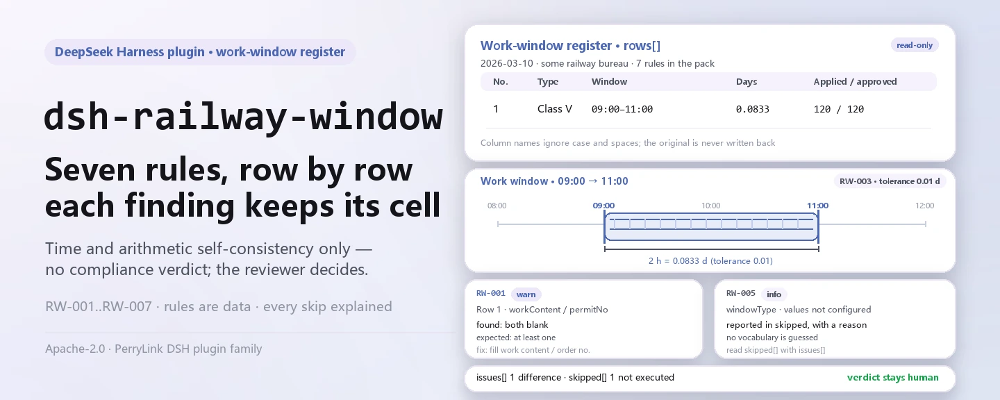

<div align="center">

<picture>
  <source media="(prefers-color-scheme: dark)" srcset="docs/assets/dsh-railway-window-hero-en-dark.webp">
  
</picture>

# dsh-railway-window

**List, in one pass, every row and column of a railway work-window register that does not add up — the verdict stays with the reviewer.**

A DSH checker for railway construction dispatchers and site managers: it reads the day's header plus one row per work window and applies seven time and arithmetic checks, reporting only differences it can point to inside the material itself — no compliance verdict, no liability finding.

[Install](#three-step-setup) · [Configuration](#configuration) · [FAQ](#faq) · [简体中文](README.md) · [English](README.en.md) · [Español](README.es.md) · [Português](README.pt.md) · [हिन्दी](README.hi.md)

[](LICENSE)
[](#compatibility)
[](https://www.npmjs.com/package/dsh-railway-window)
[](https://github.com/PerryLink/dsh-railway-window/actions/workflows/ci.yml)
[](#compatibility)

[](https://github.com/PerryLink/dsh-railway-window/stargazers)
[](https://www.npmjs.com/package/dsh-railway-window)
[](https://dshfind.com/plugins/PerryLink/dsh-railway-window?ref=badge)
[](https://securityscorecards.dev/viewer/?uri=github.com/PerryLink/dsh-railway-window)
[](https://dsh.market/)
[](https://gitee.com/perrylink/dsh-railway-window)

```sh
dsh plugin --profile <name> add dsh-railway-window
```

</div>

<sub>Community plugin, not affiliated with DeepSeek. Canonical repository: <https://github.com/PerryLink/dsh-railway-window> (Gitee is a mirror).</sub>

## What it is

`dsh-railway-window` reads one railway work-window register — the day's header plus one row per window — and checks that register's own time and arithmetic self-consistency: that each window records its work content or its traffic-control order number, that the start and end times parse and follow each other, that the recorded duration equals the span, that the approved duration does not exceed the applied duration, that the window type comes from your vocabulary, that window numbers are unique, and that the register names its working date and railway bureau (group company).

It lists only differences it can point to inside the material itself — **no compliance verdict, no liability finding, no replacement for the reviewer**. Every check that cannot run is reported in `skipped` with its reason, and an empty issue list can never be read as "nothing is wrong".

- **Who it is for**: railway construction dispatchers and site managers; no command line required — hand the material over in chat.
- **What you give it**: the source material the check works on (a table, register or document); the original is never modified. Excel can be converted to JSON/YAML first, in chat if the platform supports it.
- **What it returns**: a list of which row, which column, what differs and what to check.

```text
register (JSON / YAML)──railway_window──▶ rules/railway-window.yaml
                                           │ RW-001 … RW-007
                                           ▼
                            report: found · expected · fix
                                 skipped[]: rule id + reason
```

The tool is `railway_window`; the material comes from a `file` path or directly from inline `material` text. All computation happens host-side: no network, no model call.

<picture>
  <source media="(prefers-color-scheme: dark)" srcset="docs/assets/dsh-railway-window-flow-v5-dark.svg">
  
</picture>

## Three-step setup

1. **Install** (pick one channel; npm has `0.2.9`):

   ```sh
   # git channel (latest main)
   dsh plugin --profile web add github:PerryLink/dsh-railway-window
   # npm channel (published releases)
   dsh plugin --profile web add dsh-railway-window
   # tarball channel: pnpm pack in this repo, then
   dsh plugin --profile web add ./dsh-railway-window-<version>.tgz
   ```

   The published package ships the build output `lib/index.mjs`; using a source checkout requires `pnpm install && pnpm run build` first.

2. **Minimal config** (the defaults work; a bundle row without `config` uses them all, and the rule-pack path points at the packaged `rules/railway-window.yaml`):

   ```yaml
   - insert:
       - id: dsh-railway-window
         name: dsh-railway-window
         config:
           timeoutMs: 120000
   ```

3. **Verify it works** (built-in sample, no material of your own needed):

   ```sh
   pnpm install && pnpm run build
   node samples/quickstart/run.mjs
   dsh --profile web --dump-config | grep 'dsh-railway-window'
   ```

   Expected output `railway_window: 1 issue(s) — error 0, warn 1, info 0` and `skipped: 1`, matching `samples/quickstart/expected/result.json`; the sample input is `samples/quickstart/input/` and the screenshot is `docs/assets/quickstart.png`.

**Uninstall**: `dsh plugin --profile web remove dsh-railway-window` (or remove the row from the profile patch).

<details>
<summary>Use it in WorkBuddy / Coze</summary>

Search "Professional Document Check Suite" in WorkBuddy / Coze (the full set; this check is one part of it; availability as listed) to use the same checking capability without a command line.

</details>

## Core capabilities

`dsh-railway-window` registers the `railway_window` tool: it reads one work-window register, applies a versioned rule pack, and returns a report. Rule data is separate from code — replacing `rules/railway-window.yaml` switches the rule set without touching TypeScript.

| Rule | Check | Severity | Basis kind |
|---|---|---|---|
| `RW-001` | the work content or the order number is recorded | warn | principle |
| `RW-002` | start and end times parse and follow each other | warn | principle |
| `RW-003` | the duration equals the span (days, 0.01-day tolerance) | warn | principle |
| `RW-004` | the approved duration does not exceed the applied one | info | institutional |
| `RW-005` | the window type comes from your vocabulary (unset by default) | info | institutional |
| `RW-006` | window numbers are unique (whitespace ignored) | warn | principle |
| `RW-007` | the register names its date and railway bureau | warn | principle |

- **Every finding carries its location and its fix.** `locator` names the row and field, `found` states what was read, `expected` states the relation that should hold, and `fix` says what to check — a finding the reviewer cannot recompute is not worth much.
- **What cannot run goes to `skipped`.** A disabled rule, a missing field, or an unset vocabulary all put the rule in `skipped` with its id and reason; an empty issue list means only "the checks that ran found no differences".
- **Citation gaps are disclosed.** The rule pack does not invent quotations: when the verbatim clause text is unavailable, `excerpt` says so and severity is capped at `warn` (principle) or `info` (institutional). A test asserts that no rule claims a quotation it does not have.
- **Pure host.** Plain ESM, no native code, no network requests, no model calls; tool registration returns a disposer, so unloading removes it.
- **Wall-clock times.** All computation is wall-clock arithmetic on the input strings, with no timezone conversion; a time that will not parse is reported on its own rather than skipped silently.

### Tool parameters

| Parameter | Type | Meaning |
|---|---|---|
| `file` | string | absolute path to the material file (JSON or YAML); one of `file` / `material` |
| `material` | string | inline material text (JSON or YAML); one of `file` / `material` |
| `rulesFile` | string | overrides the configured rule-pack path (relative to the package root or absolute) |
| `only` | string[] | run only these rule ids; empty runs every rule |

## A real output

The output below is a real run of this plugin against its own `RW-001` test fixture, not a mock-up. The rule pack does not invent citations, so every finding names the clause it applies and records that the clause text was not obtained this time.

**Tool** `railway_window`

**Input**

~~~json
{"date":"2026-03-10","bureau":"某某铁路局集团公司","rows":[{"序号":"1","天窗类型":"V 类","开始时间":"2026-03-10 09:00","结束时间":"2026-03-10 11:00","作业内容":"","施工命令号":""}]}
~~~

**Output**

~~~json
{
  "id": "dsh-railway-window.RW-001.de09b5a6",
  "ruleId": "RW-001",
  "severity": "warn",
  "locator": {
    "row": 1,
    "field": "workContent"
  },
  "found": "第 1 行 workContent、permitNo 都为空",
  "expected": "workContent、permitNo 至少应填写一项",
  "fix": "补填作业内容与施工命令号；本条只核对是否填写，不判断施工是否违反规定"
}
~~~

*Observed from `dsh-railway-window/tests/fixtures/RW-001/RW-001-unsafe.json (cases.json expects 1×RW-001); executed parseMaterial+runCheck, checkedAt=2026-10-06T00:00:00.000Z`*

The table below is the example set: the first row is the detailed walkthrough, the remaining rows are short cases.

| You ask | What it answers |
|---|---|
| One row records neither the work content nor the traffic-control order number. Is that reported? | Yes. `RW-001` requires at least one of `workContent` and `permitNo` on every window and reports the row where both are missing. It only checks that one of them is filled in; it does not judge whether the work stayed inside its permitted scope or whether anything encroached on the clearance gauge. |
| A window runs from `23:30` to `01:30` and is written as two same-day times. Why is the end reported as earlier than the start? | `RW-002` compares the two instants and does not model crossing midnight, so a same-day pair reads as reversed; record the date on both sides, or disable the rule. An identical start and end counts as the start not being later, and a time that will not parse is reported on its own rather than skipped silently. |
| The duration column holds minutes (`120`) while the window ran 08:00 to 10:00. Why does the arithmetic not add up? | `RW-003` measures the span in days, so a register recording minutes differs by a factor of 1440; the default tolerance is 0.01 day. Point `daysField` at a day-denominated column, or disable the rule. It only checks the arithmetic, never whether the window was long enough for the work. |
| The approved duration is larger than the applied one. What is reported, and what if one of the two columns is blank? | `RW-004` reports the pair, because a dispatcher does not grant more than was applied for, so the two columns are usually transposed. It runs only when both `approvedMin` and `appliedMin` parse; with one missing it reports itself in `skipped`. No ceiling on how far an approval may be cut is built in, and it makes no finding about whether the window ought to be granted. |
| The window type column is filled in, but the rule never reports anything. Is it running? | No. `RW-005` ships with `values: []`, which means unconfigured, and reports itself in `skipped` until you list the classifications your bureau's measures use. Even configured, it only checks that the value is on your list; it does not decide which class a window belongs to. |
| The day's register is thin: the header names no bureau, and two windows of one section carry the same number. Which rules fire? | Two. `RW-007` reports a header that does not declare the working date and the railway bureau (group company) — it only checks that the header names them, and `skylightPlanNo` can be added to its `fields` if your form also records a window plan number. `RW-006` reports the repeated `windowNo`, comparing with whitespace ignored; a section given several windows in one day is normal, so number them apart. |

## Rules and basis

| Document | Number | Cited by rules |
|---|---|---|
| Measures for the Safety Management of Construction on Railway Operating Lines | current version and clause numbers not verified in this pass | RW-001, RW-002, RW-003, RW-006, RW-007 |
| Each railway bureau's work-window management measures (institutional configuration) | no national standard (this rule rests on the register's applied and approved columns) | RW-004 |
| Each railway bureau's work-window management measures (institutional configuration) | no national standard (this rule rests on the institution's classification vocabulary) | RW-005 |

**Boundary:** this plugin checks a **railway construction work-window register** for time and arithmetic self-consistency — that each window records its work content or its traffic-control order number, that the start and end times parse and follow each other, that the recorded duration equals the span, that the approved duration does not exceed the applied duration, that the window type comes from your vocabulary, that window numbers are unique, and that the register names its working date and railway bureau. It does **not** decide whether a window should be granted, whether work encroached on the clearance gauge, whether it was an unsafe act, or whether it affected traffic safety.

> ### ⚠️ Read this before trusting a citation in the report
>
> **Every `excerpt` in this plugin's rule pack says, in so many words, that the clause text was not
> obtained.** The regime lives in the national railway operating-line construction safety measures and in
> each railway bureau's own work-window and traffic-control-order measures. The verification pass could not
> retrieve verbatim clause text, so rather than paraphrase a quotation the pack states the gap in the
> `excerpt` field itself and puts the honest reasoning in `note`. Every rule is therefore `warn` or `info`,
> and a test asserts that no rule claims a quotation it does not have. **When the texts are in hand, replace
> each `excerpt` with the real clause and raise `kind` to `direct`.**
>
> Three limits matter before trusting a finding:
>
> - **The plugin ships no window classification and no status vocabulary.** How windows are classified and
>   how their states are worded varies by bureau, so `RW-005` reports itself in `skipped` until you
>   configure them.
> - **No approval-ratio ceiling is built in.** Whether an approved window may be shorter than applied for,
>   and by how much, is the bureau's rule; `RW-004` only checks that the approved figure does not exceed the
>   applied one, which is a data-entry property rather than a substantive one.
> - **The duration unit is days, and the rule says so.** `RW-003` measures the span in minutes internally and
>   expresses it in days, so a window that starts and ends on the same calendar day is measured correctly. A
>   register that records durations in minutes differs by a factor of 1440 — repoint `daysField` at a
>   day-denominated column, or disable the rule.
>
> The plugin also **does not handle crossing midnight**: a window written as two same-day times
> (`23:30` to `01:30`) will read as a reversed pair. Record the date on both sides, or disable that rule.

<details>
<summary>Rule sources and load-time validation</summary>

Rule data lives apart from code: each rule carries document, number, clause number in the source's own numbering, excerpt, basis kind and source URL. Load time enforces that an excerpt never overstates its basis; a check resting only on a principle (`kind: derived-from-principle`, severity capped at `warn`) or on institutional configuration (`kind: institutional-configuration`, capped at `info`) may not be marked `error`. A pack that inflates its basis fails at load rather than producing a confident-looking report.

`excerpt` must be a verbatim quotation, never a paraphrase. Every `excerpt` in this pack states in so many words that the clause text was not obtained, so `check:citations` counts them as placeholder notes rather than quotations; `rules/citations-baseline.json` records excerpt segments that cannot yet be traced and is currently empty, and any new untraceable quotation fails the gate.

The boundaries confirmed during verification and the conclusions deliberately **not** drawn are recorded in the header of `rules/railway-window.yaml` and in each rule's `note`.

</details>

## Material format

The tool accepts JSON or YAML:

```yaml
date: 2026-03-10
bureau: 某某铁路局集团公司
rows:
  - { 序号: '1', 天窗类型: V 类, 线别: 上行, 区间: K120+000 至 K125+000,
      开始时间: 2026-03-10 08:00, 结束时间: 2026-03-10 20:00, 天窗时长: '0.5',
      申请时长: '720', 批准时长: '720', 作业内容: 更换接触网吊弦,
      施工命令号: 调令〔2026〕第 018 号, 申请单位: 某某供电段, 状态: 已兑现 }
```

Column names are matched case-insensitively and ignoring spaces, underscores and hyphens; the register's own column names are kept, so a finding always names the column you can see. Times are written `2026-03-10 09:00`; a Chinese date form is reported as unparseable on purpose. Fields are optional at the reader layer and validated by the check engine, so a partial export produces "missing field" differences rather than a crash.

The reader requires at least one canonical row field — `windowNo`, `startAt`, `endAt` or `workContent` — and otherwise fails loudly instead of producing an empty report.

## Configuration

All tunables live in the Schemastery schema in `src/config.ts`, so changing `cordis.yml` is enough — no code edit; per-rule thresholds live in the rule pack under `rules/`.

| Key | Type | Default | Description |
|---|---|---|---|
| `rulesFile` | string | `rules/railway-window.yaml` | rule-pack path, relative to the package root |
| `disabledRules` | string[] | `[]` | rule ids to stop running; each appears in `skipped` |
| `onlyRules` | string[] | `[]` | run only these rule ids; empty runs every rule |
| `skipNotes` | string | `""` | note appended to every `skipped` reason |
| `timeoutMs` | number | `120000` | cooperative tool timeout budget |

Rule-level parameters worth knowing:

- `RW-002` `field` / `notAfterField` — the time pair, start against end.
- `RW-003` `daysField` / `fromField` / `toField` / `tolerance` — the duration arithmetic, in days. The default tolerance is `0.01` day.
- `RW-005` `values` — your window types, e.g. `[class V, vertical window, composite window, construction window, maintenance window]`. Empty means no check.
- `RW-007` `fields` — which header items must be declared, default `["date","bureau"]`; add `skylightPlanNo` if your form also records a window plan number.

Example override in your profile patch:

```yaml
- insert:
    - id: dsh-railway-window
      name: dsh-railway-window
      config:
        disabledRules: [RW-003]
        skipNotes: this quarter checks time and numbering only
```

## FAQ

<details>
<summary>Where do the material and the report live? Does anything go online?</summary>

The plugin has **no storage of its own**: the material is read only within this tool call (`file` path or inline `material` text), the report is returned as the tool result, and the session record afterwards is managed by the host. Computation makes no network requests, no model calls, and writes nothing back to the material; `package.json`'s `dsh.demo` declares `network: false` and `writes: []` as well.

</details>

<details>
<summary>If the report has no findings, is the register fine?</summary>

No. Look at `skipped` first: a rule disabled through `disabledRules`, a missing field, or an unset `RW-005` vocabulary all skip the affected check and state why. An empty issue list means only "the checks that ran found no differences", not "every check ran".

</details>

<details>
<summary>Why does `RW-005` never run?</summary>

Its `values` ship as `[]`, which means unconfigured; unconfigured means `skipped`. How windows are classified (class V, vertical window, composite window, and so on) varies with each bureau's construction measures, and the plugin hard-codes no classification system — fill in your bureau's vocabulary in the rule pack or the config.

</details>

<details>
<summary>How big is the performance overhead? Will it block a session?</summary>

No network requests, no model calls, no regex backtracking; the cost is reading the material once, a few time and arithmetic comparisons, and formatting the report. `timeoutMs` is a cooperative timeout budget passed to the tool (default `120000` ms), and the tool also honours the host's abort signal. For checking a whole directory, `ptc` mode pays the schema cost only once.

</details>

<details>
<summary>Troubleshooting: install, missing tool, a rule that never runs</summary>

- **The plugin installs but the tool never appears.** Check that `main` resolves to `lib/index.mjs` and that `pnpm run build` produced it; a wrong `main` makes the loader skip the entry silently.
- **`dsh plugin add` refuses the package as incompatible.** The peer range covers `0.1.x` and `0.2.x`; if your runtime sits outside it, grant an explicit exemption: `dsh plugin --profile <name> allow-version <pkg@version> --dsh-version <runtime> --accept-risk`.
- **A rule did not run.** Read the `skipped` array; it names the rule id and the reason.
- **`check` reports `manifest-peers` as failed.** The static checker compares against a hard-coded peer range that predates the 0.2 line; peer compatibility at install time is enforced by the runtime. This is a known upstream issue in `dsh-plugin-dev`.
- **Times look shifted.** All computation is wall-clock arithmetic on the input strings, with no timezone conversion.
- **A finding says the clause text was not obtained.** The rule pack does not fabricate citations; when the verbatim clause is unavailable the finding stays at `warn` / `info` and says so in `excerpt`. Treat it as a verification gap, not as proof that the material is compliant.
- **It installed but finds nothing.** Confirm the tool actually ran and returned a result; an empty result is not the same as a skipped run — check the material's fields against the table in this README first.

</details>

## Security boundaries and known limitations

- **Only the register's own completeness and arithmetic.** It does not decide whether a window should be granted, whether work encroached on the clearance gauge, whether it was a rules violation, or whether it affected traffic safety; that needs the professional judgement of dispatch, permanent-way and safety departments and is central to operational safety.
- **Citation gaps are disclosed.** The rule pack does not fabricate quotations; `excerpt` states that the clause text was not obtained, and basis kind and severity are capped by the evidence. A finding means "this field in the register does not add up", not "you violated a regulation".
- **An empty list is not "nothing wrong".** Checks that cannot run go to `skipped` with a reason; "no issues" must not be read as "nothing was checked".
- **Window classification and status wording belong to the institution.** The plugin ships no window classification and no status vocabulary; `RW-005`'s `values` default to empty, and an unconfigured rule skips rather than guesses.
- **No approval-ratio ceiling is built in.** How much shorter than applied an approval may be is set by each bureau's construction measures; `RW-004` only checks that the approved figure does not exceed the applied one — a data-entry property, not a substantive judgement.
- **The duration unit is days.** `RW-003` measures the span in minutes internally and expresses it in days; a register recording minutes differs by a factor of 1440 — repoint `daysField` at a day-denominated column, or disable the rule.
- **Crossing midnight is not handled.** A window written as two same-day times (`23:30` to `01:30`) reads as a reversed pair; record the date on both sides, or disable the rule.
- **No timezone conversion.** All computation is wall-clock arithmetic on the input strings.
- **Local only.** No network requests, no credentials, no write-back to the material; the only path read is the one you passed in `file`.

## Interoperability with other DSH plugins

This plugin registers one tool, and its registration surface is narrow:

- **One tool, one namespace.** It registers only `railway_window` and takes no bare name owned by a built-in tool or another plugin.
- **No service key, no HTTP route, no client slot.** It provides no service key, registers no `webServer` prefix, and has no client half (this repository has no `client/` directory), so it takes no slot seat.
- **No global mutation.** It does not patch prototypes, rewrite `process.env`, or replace global fetch.
- **Registrations are effects.** The disposer returned by `ctx.tools.register` removes the tool on unload/hot reload; `inject: ['tools']` means the plugin loads only when the `tools` service is present.
- **The rule pack is read-only.** At run time the tool only reads the file `rulesFile` points at; it never writes back to the rule pack or the material.

Evidence: the registration surface in `src/index.ts` (`export const inject = ['tools']`, a single `ctx.tools.register`, no other registration call).

## Compatibility

| Surface | Status |
|---|---|
| Harness | Peer range `>=0.1.2-rc.1 <0.2.0 \|\| >=0.2.0-0 <0.3.0` — verified to accept both `0.2.0-rc.2` and `0.2.1-rc.2`. **`engines.dsh` is declared** as `>=0.2.1-0 <0.3.0` and is enforced by the host since 0.2.1 |
| Node | `^22.19.0 \|\| >=24.0.0` |
| Platforms | All (plain ESM; no native code, no network, no model call) |
| Tool mode | Works in `native` and `ptc`; for a month of windows use `ptc` |

## Ecosystem & quality

- [Gitee mirror](https://gitee.com/perrylink/dsh-railway-window) (sync mirror; GitHub is canonical)
- [dshfind plugin page](https://dshfind.com/plugins/PerryLink/dsh-railway-window) (installs and ranking)
- [OpenSSF Scorecard report](https://securityscorecards.dev/viewer/?uri=github.com/PerryLink/dsh-railway-window) (driven by [.github/workflows/scorecard.yml](.github/workflows/scorecard.yml))
- [DSH Market](https://dsh.market/) (listed)
- **WorkBuddy / Coze**: search "Professional Document Check Suite" (the full set; this check is one part of it; availability as listed)
- [Choose a checker by material](https://perrylink.github.io/zh/checkers/choose/) (the checker index this plugin belongs to)
- [Issue tracker](https://github.com/PerryLink/dsh-railway-window/issues) (include version, command and minimal redacted material)

## Development

```sh
pnpm install
pnpm run typecheck        # tsc --noEmit
pnpm test                 # vitest, a compliant/violating fixture pair per rule
pnpm run build            # tsdown -> lib/index.mjs + lib/index.d.mts
pnpm run verify:self-contained
pnpm run check:lockfile
pnpm run check:readmes    # Chinese/English README consistency
pnpm run check:citations
node ../scripts/sync-shared.mjs dsh-railway-window   # refresh src/shared
```

The final `sync-shared` command copies the shared kit from `../_shared` into `src/shared/`; re-run it after every shared change. The README images are generated programmatically by [`scripts/gen-readme-assets.py`](scripts/gen-readme-assets.py) (Pillow for the hero banner, hand-written SVG for the structure diagram; light/dark pairs, and the hero comes in Chinese and English) and are safe to re-run: `python scripts/gen-readme-assets.py`.

<details>
<summary>Directory layout</summary>

| Path | Content |
|---|---|
| `src/index.ts` | tool registration and rule-pack resolution (function-plugin contract, no default export) |
| `src/config.ts` | Schemastery config schema; every tunable lives here |
| `src/model.ts` | register column aliases and material contract; the table shape is declared once and shared by the reader and the check engine |
| `src/view.ts` | model-facing report projection; `output.schema` mirrors it |
| `src/shared/` | shared kit (rule-pack loading, report shape, YAML subset, calendar arithmetic, wording guard), copied in rather than imported |
| `rules/railway-window.yaml` | the 7-rule pack |
| `rules/citations-baseline.json` | excerpt segments not yet traceable (currently empty) |
| `tests/` | vitest; each rule has compliant/violating fixtures under `tests/fixtures/<RULE>/` |
| `scripts/` | mechanical gates: self-containment, lockfile drift, README consistency, citation check, asset generation |

</details>

Topics: `dsh`, `dsh-plugin`, `deepseek-harness`, `deepseek`, `cordis`, `railway`, `window`

## Family & thanks

This project is part of the DeepSeek Harness plugin family from [PerryLink](https://github.com/PerryLink) (all Apache-2.0). Full index: [choose a checker by material](https://perrylink.github.io/zh/checkers/choose/) and [all plugins](https://github.com/PerryLink); this repository is one of them. If it is useful, **a star helps the next person find it** — nothing is gated behind it.

- [@PerryLink](https://github.com/PerryLink) — creator and maintainer: rule pack, check core, five-language docs and asset script.

<details>
<summary>Expand all plugins</summary>

| Plugin | Status |
|---|---|
| **[dsh-aqua-input-check](https://github.com/PerryLink/dsh-aqua-input-check)** |  |
| **[dsh-archive-check](https://github.com/PerryLink/dsh-archive-check)** |  |
| **[dsh-auto-review](https://github.com/PerryLink/dsh-auto-review)** |  |
| **[dsh-autotier](https://github.com/PerryLink/dsh-autotier)** | 🧊 FROZEN — see the repo README |
| **[dsh-bid-ca-precheck](https://github.com/PerryLink/dsh-bid-ca-precheck)** |  |
| **[dsh-bid-qual-check](https://github.com/PerryLink/dsh-bid-qual-check)** |  |
| **[dsh-cert-mcp](https://github.com/PerryLink/dsh-cert-mcp)** | 🧊 FROZEN — see the repo README |
| **[dsh-checkpoint-rewind](https://github.com/PerryLink/dsh-checkpoint-rewind)** |  |
| **[dsh-click](https://github.com/PerryLink/dsh-click)** |  |
| **[dsh-composer-history](https://github.com/PerryLink/dsh-composer-history)** |  |
| **[dsh-contract-stance](https://github.com/PerryLink/dsh-contract-stance)** |  |
| **[dsh-customs-doc-check](https://github.com/PerryLink/dsh-customs-doc-check)** |  |
| **[dsh-data-quality](https://github.com/PerryLink/dsh-data-quality)** | 🧊 FROZEN — see the repo README |
| **[dsh-demurrage-ledger](https://github.com/PerryLink/dsh-demurrage-ledger)** |  |
| **[dsh-doublecheck](https://github.com/PerryLink/dsh-doublecheck)** |  |
| **[dsh-drill-script-check](https://github.com/PerryLink/dsh-drill-script-check)** |  |
| **[dsh-eia-guide-check](https://github.com/PerryLink/dsh-eia-guide-check)** |  |
| **[dsh-emergency-plan](https://github.com/PerryLink/dsh-emergency-plan)** |  |
| **[dsh-essay-rubric-check](https://github.com/PerryLink/dsh-essay-rubric-check)** |  |
| **[dsh-evidence-check](https://github.com/PerryLink/dsh-evidence-check)** |  |
| **[dsh-export-ctl-check](https://github.com/PerryLink/dsh-export-ctl-check)** |  |
| **[dsh-fast](https://github.com/PerryLink/dsh-fast)** |  |
| **[dsh-fmea-table-check](https://github.com/PerryLink/dsh-fmea-table-check)** |  |
| **[dsh-forecast-penalty](https://github.com/PerryLink/dsh-forecast-penalty)** |  |
| **[dsh-fund-research](https://github.com/PerryLink/dsh-fund-research)** |  |
| **[dsh-github](https://github.com/PerryLink/dsh-github)** |  |
| **[dsh-gongwen-flow-check](https://github.com/PerryLink/dsh-gongwen-flow-check)** |  |
| **[dsh-gongwen-word-check](https://github.com/PerryLink/dsh-gongwen-word-check)** |  |
| **[dsh-guard-plan-qc](https://github.com/PerryLink/dsh-guard-plan-qc)** |  |
| **[dsh-hazchem-check](https://github.com/PerryLink/dsh-hazchem-check)** |  |
| **[dsh-hazplan-check](https://github.com/PerryLink/dsh-hazplan-check)** |  |
| **[dsh-hidden-risk-map](https://github.com/PerryLink/dsh-hidden-risk-map)** |  |
| **[dsh-hs-classify](https://github.com/PerryLink/dsh-hs-classify)** |  |
| **[dsh-icd-rule-check](https://github.com/PerryLink/dsh-icd-rule-check)** |  |
| **[dsh-industry-research](https://github.com/PerryLink/dsh-industry-research)** |  |
| **[dsh-lawcite-adapter](https://github.com/PerryLink/dsh-lawcite-adapter)** |  |
| **[dsh-laya](https://github.com/PerryLink/dsh-laya)** |  |
| **[dsh-lc-doc-check](https://github.com/PerryLink/dsh-lc-doc-check)** |  |
| **[dsh-learning-gap-check](https://github.com/PerryLink/dsh-learning-gap-check)** |  |
| **[dsh-library](https://github.com/PerryLink/dsh-library)** |  |
| **[dsh-local-ai](https://github.com/PerryLink/dsh-local-ai)** |  |
| **[dsh-lsp-actions](https://github.com/PerryLink/dsh-lsp-actions)** |  |
| **[dsh-mask](https://github.com/PerryLink/dsh-mask)** |  |
| **[dsh-mcp-panel](https://github.com/PerryLink/dsh-mcp-panel)** |  |
| **[dsh-medrec-qc](https://github.com/PerryLink/dsh-medrec-qc)** |  |
| **[dsh-memento](https://github.com/PerryLink/dsh-memento)** | 🧊 FROZEN — see the repo README |
| **[dsh-nsfc-form-check](https://github.com/PerryLink/dsh-nsfc-form-check)** |  |
| **[dsh-nurse-record-check](https://github.com/PerryLink/dsh-nurse-record-check)** |  |
| **[dsh-observe](https://github.com/PerryLink/dsh-observe)** |  |
| **[dsh-origin-rvc-check](https://github.com/PerryLink/dsh-origin-rvc-check)** |  |
| **[dsh-ota-review-check](https://github.com/PerryLink/dsh-ota-review-check)** |  |
| **[dsh-output-styles](https://github.com/PerryLink/dsh-output-styles)** |  |
| **[dsh-paper-doc-adapter](https://github.com/PerryLink/dsh-paper-doc-adapter)** |  |
| **[dsh-permission-rules](https://github.com/PerryLink/dsh-permission-rules)** |  |
| **[dsh-permit-report-check](https://github.com/PerryLink/dsh-permit-report-check)** |  |
| **[dsh-pipeline-check](https://github.com/PerryLink/dsh-pipeline-check)** |  |
| **[dsh-pleading-draft](https://github.com/PerryLink/dsh-pleading-draft)** |  |
| **[dsh-plugin-doctor](https://github.com/PerryLink/dsh-plugin-doctor)** | 🚫 RETIRED (repo archived) |
| **[dsh-plugin-guide](https://github.com/PerryLink/dsh-plugin-guide)** |  |
| **[dsh-plugin-kit](https://github.com/PerryLink/dsh-plugin-kit)** | 🚫 RETIRED (repo archived) |
| **[dsh-plugin-upgrade](https://github.com/PerryLink/dsh-plugin-upgrade)** | 🚫 RETIRED (repo archived) |
| **[dsh-policy-brief-draft](https://github.com/PerryLink/dsh-policy-brief-draft)** |  |
| **[dsh-power-loss-split](https://github.com/PerryLink/dsh-power-loss-split)** |  |
| **[dsh-power-ticket-check](https://github.com/PerryLink/dsh-power-ticket-check)** |  |
| **[dsh-ppap-check](https://github.com/PerryLink/dsh-ppap-check)** |  |
| **[dsh-protest-deadline](https://github.com/PerryLink/dsh-protest-deadline)** |  |
| **[dsh-railway-window](https://github.com/PerryLink/dsh-railway-window)** |  |
| **[dsh-repair-order-qc](https://github.com/PerryLink/dsh-repair-order-qc)** |  |
| **[dsh-research-report](https://github.com/PerryLink/dsh-research-report)** |  |
| **[dsh-review-reply-check](https://github.com/PerryLink/dsh-review-reply-check)** |  |
| **[dsh-rulefile-check](https://github.com/PerryLink/dsh-rulefile-check)** |  |
| **[dsh-safety-brief-check](https://github.com/PerryLink/dsh-safety-brief-check)** |  |
| **[dsh-score](https://github.com/PerryLink/dsh-score)** | 🧊 FROZEN — see the repo README |
| **[dsh-session-sync](https://github.com/PerryLink/dsh-session-sync)** |  |
| **[dsh-site-log-check](https://github.com/PerryLink/dsh-site-log-check)** |  |
| **[dsh-skill-pack-security](https://github.com/PerryLink/dsh-skill-pack-security)** |  |
| **[dsh-soe-decision-check](https://github.com/PerryLink/dsh-soe-decision-check)** |  |
| **[dsh-soilwater-check](https://github.com/PerryLink/dsh-soilwater-check)** |  |
| **[dsh-sop-sync-check](https://github.com/PerryLink/dsh-sop-sync-check)** |  |
| **[dsh-spc-gbt-adapter](https://github.com/PerryLink/dsh-spc-gbt-adapter)** |  |
| **[dsh-talk](https://github.com/PerryLink/dsh-talk)** |  |
| **[dsh-tender-extract](https://github.com/PerryLink/dsh-tender-extract)** |  |
| **[dsh-tender-matrix](https://github.com/PerryLink/dsh-tender-matrix)** |  |
| **[dsh-test-drive](https://github.com/PerryLink/dsh-test-drive)** |  |
| **[dsh-ticktick](https://github.com/PerryLink/dsh-ticktick)** | 🚫 RETIRED (repo archived) |
| **[dsh-translate](https://github.com/PerryLink/dsh-translate)** |  |
| **[dsh-warranty-calc](https://github.com/PerryLink/dsh-warranty-calc)** |  |
| **[dsh-budget](https://github.com/PerryLink/dsh-budget)** | 🧊 FROZEN — see the repo README |
| **[dsh-claude-move](https://github.com/PerryLink/dsh-claude-move)** | 🧊 FROZEN — see the repo README |
| **[dsh-defend](https://github.com/PerryLink/dsh-defend)** | 🧊 FROZEN — see the repo README |
| **[dsh-draw](https://github.com/PerryLink/dsh-draw)** | 🧊 FROZEN — see the repo README |
| **[dsh-reach](https://github.com/PerryLink/dsh-reach)** | 🧊 FROZEN — see the repo README |
| **[dsh-background-agents](https://github.com/PerryLink/dsh-background-agents)** | 🚫 RETIRED (repo archived) |
| **[dsh-session-pin](https://github.com/PerryLink/dsh-session-pin)** | 🚫 RETIRED (repo archived) |
| **[dsh-team-rooms](https://github.com/PerryLink/dsh-team-rooms)** | 🚫 RETIRED (repo archived) |

</details>

## License

[LICENSE](LICENSE) (Apache License 2.0) © 2026 dsh-railway-window contributors

<p align="center"><sub>Apache-2.0 · Community plugin, not affiliated with DeepSeek.</sub></p>
