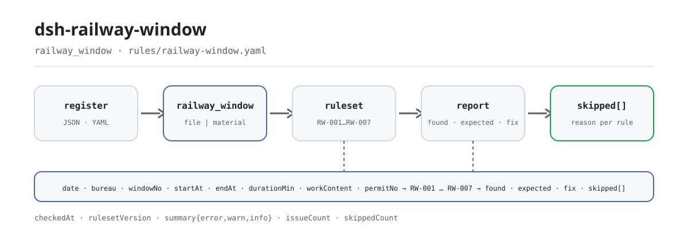

<div align="center">

<picture>
  <source media="(prefers-color-scheme: dark)" srcset="docs/assets/dsh-railway-window-flow-dark.svg">
  
</picture>

# dsh-railway-window

**Enumere de una vez cada fila y cada columna del registro de ventanas de trabajo ferroviario que no cuadra: el dictamen queda en manos del revisor.**

Un verificador DSH para despachadores de obra ferroviaria y responsables de sitio: lee la cabecera del día más una fila por ventana y aplica siete comprobaciones de tiempo y aritmética, informando solo de las diferencias que puede señalar dentro del propio material, sin dictamen de cumplimiento ni atribución de responsabilidad.

[Instalación](#instalación-en-tres-pasos) · [Configuración](#configuración) · [FAQ](#faq) · [简体中文](README.md) · [English](README.en.md) · [Español](README.es.md) · [Português](README.pt.md) · [हिन्दी](README.hi.md)

[](LICENSE)
[](#compatibilidad)
[](https://www.npmjs.com/package/dsh-railway-window)
[](https://github.com/PerryLink/dsh-railway-window/actions/workflows/ci.yml)
[](#compatibilidad)

[](https://github.com/PerryLink/dsh-railway-window/stargazers)
[](https://www.npmjs.com/package/dsh-railway-window)
[](https://dshfind.com/plugins/PerryLink/dsh-railway-window?ref=badge)
[](https://securityscorecards.dev/viewer/?uri=github.com/PerryLink/dsh-railway-window)
[](https://dsh.market/)
[](https://gitee.com/perrylink/dsh-railway-window)

```sh
dsh plugin --profile <name> add dsh-railway-window
```

</div>

<sub>Plugin comunitario, no afiliado a DeepSeek. Repositorio canónico: <https://github.com/PerryLink/dsh-railway-window> (Gitee es un espejo).</sub>

## Qué es

`dsh-railway-window` lee un registro de ventanas de trabajo ferroviario —la cabecera del día más una fila por ventana— y comprueba la coherencia temporal y aritmética de ese propio registro: que cada ventana registre su contenido de trabajo o su número de orden de control de tráfico, que el inicio y el fin se puedan leer y sean sucesivos, que la duración registrada sea igual al intervalo, que la duración aprobada no supere la solicitada, que el tipo de ventana proceda de su vocabulario, que los números de ventana no se repitan y que el registro declare su fecha de trabajo y la administración ferroviaria (grupo empresarial).

Solo enumera diferencias que puede señalar dentro del propio material: **sin dictamen de cumplimiento, sin atribución de responsabilidad y sin sustituir al revisor**. Toda comprobación que no pueda ejecutarse queda en `skipped` con su motivo, y una lista de problemas vacía nunca puede leerse como «no hay nada mal».

- **Para quién es**: despachadores de obra ferroviaria y responsables de sitio; no hace falta saber usar la línea de comandos: entregue el material en el chat.
- **Qué entrega usted**: el material de origen sobre el que trabaja la comprobación (una tabla, un registro o un documento); el original nunca se modifica. Excel puede convertirse antes a JSON/YAML, incluso en el chat si la plataforma lo permite.
- **Qué devuelve**: una lista de qué fila, qué columna, qué difiere y qué revisar.

```text
registro (JSON / YAML)──railway_window──▶ rules/railway-window.yaml
                                           │ RW-001 … RW-007
                                           ▼
                            informe: found · expected · fix
                                 skipped[]: id de regla + motivo
```

La herramienta es `railway_window`; el material llega por una ruta `file` o directamente como texto `material` en línea. Todo el cálculo ocurre en el host: sin red y sin llamada al modelo.

## Instalación en tres pasos

1. **Instalar** (elija un canal; npm tiene `0.2.9`):

   ```sh
   # canal git (última main)
   dsh plugin --profile web add github:PerryLink/dsh-railway-window
   # canal npm (versiones publicadas)
   dsh plugin --profile web add dsh-railway-window
   # canal tarball: tras pnpm pack en este repositorio
   dsh plugin --profile web add ./dsh-railway-window-<version>.tgz
   ```

   El paquete publicado incluye el artefacto `lib/index.mjs`; para usar un checkout del código fuente hace falta antes `pnpm install && pnpm run build`.

2. **Configuración mínima** (los valores por defecto funcionan; una fila de bundle sin `config` los usa todos y la ruta del paquete de reglas apunta al `rules/railway-window.yaml` incluido):

   ```yaml
   - insert:
       - id: dsh-railway-window
         name: dsh-railway-window
         config:
           timeoutMs: 120000
   ```

3. **Comprobar que funciona** (muestra incluida, sin material propio):

   ```sh
   pnpm install && pnpm run build
   node samples/quickstart/run.mjs
   dsh --profile web --dump-config | grep 'dsh-railway-window'
   ```

   Salida esperada: `railway_window: 1 issue(s) — error 0, warn 1, info 0` y `skipped: 1`, coincidiendo con `samples/quickstart/expected/result.json`; la entrada de muestra está en `samples/quickstart/input/` y la captura en `docs/assets/quickstart.png`.

**Desinstalar**: `dsh plugin --profile web remove dsh-railway-window` (o borre la fila del patch del perfil).

<details>
<summary>Usarlo en WorkBuddy / Coze</summary>

Busque «Professional Document Check Suite» en WorkBuddy / Coze (el conjunto completo; esta comprobación es una de sus partes; disponibilidad según catálogo) para usar la misma capacidad de verificación sin línea de comandos.

</details>

## Capacidades clave

`dsh-railway-window` registra la herramienta `railway_window`: lee un registro de ventanas, aplica un paquete de reglas versionado y devuelve un informe. Los datos de las reglas están separados del código: sustituir `rules/railway-window.yaml` cambia el conjunto de reglas sin tocar TypeScript.

| Regla | Comprobación | Gravedad | Tipo de base |
|---|---|---|---|
| `RW-001` | se registra el contenido de trabajo o el número de orden | warn | principio |
| `RW-002` | el inicio y el fin se leen y son sucesivos | warn | principio |
| `RW-003` | la duración es igual al intervalo (días, tolerancia 0,01 día) | warn | principio |
| `RW-004` | la duración aprobada no supera la solicitada | info | institucional |
| `RW-005` | el tipo de ventana procede de su vocabulario (sin configurar por defecto) | info | institucional |
| `RW-006` | los números de ventana son únicos (se ignoran los espacios) | warn | principio |
| `RW-007` | el registro declara la fecha y la administración ferroviaria | warn | principio |

- **Cada hallazgo lleva su ubicación y su corrección.** `locator` nombra la fila y el campo, `found` dice lo que se leyó, `expected` la relación que debería cumplirse y `fix` qué revisar; un hallazgo que el revisor no puede recalcular vale poco.
- **Lo que no puede ejecutarse va a `skipped`.** Una regla desactivada, un campo ausente o un vocabulario sin configurar ponen la regla en `skipped` con su id y su motivo; una lista de problemas vacía solo significa «las comprobaciones que se ejecutaron no encontraron diferencias».
- **Las lagunas de cita se declaran.** El paquete de reglas no inventa citas: cuando el texto literal de la cláusula no está disponible, `excerpt` lo dice y la gravedad queda limitada a `warn` (principio) o `info` (institucional). Una prueba verifica que ninguna regla afirma una cita que no tiene.
- **Solo host.** ESM puro, sin código nativo, sin peticiones de red y sin llamadas al modelo; el registro de la herramienta devuelve un disposer, de modo que descargarla la elimina.
- **Horas de reloj.** Todo el cálculo es aritmética de hora local sobre las cadenas de entrada, sin conversión de zona horaria; una hora que no se puede leer se informa aparte en lugar de omitirse en silencio.

### Parámetros de la herramienta

| Parámetro | Tipo | Significado |
|---|---|---|
| `file` | string | ruta absoluta al archivo de material (JSON o YAML); uno de `file` / `material` |
| `material` | string | texto de material en línea (JSON o YAML); uno de `file` / `material` |
| `rulesFile` | string | sustituye la ruta configurada del paquete de reglas (relativa a la raíz del paquete o absoluta) |
| `only` | string[] | ejecutar solo estos ids de regla; vacío ejecuta todas |

## Una salida real

La salida siguiente es una ejecución real de este plugin contra su propio fixture de prueba `RW-001`, no un montaje. El paquete de reglas no inventa citas, así que cada hallazgo nombra la cláusula aplicada y deja constancia de que su texto no se obtuvo esta vez.

**Herramienta** `railway_window`

**Entrada**

~~~json
{"date":"2026-03-10","bureau":"某某铁路局集团公司","rows":[{"序号":"1","天窗类型":"V 类","开始时间":"2026-03-10 09:00","结束时间":"2026-03-10 11:00","作业内容":"","施工命令号":""}]}
~~~

**Salida**

~~~json
{
  "id": "dsh-railway-window.RW-001.de09b5a6",
  "ruleId": "RW-001",
  "severity": "warn",
  "locator": {
    "row": 1,
    "field": "workContent"
  },
  "found": "第 1 行 workContent、permitNo 都为空",
  "expected": "workContent、permitNo 至少应填写一项",
  "fix": "补填作业内容与施工命令号；本条只核对是否填写，不判断施工是否违反规定"
}
~~~

*Observado en `dsh-railway-window/tests/fixtures/RW-001/RW-001-unsafe.json (cases.json expects 1×RW-001); executed parseMaterial+runCheck, checkedAt=2026-10-06T00:00:00.000Z`*

La tabla siguiente es el conjunto de ejemplos: la primera fila es el caso detallado y las demás son casos breves.

| Usted pregunta | Qué responde |
|---|---|
| Una fila no registra ni el contenido de trabajo ni el número de orden de control de tráfico. ¿Se informa de ello? | Sí. `RW-001` exige que en cada ventana esté puesto al menos uno de los dos, `workContent` o `permitNo`, e informa de la fila en la que faltan ambos. Solo comprueba que uno de ellos esté rellenado; no juzga si la obra se mantuvo dentro de su ámbito autorizado ni si algo invadió el gálibo de circulación. |
| Una ventana va de `23:30` a `01:30` y está escrita como dos horas del mismo día. ¿Por qué se informa de que el fin es anterior al inicio? | `RW-002` compara los dos instantes y no modela el cruce de medianoche, así que un par del mismo día se lee invertido; registre la fecha en ambos lados o desactive la regla. Si el inicio y el fin coinciden, se considera que el inicio no es posterior, y una hora que no se puede leer se informa por separado en lugar de omitirse en silencio. |
| La columna de duración está en minutos (`120`) y la ventana fue de 08:00 a 10:00. ¿Por qué no cuadra la aritmética? | `RW-003` mide el intervalo en días, así que un registro en minutos difiere por un factor de 1440; la tolerancia de fábrica es de 0,01 día. Apunte `daysField` a una columna de duración expresada en días o desactive la regla. Solo comprueba la aritmética, nunca si la ventana fue lo bastante larga para la obra. |
| La duración aprobada es mayor que la solicitada. ¿Qué se informa, y qué ocurre si falta una de las dos columnas? | `RW-004` informa de ese par, porque un despachador no concede más de lo solicitado y lo habitual es que las dos columnas estén invertidas. Solo se ejecuta cuando `approvedMin` y `appliedMin` se pueden leer; si falta uno, informa de que entró en `skipped`. No incorpora ningún techo de reducción de la aprobación y no concluye si la ventana debería concederse. |
| La columna del tipo de ventana tiene valor, pero la regla nunca informa de nada. ¿Se está ejecutando? | No. `RW-005` viene con `values: []`, es decir sin configurar, e informa de que entró en `skipped` hasta que liste las clasificaciones que usan las medidas de su administración. Aun configurada, solo comprueba que el valor figure en su lista; no decide en qué clase debe encuadrarse una ventana. |
| El registro del día está incompleto: la cabecera no nombra la administración y dos ventanas de un mismo tramo repiten número. ¿Qué reglas se activan? | Dos. `RW-007` informa de una cabecera que no declara la fecha de trabajo y la administración ferroviaria (grupo empresarial) —solo comprueba que la cabecera las declare, y puede añadir `skylightPlanNo` a sus `fields` si su formulario también registra un número de plan—. `RW-006` informa del `windowNo` repetido, comparando con los espacios en blanco ignorados; que un tramo reciba varias ventanas el mismo día es normal, así que numérelas por separado. |

## Reglas y base

| Documento | Número | Reglas que lo citan |
|---|---|---|
| Medidas de gestión de la seguridad de las obras en líneas ferroviarias en servicio | versión vigente y números de cláusula no verificados en esta pasada | RW-001, RW-002, RW-003, RW-006, RW-007 |
| Medidas de gestión de ventanas de trabajo de cada administración ferroviaria (configuración institucional) | sin estándar nacional (esta regla se apoya en las columnas de solicitado y aprobado del registro) | RW-004 |
| Medidas de gestión de ventanas de trabajo de cada administración ferroviaria (configuración institucional) | sin estándar nacional (esta regla se apoya en el vocabulario de clasificación de la institución) | RW-005 |

**Límite:** este plugin comprueba la coherencia temporal y aritmética de un **registro de ventanas de trabajo de obra ferroviaria** —que cada ventana registre su contenido de trabajo o su número de orden de control de tráfico, que el inicio y el fin se lean y sean sucesivos, que la duración registrada sea igual al intervalo, que la duración aprobada no supere la solicitada, que el tipo de ventana proceda de su vocabulario, que los números de ventana sean únicos y que el registro declare su fecha de trabajo y la administración ferroviaria—. **No** decide si una ventana debería concederse, si la obra invadió el gálibo de circulación, si constituyó un acto inseguro o si afectó a la seguridad del tráfico.

> ### ⚠️ Lea esto antes de fiarse de una cita del informe
>
> **Cada `excerpt` del paquete de reglas de este plugin dice, con todas las letras, que el texto de la
> cláusula no se obtuvo.** El régimen vive en las medidas nacionales de seguridad de obras en líneas
> ferroviarias en servicio y en las medidas de ventanas de trabajo y órdenes de control de tráfico de cada
> administración. La pasada de verificación no pudo recuperar el texto literal, así que en lugar de
> parafrasear una cita el paquete declara la laguna en el propio campo `excerpt` y pone el razonamiento
> honesto en `note`. Por eso toda regla es `warn` o `info`, y una prueba verifica que ninguna regla afirma
> una cita que no tiene. **Cuando los textos estén disponibles, sustituya cada `excerpt` por la cláusula
> real y eleve `kind` a `direct`.**
>
> Tres límites importan antes de fiarse de un hallazgo:
>
> - **El plugin no incluye clasificación de ventanas ni vocabulario de estados.** Cómo se clasifican las
>   ventanas y cómo se redactan sus estados varía por administración, así que `RW-005` se declara en
>   `skipped` hasta que usted los configure.
> - **No hay techo de ratio de aprobación incorporado.** Si una ventana aprobada puede ser más corta que la
>   solicitada, y cuánto, es regla de la administración; `RW-004` solo comprueba que la cifra aprobada no
>   supere la solicitada, una propiedad de captura de datos y no una propiedad sustantiva.
> - **La unidad de duración es el día, y la regla lo dice.** `RW-003` mide el intervalo en minutos
>   internamente y lo expresa en días, así que una ventana que empieza y termina el mismo día natural se
>   mide correctamente. Un registro que anota duraciones en minutos difiere por un factor de 1440: apunte
>   `daysField` a una columna en días o desactive la regla.
>
> El plugin tampoco **maneja el cruce de medianoche**: una ventana escrita como dos horas del mismo día
> (`23:30` a `01:30`) se leerá como un par invertido. Registre la fecha en ambos lados o desactive esa regla.

<details>
<summary>Origen de las reglas y validación en carga</summary>

Los datos de las reglas están separados del código: cada regla lleva documento, número, cláusula en la numeración propia de la fuente, extracto, tipo de base y URL de origen. En carga se impone que un extracto no exagere su base; una comprobación apoyada solo en un principio (`kind: derived-from-principle`, gravedad máxima `warn`) o en configuración institucional (`kind: institutional-configuration`, máxima `info`) no puede marcarse `error`. Un paquete que infle su base falla en carga en lugar de producir un informe que parezca sólido.

`excerpt` debe ser una cita literal, nunca una paráfrasis. Cada `excerpt` de este paquete declara con todas las letras que el texto de la cláusula no se obtuvo, así que `check:citations` los cuenta como notas de marcador y no como citas; `rules/citations-baseline.json` registra los segmentos de extracto aún no rastreables y está vacío, y cualquier cita nueva no rastreable hace fallar la puerta.

Los límites confirmados durante la verificación y las conclusiones deliberadamente **no** afirmadas están en la cabecera de `rules/railway-window.yaml` y en el `note` de cada regla.

</details>

## Formato del material

La herramienta acepta JSON o YAML:

```yaml
date: 2026-03-10
bureau: 某某铁路局集团公司
rows:
  - { 序号: '1', 天窗类型: V 类, 线别: 上行, 区间: K120+000 至 K125+000,
      开始时间: 2026-03-10 08:00, 结束时间: 2026-03-10 20:00, 天窗时长: '0.5',
      申请时长: '720', 批准时长: '720', 作业内容: 更换接触网吊弦,
      施工命令号: 调令〔2026〕第 018 号, 申请单位: 某某供电段, 状态: 已兑现 }
```

Los nombres de columna se comparan sin distinguir mayúsculas y minúsculas y omitiendo espacios, guiones bajos y guiones; se conservan los nombres propios del registro, así que un hallazgo siempre nombra la columna que usted ve. Las horas se escriben `2026-03-10 09:00`; una fecha en formato chino se informa como no legible a propósito. Los campos son opcionales en la capa de lectura y los valida el motor, de modo que una exportación parcial produce diferencias por «campo ausente» en vez de un fallo.

La capa de lectura exige al menos un campo canónico de fila —`windowNo`, `startAt`, `endAt` o `workContent`— y, si no lo hay, falla de forma ruidosa en lugar de producir un informe vacío.

## Configuración

Todos los parámetros ajustables viven en el esquema Schemastery de `src/config.ts`, por lo que cambiar `cordis.yml` basta, sin tocar código; los umbrales por regla están en el paquete de reglas bajo `rules/`.

| Clave | Tipo | Predeterminado | Descripción |
|---|---|---|---|
| `rulesFile` | string | `rules/railway-window.yaml` | ruta del paquete de reglas, relativa a la raíz del paquete |
| `disabledRules` | string[] | `[]` | ids de reglas que se dejan de ejecutar; cada una aparece en `skipped` |
| `onlyRules` | string[] | `[]` | ejecutar solo estas reglas; vacío ejecuta todas |
| `skipNotes` | string | `""` | nota añadida a cada motivo de `skipped` |
| `timeoutMs` | number | `120000` | presupuesto de tiempo de espera cooperativo de la herramienta |

Parámetros a nivel de regla que conviene conocer:

- `RW-002` `field` / `notAfterField`: el par de horas, inicio frente a fin.
- `RW-003` `daysField` / `fromField` / `toField` / `tolerance`: la aritmética de duración, en días. La tolerancia por defecto es `0,01` día.
- `RW-005` `values`: sus tipos de ventana, por ejemplo `[clase V, ventana vertical, ventana compuesta, ventana de obra, ventana de mantenimiento]`. Vacío significa que no se comprueba.
- `RW-007` `fields`: qué elementos de cabecera deben declararse, por defecto `["date","bureau"]`; añada `skylightPlanNo` si su formulario también registra un número de plan.

Ejemplo de sustitución en el patch del perfil:

```yaml
- insert:
    - id: dsh-railway-window
      name: dsh-railway-window
      config:
        disabledRules: [RW-003]
        skipNotes: este trimestre solo se comprueban tiempos y numeración
```

## FAQ

<details>
<summary>¿Dónde viven el material y el informe? ¿Sale algo a la red?</summary>

El plugin **no tiene almacenamiento propio**: el material solo se lee dentro de esta llamada a la herramienta (ruta `file` o texto `material` en línea), el informe se devuelve como resultado de la herramienta y el registro de sesión posterior lo gestiona el host. El cálculo no hace peticiones de red, no llama al modelo y no escribe de vuelta en el material; el `dsh.demo` de `package.json` también declara `network: false` y `writes: []`.

</details>

<details>
<summary>Si el informe no trae hallazgos, ¿el registro está bien?</summary>

No. Mire primero `skipped`: una regla desactivada por `disabledRules`, un campo ausente o el vocabulario de `RW-005` sin configurar hacen que la comprobación correspondiente se omita y diga por qué. Una lista de problemas vacía solo significa «las comprobaciones que se ejecutaron no encontraron diferencias», no «se ejecutaron todas».

</details>

<details>
<summary>¿Por qué `RW-005` no se ejecuta nunca?</summary>

Su `values` viene como `[]`, es decir sin configurar; sin configurar se va a `skipped`. Cómo se clasifican las ventanas (clase V, ventana vertical, ventana compuesta, etc.) varía con las medidas de cada administración, y el plugin no codifica ningún sistema de clasificación: introduzca el vocabulario de su administración en el paquete de reglas o en la configuración.

</details>

<details>
<summary>¿Cuánto cuesta en rendimiento? ¿Bloqueará la sesión?</summary>

Sin peticiones de red, sin llamadas al modelo y sin retroceso de expresiones regulares; el coste es leer el material una vez, unas pocas comparaciones de tiempo y aritmética, y formatear el informe. `timeoutMs` es un presupuesto de tiempo de espera cooperativo que se pasa a la herramienta (por defecto `120000` ms), y la herramienta también responde a la señal de aborto del host. Para comprobar un directorio entero, el modo `ptc` paga el coste del esquema una sola vez.

</details>

<details>
<summary>Solución de problemas: instalación, herramienta ausente, una regla que no corre</summary>

- **El plugin se instala pero la herramienta no aparece.** Compruebe que `main` resuelve a `lib/index.mjs` y que `pnpm run build` lo generó; un `main` equivocado hace que el cargador omita la entrada en silencio.
- **`dsh plugin add` rechaza el paquete por incompatibilidad.** El rango de peers cubre `0.1.x` y `0.2.x`; si su runtime queda fuera, conceda una exención explícita: `dsh plugin --profile <name> allow-version <pkg@version> --dsh-version <runtime> --accept-risk`.
- **Una regla no se ejecutó.** Lea el arreglo `skipped`; indica el id de la regla y el motivo.
- **`check` informa `manifest-peers` como fallo.** El verificador estático compara con un rango de peers codificado que es anterior a la línea 0.2; la compatibilidad de peers en la instalación la aplica el runtime. Es un problema conocido de `dsh-plugin-dev`.
- **Las horas parecen desplazadas.** Todo el cálculo es aritmética de hora local sobre las cadenas de entrada, sin conversión de zona horaria.
- **Un hallazgo dice que el texto de la cláusula no se obtuvo.** El paquete de reglas no fabrica citas; cuando la cláusula literal no está disponible, el hallazgo se queda en `warn` / `info` y lo dice en `excerpt`. Trátelo como una laguna de verificación, no como prueba de que el material cumple.
- **Se instaló pero no encuentra nada.** Confirme que la herramienta se ejecutó de verdad y devolvió un resultado; un resultado vacío no es lo mismo que una ejecución omitida: compare los campos del material con la tabla de este README.

</details>

## Límites de seguridad y limitaciones conocidas

- **Solo la integridad y la aritmética del propio registro.** No decide si una ventana debería concederse, si la obra invadió el gálibo de circulación, si fue una infracción o si afectó a la seguridad del tráfico; eso exige el juicio profesional de los departamentos de despacho, vía y seguridad, y es el núcleo de la seguridad operativa.
- **Las lagunas de cita se declaran.** El paquete de reglas no fabrica citas; `excerpt` dice que el texto de la cláusula no se obtuvo, y el tipo de base y la gravedad quedan limitados por la evidencia. Un hallazgo significa «este campo del registro no cuadra», no «usted incumplió una norma».
- **Una lista vacía no es «nada mal».** Las comprobaciones que no pueden ejecutarse van a `skipped` con un motivo; «sin problemas» no debe leerse como «no se comprobó nada».
- **La clasificación de ventanas y la redacción de estados son de la institución.** El plugin no incluye clasificación de ventanas ni vocabulario de estados; los `values` de `RW-005` vienen vacíos y una regla sin configurar se omite en lugar de adivinar.
- **No hay techo de ratio de aprobación incorporado.** Cuánto más corta que la solicitada puede ser una aprobación lo fijan las medidas de obra de cada administración; `RW-004` solo comprueba que la cifra aprobada no supere la solicitada, una propiedad de captura de datos, no un juicio sustantivo.
- **La unidad de duración es el día.** `RW-003` mide el intervalo en minutos internamente y lo expresa en días; un registro en minutos difiere por un factor de 1440: apunte `daysField` a una columna en días o desactive la regla.
- **No se maneja el cruce de medianoche.** Una ventana escrita como dos horas del mismo día (`23:30` a `01:30`) se lee como un par invertido; registre la fecha en ambos lados o desactive la regla.
- **Sin conversión de zona horaria.** Todo el cálculo es aritmética de hora local sobre las cadenas de entrada.
- **Solo local.** Sin peticiones de red, sin credenciales y sin escribir de vuelta en el material; la única ruta leída es la que pasó en `file`.

## Interoperabilidad con otros plugins DSH

Este plugin registra una sola herramienta y su superficie de registro es estrecha:

- **Una herramienta, un espacio de nombres.** Solo registra `railway_window` y no ocupa ningún nombre desnudo de una herramienta integrada ni de otro plugin.
- **Sin clave de servicio, sin ruta HTTP, sin slot de cliente.** No aporta service key, no registra ningún prefijo `webServer` y no tiene mitad cliente (este repositorio no tiene directorio `client/`), así que no compite por un asiento de slot.
- **Sin mutación global.** No modifica prototipos, no reescribe `process.env` ni sustituye el fetch global.
- **Los registros son efectos.** El disposer que devuelve `ctx.tools.register` retira la herramienta al descargar o recargar en caliente; `inject: ['tools']` significa que el plugin solo carga cuando existe el servicio `tools`.
- **El paquete de reglas es de solo lectura.** En ejecución la herramienta solo lee el archivo al que apunta `rulesFile`; nunca escribe de vuelta en el paquete de reglas ni en el material.

Evidencia: la superficie de registro en `src/index.ts` (`export const inject = ['tools']`, una única llamada `ctx.tools.register`, ninguna otra llamada de registro).

## Compatibilidad

| Superficie | Estado |
|---|---|
| Harness | Rango de peers `>=0.1.2-rc.1 <0.2.0 \|\| >=0.2.0-0 <0.3.0` — verificado para aceptar tanto `0.2.0-rc.2` como `0.2.1-rc.2`. **`engines.dsh` se declara** como `>=0.2.1-0 <0.3.0` y el host lo aplica desde 0.2.1 |
| Node | `^22.19.0 \|\| >=24.0.0` |
| Plataformas | Todas (ESM puro; sin código nativo, sin red, sin llamada al modelo) |
| Modo de herramienta | Funciona en `native` y `ptc`; para un mes de ventanas use `ptc` |

## Ecosistema y calidad

- [Espejo en Gitee](https://gitee.com/perrylink/dsh-railway-window) (espejo sincronizado; GitHub es el canónico)
- [Página del plugin en dshfind](https://dshfind.com/plugins/PerryLink/dsh-railway-window) (instalaciones y ranking)
- [Informe OpenSSF Scorecard](https://securityscorecards.dev/viewer/?uri=github.com/PerryLink/dsh-railway-window) (impulsado por [.github/workflows/scorecard.yml](.github/workflows/scorecard.yml))
- [DSH Market](https://dsh.market/) (en catálogo)
- **WorkBuddy / Coze**: busque «Professional Document Check Suite» (el conjunto completo; esta comprobación es una de sus partes; disponibilidad según catálogo)
- [Elegir un verificador por material](https://perrylink.github.io/zh/checkers/choose/) (el índice de verificadores al que pertenece este plugin)
- [Seguimiento de incidencias](https://github.com/PerryLink/dsh-railway-window/issues) (incluya versión, comando y material mínimo redactado)

## Desarrollo

```sh
pnpm install
pnpm run typecheck        # tsc --noEmit
pnpm test                 # vitest, un par de fixtures conforme/infractor por regla
pnpm run build            # tsdown -> lib/index.mjs + lib/index.d.mts
pnpm run verify:self-contained
pnpm run check:lockfile
pnpm run check:readmes    # consistencia de los README chino e inglés
pnpm run check:citations
node ../scripts/sync-shared.mjs dsh-railway-window   # refrescar src/shared
```

El último comando `sync-shared` copia el kit compartido de `../_shared` a `src/shared/`; vuelva a ejecutarlo tras cada cambio compartido. Las imágenes del README las genera por programa [`scripts/gen-readme-assets.py`](scripts/gen-readme-assets.py) (Python + Pillow, par de SVG claro/oscuro) y se puede volver a ejecutar: `python scripts/gen-readme-assets.py`.

<details>
<summary>Estructura de directorios</summary>

| Ruta | Contenido |
|---|---|
| `src/index.ts` | registro de la herramienta y resolución del paquete de reglas (contrato function-plugin, sin default export) |
| `src/config.ts` | esquema de configuración Schemastery; todos los ajustes viven aquí |
| `src/model.ts` | alias de columnas del registro y contrato del material; la forma de la tabla se declara una vez y la comparten lector y motor |
| `src/view.ts` | proyección del informe orientada al modelo; `output.schema` la refleja |
| `src/shared/` | kit compartido (carga del paquete de reglas, forma del informe, subconjunto YAML, aritmética de fechas, guardia de redacción), copiado en vez de importado |
| `rules/railway-window.yaml` | el paquete de 7 reglas |
| `rules/citations-baseline.json` | segmentos de extracto aún no rastreables (actualmente vacío) |
| `tests/` | vitest; cada regla tiene fixtures conforme/infractor en `tests/fixtures/<RULE>/` |
| `scripts/` | puertas mecánicas: autocontención, deriva del lockfile, consistencia de README, comprobación de citas, generación de imágenes |

</details>

Temas: `dsh`, `dsh-plugin`, `deepseek-harness`, `deepseek`, `cordis`, `railway`, `window`

## Familia y agradecimientos

Este proyecto forma parte de la familia de plugins de DeepSeek Harness de [PerryLink](https://github.com/PerryLink) (todos Apache-2.0). Índice completo: [elegir un verificador por material](https://perrylink.github.io/zh/checkers/choose/) y [todos los plugins](https://github.com/PerryLink); este repositorio es uno de ellos. Si le resulta útil, **una estrella ayuda a que la siguiente persona lo encuentre** — no desbloquea nada.

- [@PerryLink](https://github.com/PerryLink) — creador y mantenedor: paquete de reglas, núcleo de verificación, documentación en cinco idiomas y script de imágenes.

<details>
<summary>Ver todos los plugins</summary>

| Plugin | Estado |
|---|---|
| **[dsh-aqua-input-check](https://github.com/PerryLink/dsh-aqua-input-check)** |  |
| **[dsh-archive-check](https://github.com/PerryLink/dsh-archive-check)** |  |
| **[dsh-auto-review](https://github.com/PerryLink/dsh-auto-review)** |  |
| **[dsh-autotier](https://github.com/PerryLink/dsh-autotier)** | 🧊 CONGELADO — ver el README del repo |
| **[dsh-bid-ca-precheck](https://github.com/PerryLink/dsh-bid-ca-precheck)** |  |
| **[dsh-bid-qual-check](https://github.com/PerryLink/dsh-bid-qual-check)** |  |
| **[dsh-cert-mcp](https://github.com/PerryLink/dsh-cert-mcp)** | 🧊 CONGELADO — ver el README del repo |
| **[dsh-checkpoint-rewind](https://github.com/PerryLink/dsh-checkpoint-rewind)** |  |
| **[dsh-click](https://github.com/PerryLink/dsh-click)** |  |
| **[dsh-composer-history](https://github.com/PerryLink/dsh-composer-history)** |  |
| **[dsh-contract-stance](https://github.com/PerryLink/dsh-contract-stance)** |  |
| **[dsh-customs-doc-check](https://github.com/PerryLink/dsh-customs-doc-check)** |  |
| **[dsh-data-quality](https://github.com/PerryLink/dsh-data-quality)** | 🧊 CONGELADO — ver el README del repo |
| **[dsh-demurrage-ledger](https://github.com/PerryLink/dsh-demurrage-ledger)** |  |
| **[dsh-doublecheck](https://github.com/PerryLink/dsh-doublecheck)** |  |
| **[dsh-drill-script-check](https://github.com/PerryLink/dsh-drill-script-check)** |  |
| **[dsh-eia-guide-check](https://github.com/PerryLink/dsh-eia-guide-check)** |  |
| **[dsh-emergency-plan](https://github.com/PerryLink/dsh-emergency-plan)** |  |
| **[dsh-essay-rubric-check](https://github.com/PerryLink/dsh-essay-rubric-check)** |  |
| **[dsh-evidence-check](https://github.com/PerryLink/dsh-evidence-check)** |  |
| **[dsh-export-ctl-check](https://github.com/PerryLink/dsh-export-ctl-check)** |  |
| **[dsh-fast](https://github.com/PerryLink/dsh-fast)** |  |
| **[dsh-fmea-table-check](https://github.com/PerryLink/dsh-fmea-table-check)** |  |
| **[dsh-forecast-penalty](https://github.com/PerryLink/dsh-forecast-penalty)** |  |
| **[dsh-fund-research](https://github.com/PerryLink/dsh-fund-research)** |  |
| **[dsh-github](https://github.com/PerryLink/dsh-github)** |  |
| **[dsh-gongwen-flow-check](https://github.com/PerryLink/dsh-gongwen-flow-check)** |  |
| **[dsh-gongwen-word-check](https://github.com/PerryLink/dsh-gongwen-word-check)** |  |
| **[dsh-guard-plan-qc](https://github.com/PerryLink/dsh-guard-plan-qc)** |  |
| **[dsh-hazchem-check](https://github.com/PerryLink/dsh-hazchem-check)** |  |
| **[dsh-hazplan-check](https://github.com/PerryLink/dsh-hazplan-check)** |  |
| **[dsh-hidden-risk-map](https://github.com/PerryLink/dsh-hidden-risk-map)** |  |
| **[dsh-hs-classify](https://github.com/PerryLink/dsh-hs-classify)** |  |
| **[dsh-icd-rule-check](https://github.com/PerryLink/dsh-icd-rule-check)** |  |
| **[dsh-industry-research](https://github.com/PerryLink/dsh-industry-research)** |  |
| **[dsh-lawcite-adapter](https://github.com/PerryLink/dsh-lawcite-adapter)** |  |
| **[dsh-laya](https://github.com/PerryLink/dsh-laya)** |  |
| **[dsh-lc-doc-check](https://github.com/PerryLink/dsh-lc-doc-check)** |  |
| **[dsh-learning-gap-check](https://github.com/PerryLink/dsh-learning-gap-check)** |  |
| **[dsh-library](https://github.com/PerryLink/dsh-library)** |  |
| **[dsh-local-ai](https://github.com/PerryLink/dsh-local-ai)** |  |
| **[dsh-lsp-actions](https://github.com/PerryLink/dsh-lsp-actions)** |  |
| **[dsh-mask](https://github.com/PerryLink/dsh-mask)** |  |
| **[dsh-mcp-panel](https://github.com/PerryLink/dsh-mcp-panel)** |  |
| **[dsh-medrec-qc](https://github.com/PerryLink/dsh-medrec-qc)** |  |
| **[dsh-memento](https://github.com/PerryLink/dsh-memento)** | 🧊 CONGELADO — ver el README del repo |
| **[dsh-nsfc-form-check](https://github.com/PerryLink/dsh-nsfc-form-check)** |  |
| **[dsh-nurse-record-check](https://github.com/PerryLink/dsh-nurse-record-check)** |  |
| **[dsh-observe](https://github.com/PerryLink/dsh-observe)** |  |
| **[dsh-origin-rvc-check](https://github.com/PerryLink/dsh-origin-rvc-check)** |  |
| **[dsh-ota-review-check](https://github.com/PerryLink/dsh-ota-review-check)** |  |
| **[dsh-output-styles](https://github.com/PerryLink/dsh-output-styles)** |  |
| **[dsh-paper-doc-adapter](https://github.com/PerryLink/dsh-paper-doc-adapter)** |  |
| **[dsh-permission-rules](https://github.com/PerryLink/dsh-permission-rules)** |  |
| **[dsh-permit-report-check](https://github.com/PerryLink/dsh-permit-report-check)** |  |
| **[dsh-pipeline-check](https://github.com/PerryLink/dsh-pipeline-check)** |  |
| **[dsh-pleading-draft](https://github.com/PerryLink/dsh-pleading-draft)** |  |
| **[dsh-plugin-doctor](https://github.com/PerryLink/dsh-plugin-doctor)** | 🚫 RETIRADO (repo archivado) |
| **[dsh-plugin-guide](https://github.com/PerryLink/dsh-plugin-guide)** |  |
| **[dsh-plugin-kit](https://github.com/PerryLink/dsh-plugin-kit)** | 🚫 RETIRADO (repo archivado) |
| **[dsh-plugin-upgrade](https://github.com/PerryLink/dsh-plugin-upgrade)** | 🚫 RETIRADO (repo archivado) |
| **[dsh-policy-brief-draft](https://github.com/PerryLink/dsh-policy-brief-draft)** |  |
| **[dsh-power-loss-split](https://github.com/PerryLink/dsh-power-loss-split)** |  |
| **[dsh-power-ticket-check](https://github.com/PerryLink/dsh-power-ticket-check)** |  |
| **[dsh-ppap-check](https://github.com/PerryLink/dsh-ppap-check)** |  |
| **[dsh-protest-deadline](https://github.com/PerryLink/dsh-protest-deadline)** |  |
| **[dsh-railway-window](https://github.com/PerryLink/dsh-railway-window)** |  |
| **[dsh-repair-order-qc](https://github.com/PerryLink/dsh-repair-order-qc)** |  |
| **[dsh-research-report](https://github.com/PerryLink/dsh-research-report)** |  |
| **[dsh-review-reply-check](https://github.com/PerryLink/dsh-review-reply-check)** |  |
| **[dsh-rulefile-check](https://github.com/PerryLink/dsh-rulefile-check)** |  |
| **[dsh-safety-brief-check](https://github.com/PerryLink/dsh-safety-brief-check)** |  |
| **[dsh-score](https://github.com/PerryLink/dsh-score)** | 🧊 CONGELADO — ver el README del repo |
| **[dsh-session-sync](https://github.com/PerryLink/dsh-session-sync)** |  |
| **[dsh-site-log-check](https://github.com/PerryLink/dsh-site-log-check)** |  |
| **[dsh-skill-pack-security](https://github.com/PerryLink/dsh-skill-pack-security)** |  |
| **[dsh-soe-decision-check](https://github.com/PerryLink/dsh-soe-decision-check)** |  |
| **[dsh-soilwater-check](https://github.com/PerryLink/dsh-soilwater-check)** |  |
| **[dsh-sop-sync-check](https://github.com/PerryLink/dsh-sop-sync-check)** |  |
| **[dsh-spc-gbt-adapter](https://github.com/PerryLink/dsh-spc-gbt-adapter)** |  |
| **[dsh-talk](https://github.com/PerryLink/dsh-talk)** |  |
| **[dsh-tender-extract](https://github.com/PerryLink/dsh-tender-extract)** |  |
| **[dsh-tender-matrix](https://github.com/PerryLink/dsh-tender-matrix)** |  |
| **[dsh-test-drive](https://github.com/PerryLink/dsh-test-drive)** |  |
| **[dsh-ticktick](https://github.com/PerryLink/dsh-ticktick)** | 🚫 RETIRADO (repo archivado) |
| **[dsh-translate](https://github.com/PerryLink/dsh-translate)** |  |
| **[dsh-warranty-calc](https://github.com/PerryLink/dsh-warranty-calc)** |  |
| **[dsh-budget](https://github.com/PerryLink/dsh-budget)** | 🧊 CONGELADO — ver el README del repo |
| **[dsh-claude-move](https://github.com/PerryLink/dsh-claude-move)** | 🧊 CONGELADO — ver el README del repo |
| **[dsh-defend](https://github.com/PerryLink/dsh-defend)** | 🧊 CONGELADO — ver el README del repo |
| **[dsh-draw](https://github.com/PerryLink/dsh-draw)** | 🧊 CONGELADO — ver el README del repo |
| **[dsh-reach](https://github.com/PerryLink/dsh-reach)** | 🧊 CONGELADO — ver el README del repo |
| **[dsh-background-agents](https://github.com/PerryLink/dsh-background-agents)** | 🚫 RETIRADO (repo archivado) |
| **[dsh-session-pin](https://github.com/PerryLink/dsh-session-pin)** | 🚫 RETIRADO (repo archivado) |
| **[dsh-team-rooms](https://github.com/PerryLink/dsh-team-rooms)** | 🚫 RETIRADO (repo archivado) |

</details>

## Licencia

[LICENSE](LICENSE) (Apache License 2.0) © 2026 dsh-railway-window contributors

<p align="center"><sub>Apache-2.0 · Plugin comunitario, no afiliado a DeepSeek.</sub></p>
