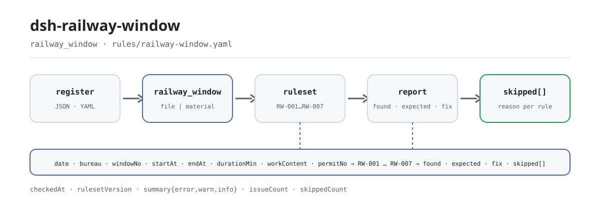

<div align="center">

<picture>
  <source media="(prefers-color-scheme: dark)" srcset="docs/assets/dsh-railway-window-flow-dark.svg">
  
</picture>

# dsh-railway-window

**रेलवे कार्य-विंडो रजिस्टर की हर वह पंक्ति और स्तंभ एक ही बार में सूचीबद्ध करें जो मेल नहीं खाती — अंतिम निर्णय समीक्षक का।**

रेलवे निर्माण-कार्य के नियंत्रकों और साइट प्रबंधकों के लिए एक DSH जाँच प्लगइन: यह दिन का हेडर और प्रत्येक विंडो की एक पंक्ति पढ़ता है तथा समय और अंकगणित की सात जाँचें लगाता है; केवल वही अंतर बताता है जिन्हें सामग्री के भीतर ही इंगित किया जा सके — कोई अनुपालन-निर्णय नहीं, कोई दायित्व-निर्धारण नहीं।

[इंस्टॉल](#तीन-चरणों-में-शुरुआत) · [कॉन्फ़िगरेशन](#कॉन्फ़िगरेशन) · [FAQ](#faq) · [简体中文](README.md) · [English](README.en.md) · [Español](README.es.md) · [Português](README.pt.md) · [हिन्दी](README.hi.md)

[](LICENSE)
[](#संगतता)
[](https://www.npmjs.com/package/dsh-railway-window)
[](https://github.com/PerryLink/dsh-railway-window/actions/workflows/ci.yml)
[](#संगतता)

[](https://github.com/PerryLink/dsh-railway-window/stargazers)
[](https://www.npmjs.com/package/dsh-railway-window)
[](https://dshfind.com/plugins/PerryLink/dsh-railway-window?ref=badge)
[](https://securityscorecards.dev/viewer/?uri=github.com/PerryLink/dsh-railway-window)
[](https://dsh.market/)
[](https://gitee.com/perrylink/dsh-railway-window)

```sh
dsh plugin --profile <name> add dsh-railway-window
```

</div>

<sub>सामुदायिक प्लगइन, DeepSeek से असंबद्ध। कैनोनिकल रिपॉज़िटरी: <https://github.com/PerryLink/dsh-railway-window> (Gitee एक मिरर है)।</sub>

## यह क्या है

`dsh-railway-window` एक रेलवे कार्य-विंडो रजिस्टर पढ़ता है — दिन का हेडर और प्रत्येक विंडो की एक पंक्ति — और उसी रजिस्टर की समय तथा अंकगणितीय संगति जाँचता है: क्या प्रत्येक विंडो अपनी कार्य-सामग्री या अपना यातायात-नियंत्रण आदेश क्रमांक दर्ज करती है, क्या आरंभ और समाप्ति के समय पढ़े जा सकते हैं और क्रम में हैं, क्या दर्ज अवधि ठीक अंतराल के बराबर है, क्या स्वीकृत अवधि आवेदित अवधि से अधिक नहीं है, क्या विंडो का प्रकार आपकी शब्दावली से आता है, क्या विंडो क्रमांक दोहराए नहीं गए हैं, और क्या रजिस्टर अपनी कार्य-तिथि तथा रेलवे प्रशासन (समूह कंपनी) घोषित करता है।

यह केवल वही अंतर सूचीबद्ध करता है जिन्हें सामग्री के भीतर ही इंगित किया जा सके — **कोई अनुपालन-निर्णय नहीं, कोई दायित्व-निर्धारण नहीं, समीक्षक का विकल्प नहीं**। जो जाँच चल नहीं सकती वह कारण के साथ `skipped` में दर्ज होती है, और खाली समस्या-सूची को कभी «कुछ गड़बड़ नहीं» नहीं पढ़ा जा सकता।

- **किसके लिए**: रेलवे निर्माण-कार्य के नियंत्रक और साइट प्रबंधक; कमांड लाइन आनी ज़रूरी नहीं — सामग्री चैट में सौंप दें।
- **आप क्या देते हैं**: जिस मूल सामग्री पर जाँच होती है (तालिका, रजिस्टर या दस्तावेज़); मूल कभी नहीं बदला जाता। Excel को पहले JSON/YAML में बदला जा सकता है, चैट में भी यदि प्लेटफ़ॉर्म अनुमति दे।
- **क्या लौटाता है**: कौन-सी पंक्ति, कौन-सा स्तंभ, क्या अंतर है और क्या जाँचना है — इसकी सूची।

```text
रजिस्टर (JSON / YAML)──railway_window──▶ rules/railway-window.yaml
                                          │ RW-001 … RW-007
                                          ▼
                           रिपोर्ट: found · expected · fix
                                skipped[]: नियम id + कारण
```

उपकरण का नाम `railway_window` है; सामग्री `file` पथ से या सीधे `material` इनलाइन पाठ से आती है। पूरी गणना होस्ट पर होती है — कोई नेटवर्क नहीं, कोई मॉडल कॉल नहीं।

## तीन चरणों में शुरुआत

1. **इंस्टॉल** (कोई एक चैनल; npm पर `0.2.9` है):

   ```sh
   # git चैनल (नवीनतम main)
   dsh plugin --profile web add github:PerryLink/dsh-railway-window
   # npm चैनल (प्रकाशित संस्करण)
   dsh plugin --profile web add dsh-railway-window
   # tarball चैनल: इस रेपो में pnpm pack के बाद
   dsh plugin --profile web add ./dsh-railway-window-<version>.tgz
   ```

   प्रकाशित पैकेज में बिल्ड आर्टिफ़ैक्ट `lib/index.mjs` शामिल है; स्रोत checkout से उपयोग के लिए पहले `pnpm install && pnpm run build` चाहिए।

2. **न्यूनतम कॉन्फ़िगरेशन** (डिफ़ॉल्ट चल जाते हैं; `config` के बिना bundle पंक्ति सभी डिफ़ॉल्ट लेती है, और नियम-पैक पथ पैकेज के `rules/railway-window.yaml` की ओर जाता है):

   ```yaml
   - insert:
       - id: dsh-railway-window
         name: dsh-railway-window
         config:
           timeoutMs: 120000
   ```

3. **जाँचें कि काम करता है** (साथ आया नमूना, अपनी सामग्री की ज़रूरत नहीं):

   ```sh
   pnpm install && pnpm run build
   node samples/quickstart/run.mjs
   dsh --profile web --dump-config | grep 'dsh-railway-window'
   ```

   अपेक्षित आउटपुट `railway_window: 1 issue(s) — error 0, warn 1, info 0` और `skipped: 1`, जो `samples/quickstart/expected/result.json` से मेल खाता है; नमूना इनपुट `samples/quickstart/input/` में है और स्क्रीनशॉट `docs/assets/quickstart.png` में।

**अनइंस्टॉल**: `dsh plugin --profile web remove dsh-railway-window` (या प्रोफ़ाइल patch से वह पंक्ति हटा दें)।

<details>
<summary>WorkBuddy / Coze में उपयोग</summary>

WorkBuddy / Coze में «Professional Document Check Suite» खोजें (पूरा सेट; यह जाँच उसका एक भाग है; उपलब्धता कैटलॉग के अनुसार) — वही जाँच क्षमता बिना कमांड लाइन के मिलती है।

</details>

## मुख्य क्षमताएँ

`dsh-railway-window` `railway_window` उपकरण पंजीकृत करता है: एक कार्य-विंडो रजिस्टर पढ़ता है, संस्करणबद्ध नियम-पैक लगाता है और रिपोर्ट लौटाता है। नियम-डेटा कोड से अलग है — `rules/railway-window.yaml` बदलने से TypeScript छुए बिना नियम-समुच्चय बदल जाता है।

| नियम | जाँच | गंभीरता | आधार का प्रकार |
|---|---|---|---|
| `RW-001` | कार्य-सामग्री या आदेश क्रमांक दर्ज है | warn | सिद्धांत से व्युत्पन्न |
| `RW-002` | आरंभ और समाप्ति पढ़े जा सकते हैं और क्रम में हैं | warn | सिद्धांत से व्युत्पन्न |
| `RW-003` | अवधि अंतराल के बराबर है (दिन, 0.01 दिन सह्यता) | warn | सिद्धांत से व्युत्पन्न |
| `RW-004` | स्वीकृत अवधि आवेदित से अधिक नहीं | info | संस्थागत |
| `RW-005` | विंडो प्रकार आपकी शब्दावली से है (डिफ़ॉल्ट रूप से अनकॉन्फ़िगर्ड) | info | संस्थागत |
| `RW-006` | विंडो क्रमांक अद्वितीय हैं (श्वेत स्थान छोड़कर) | warn | सिद्धांत से व्युत्पन्न |
| `RW-007` | रजिस्टर तिथि और रेलवे प्रशासन घोषित करता है | warn | सिद्धांत से व्युत्पन्न |

- **हर निष्कर्ष अपना स्थान और सुधार बताता है।** `locator` पंक्ति और फ़ील्ड बताता है, `found` पढ़ी गई बात, `expected` वह संबंध जो होना चाहिए, और `fix` वह जो जाँचना है; जिस निष्कर्ष को समीक्षक दोबारा न गण सके, उसका मूल्य कम है।
- **जो चल नहीं सकता वह `skipped` में।** बंद किया गया नियम, छूटा हुआ फ़ील्ड या बिना कॉन्फ़िगर शब्दावली — सब नियम को id और कारण के साथ `skipped` में डालते हैं; खाली समस्या-सूची का अर्थ केवल «जो जाँचें चलीं उन्हें कोई अंतर नहीं मिला» है।
- **उद्धरण की कमियाँ बताई जाती हैं।** नियम-पैक उद्धरण नहीं गढ़ता: जब शब्दशः धारा-पाठ नहीं मिलता, `excerpt` यही कहता है और गंभीरता `warn` (सिद्धांत) या `info` (संस्थागत) तक सीमित रहती है। एक परीक्षण पुष्टि करता है कि कोई नियम ऐसा उद्धरण नहीं दावा करता जो उसके पास नहीं है।
- **केवल होस्ट।** शुद्ध ESM, कोई नेटिव कोड नहीं, कोई नेटवर्क अनुरोध नहीं, कोई मॉडल कॉल नहीं; उपकरण का पंजीकरण disposer लौटाता है, इसलिए अनलोड करने पर वह हट जाता है।
- **वॉल-क्लॉक समय।** सारी गणना इनपुट स्ट्रिंग पर वॉल-क्लॉक अंकगणित है, समय क्षेत्र का कोई रूपांतरण नहीं; जो समय पढ़ा न जा सके वह चुपचाप छोड़े जाने के बजाय अलग से दर्ज होता है।

### उपकरण के पैरामीटर

| पैरामीटर | प्रकार | अर्थ |
|---|---|---|
| `file` | string | सामग्री फ़ाइल का निरपेक्ष पथ (JSON या YAML); `file` / `material` में से एक |
| `material` | string | इनलाइन सामग्री पाठ (JSON या YAML); `file` / `material` में से एक |
| `rulesFile` | string | कॉन्फ़िगर किए गए नियम-पैक पथ को बदलता है (पैकेज रूट के सापेक्ष या निरपेक्ष) |
| `only` | string[] | केवल ये नियम id चलाएँ; खाली होने पर सभी चलते हैं |

## एक वास्तविक आउटपुट

नीचे दिया गया आउटपुट इस प्लगइन के अपने `RW-001` टेस्ट फ़िक्स्चर पर वास्तविक चलाने से आया है, कोई नकली चित्र नहीं। नियम-पैक उद्धरण नहीं गढ़ता, इसलिए हर निष्कर्ष लागू धारा का नाम और यह भी बताता है कि उसका मूल पाठ इस बार प्राप्त नहीं हुआ।

**उपकरण** `railway_window`

**इनपुट**

~~~json
{"date":"2026-03-10","bureau":"某某铁路局集团公司","rows":[{"序号":"1","天窗类型":"V 类","开始时间":"2026-03-10 09:00","结束时间":"2026-03-10 11:00","作业内容":"","施工命令号":""}]}
~~~

**आउटपुट**

~~~json
{
  "id": "dsh-railway-window.RW-001.de09b5a6",
  "ruleId": "RW-001",
  "severity": "warn",
  "locator": {
    "row": 1,
    "field": "workContent"
  },
  "found": "第 1 行 workContent、permitNo 都为空",
  "expected": "workContent、permitNo 至少应填写一项",
  "fix": "补填作业内容与施工命令号；本条只核对是否填写，不判断施工是否违反规定"
}
~~~

*स्रोत `dsh-railway-window/tests/fixtures/RW-001/RW-001-unsafe.json (cases.json expects 1×RW-001); executed parseMaterial+runCheck, checkedAt=2026-10-06T00:00:00.000Z`*

नीचे दी गई तालिका उदाहरण-समुच्चय है: पहली पंक्ति विस्तृत केस है, बाकी संक्षिप्त केस हैं।

| आपका सवाल | इसका जवाब |
|---|---|
| एक पंक्ति में न कार्य-सामग्री दर्ज है और न यातायात-नियंत्रण आदेश क्रमांक। क्या यह दर्ज होता है? | हाँ। `RW-001` हर विंडो में `workContent` या `permitNo` में से कम से कम एक भरा होने की अपेक्षा करता है और जिस पंक्ति में दोनों न हों उसे दर्ज करता है। यह केवल देखता है कि इनमें से एक भरा है; यह नहीं आँकता कि वह कार्य अनुमत दायरे के भीतर रहा या क्लीयरेंस गेज में दख़ल हुआ। |
| एक विंडो `23:30` से `01:30` तक है और उसे एक ही दिन के दो समयों के रूप में लिखा गया है। समाप्ति को आरंभ से पहले क्यों बताया जाता है? | `RW-002` दोनों क्षणों की तुलना करता है और मध्यरात्रि पार होने की स्थिति को नहीं समझता, इसलिए एक ही दिन का यह जोड़ा उलटा पढ़ा जाता है; दोनों ओर तिथि लिखें या इस नियम को बंद कर दें। यदि आरंभ और समाप्ति एक ही क्षण हों तो आरंभ को बाद का नहीं माना जाता, और जो समय पढ़ा न जा सके वह चुपचाप छोड़े जाने के बजाय अलग से दर्ज होता है। |
| अवधि कॉलम में मिनट (`120`) लिखे हैं और विंडो 08:00 से 10:00 तक थी। अंकगणित क्यों मेल नहीं खाता? | `RW-003` अंतराल को दिनों में नापता है, इसलिए मिनटों में लिखा रजिस्टर 1440 गुना भिन्न होता है; डिफ़ॉल्ट सहनशीलता 0.01 दिन है। `daysField` को दिनों में लिखी अवधि वाले कॉलम पर लगाएँ या इस नियम को बंद कर दें। यह केवल अंकगणित जाँचता है, यह नहीं कि विंडो उस कार्य के लिए पर्याप्त लंबी थी। |
| स्वीकृत अवधि आवेदित अवधि से बड़ी है। क्या दर्ज होता है, और यदि इनमें से एक कॉलम खाली हो तो? | `RW-004` उस जोड़े को दर्ज करता है, क्योंकि नियंत्रण कक्ष आवेदन से अधिक नहीं देता और सामान्यतः दोनों कॉलम उलटे भरे होते हैं। यह तभी चलता है जब `approvedMin` और `appliedMin` दोनों पढ़े जा सकें; एक न हो तो यह बताता है कि वह `skipped` में गया। इसमें स्वीकृति घटाने की कोई ऊपरी सीमा नहीं है और यह नहीं तय करता कि वह विंडो मंज़ूर होनी चाहिए थी या नहीं। |
| विंडो प्रकार कॉलम में मान भरा है, पर यह नियम कभी कुछ दर्ज नहीं करता। क्या यह चल रहा है? | नहीं। `RW-005` में `values: []` है, अर्थात् कॉन्फ़िगर नहीं किया गया, और जब तक आप अपने प्रशासन के नियमों में प्रयुक्त वर्गीकरण दर्ज नहीं करते, यह बताता है कि वह `skipped` में गया। कॉन्फ़िगर होने पर भी यह केवल देखता है कि मान आपकी सूची में है; यह तय नहीं करता कि विंडो किस वर्ग में रखी जानी चाहिए। |
| उस दिन का रजिस्टर अधूरा है: हेडर में रेलवे प्रशासन नहीं लिखा और एक ही खंड की दो विंडो का क्रमांक दोहराया गया है। कौन से नियम चलेंगे? | दो। `RW-007` ऐसे हेडर को दर्ज करता है जो कार्य-तिथि और रेलवे प्रशासन (समूह कंपनी) घोषित नहीं करता — यह केवल देखता है कि हेडर इन्हें घोषित करता है, और यदि आपके फ़ॉर्म में विंडो योजना क्रमांक भी दर्ज होता है तो `skylightPlanNo` को उसके `fields` में जोड़ा जा सकता है। `RW-006` दोहराए गए `windowNo` को दर्ज करता है और तुलना करते समय श्वेत स्थान छोड़ देता है; एक ही खंड को एक दिन में कई विंडो मिलना सामान्य है, इसलिए क्रमांक अलग-अलग रखें। |

## नियम और आधार

| दस्तावेज़ | संख्यांक | इन्हें उद्धृत करने वाले नियम |
|---|---|---|
| रेलवे परिचालन-लाइन निर्माण सुरक्षा प्रबंधन के उपाय | वर्तमान संस्करण और धारा-क्रमांक इस बार सत्यापित नहीं | RW-001, RW-002, RW-003, RW-006, RW-007 |
| प्रत्येक रेलवे प्रशासन के कार्य-विंडो प्रबंधन उपाय (संस्थागत कॉन्फ़िगरेशन) | कोई राष्ट्रीय मानक नहीं (यह नियम रजिस्टर के आवेदित और स्वीकृत स्तंभों पर टिका है) | RW-004 |
| प्रत्येक रेलवे प्रशासन के कार्य-विंडो प्रबंधन उपाय (संस्थागत कॉन्फ़िगरेशन) | कोई राष्ट्रीय मानक नहीं (यह नियम संस्था की वर्गीकरण-शब्दावली पर टिका है) | RW-005 |

**सीमा:** यह प्लगइन एक **रेलवे निर्माण कार्य-विंडो रजिस्टर** की समय और अंकगणितीय संगति जाँचता है — कि प्रत्येक विंडो अपनी कार्य-सामग्री या यातायात-नियंत्रण आदेश क्रमांक दर्ज करती है, आरंभ और समाप्ति पढ़े जा सकते हैं और क्रम में हैं, दर्ज अवधि अंतराल के बराबर है, स्वीकृत अवधि आवेदित से अधिक नहीं है, विंडो प्रकार आपकी शब्दावली से है, विंडो क्रमांक अद्वितीय हैं, और रजिस्टर अपनी कार्य-तिथि तथा रेलवे प्रशासन घोषित करता है। यह **नहीं** तय करता कि विंडो मंज़ूर होनी चाहिए थी, कार्य क्लीयरेंस गेज में घुसा, कोई उल्लंघन हुआ या यातायात सुरक्षा प्रभावित हुई।

> ### ⚠️ रिपोर्ट के किसी उद्धरण पर भरोसा करने से पहले यह पढ़ें
>
> **इस प्लगइन के नियम-पैक का हर `excerpt` स्पष्ट शब्दों में कहता है कि धारा-पाठ इस बार प्राप्त नहीं
> हुआ।** यह व्यवस्था राष्ट्रीय रेलवे परिचालन-लाइन निर्माण सुरक्षा उपायों तथा प्रत्येक रेलवे प्रशासन के
> कार्य-विंडो और यातायात-नियंत्रण आदेश उपायों में है। सत्यापन-चरण शब्दशः धारा-पाठ नहीं ला सका, इसलिए
> उद्धरण का रूपांतरण करने के बजाय पैक `excerpt` फ़ील्ड में ही यह कमी बताता है और ईमानदार तर्क `note`
> में रखता है। इसलिए हर नियम `warn` या `info` है, और एक परीक्षण पुष्टि करता है कि कोई नियम ऐसा उद्धरण
> नहीं दावा करता जो उसके पास नहीं है। **पाठ मिलने पर हर `excerpt` को वास्तविक धारा से बदलें और `kind`
> को `direct` तक बढ़ाएँ।**
>
> किसी निष्कर्ष पर भरोसा करने से पहले तीन सीमाएँ महत्वपूर्ण हैं:
>
> - **प्लगइन कोई विंडो-वर्गीकरण और कोई स्थिति-शब्दावली नहीं लाता।** विंडो कैसे वर्गीकृत हों और उनकी
>   स्थितियाँ कैसे लिखी जाएँ, यह प्रशासन के अनुसार बदलता है, इसलिए `RW-005` कॉन्फ़िगर होने तक स्वयं को
>   `skipped` में दर्ज करता है।
> - **कोई स्वीकृति-अनुपात ऊपरी सीमा अंतर्निहित नहीं है।** स्वीकृत विंडो आवेदित से कितनी छोटी हो सकती है
>   और कितनी, यह प्रशासन का नियम है; `RW-004` केवल जाँचता है कि स्वीकृत संख्या आवेदित से अधिक नहीं है —
>   यह प्रविष्टि-स्तर का गुण है, विषय-स्तर का नहीं।
> - **अवधि की इकाई दिन है, और नियम स्वयं यह कहता है।** `RW-003` अंतराल को भीतर से मिनटों में नापता है
>   और दिनों में व्यक्त करता है, इसलिए एक ही कैलेंडर दिन में शुरू-समाप्त होने वाली विंडो सही नापी जाती
>   है। मिनटों में अवधि दर्ज करने वाला रजिस्टर 1440 गुना भिन्न होता है — `daysField` को दिन-इकाई वाले
>   स्तंभ पर लगाएँ या नियम बंद करें।
>
> प्लगइन **मध्यरात्रि पार होने** को भी नहीं संभालता: एक ही दिन के दो समयों (`23:30` से `01:30`) में
> लिखी विंडो उलटा जोड़ा पढ़ी जाएगी। दोनों ओर तिथि लिखें या वह नियम बंद करें।

<details>
<summary>नियमों का स्रोत और लोड-समय सत्यापन</summary>

नियम-डेटा कोड से अलग रहता है: प्रत्येक नियम में दस्तावेज़, संख्या, स्रोत की अपनी क्रमांकन-प्रणाली के अनुसार धारा, उद्धरण, आधार का प्रकार और स्रोत URL होता है। लोड के समय लागू होता है कि उद्धरण अपने आधार को बढ़ा-चढ़ाकर न बताए; केवल किसी सिद्धांत (`kind: derived-from-principle`, अधिकतम गंभीरता `warn`) या संस्थागत कॉन्फ़िगरेशन (`kind: institutional-configuration`, अधिकतम `info`) पर टिकी जाँच को `error` नहीं चिह्नित किया जा सकता। अपना आधार बढ़ा-चढ़ाकर बताने वाला पैक लोड पर विफल होता है, ठोस दिखने वाली रिपोर्ट नहीं बनाता।

`excerpt` शब्दशः उद्धरण होना चाहिए, कभी रूपांतरण नहीं। इस पैक का हर `excerpt` स्पष्ट शब्दों में कहता है कि धारा-पाठ प्राप्त नहीं हुआ, इसलिए `check:citations` उन्हें उद्धरण नहीं बल्कि प्लेसहोल्डर टिप्पणी गिनता है; `rules/citations-baseline.json` उन अंशों को दर्ज करता है जिनका स्रोत अभी नहीं मिला और वह अभी खाली है; कोई भी नया बिना-स्रोत उद्धरण गेट विफल करता है।

सत्यापन के दौरान पुष्ट सीमाएँ और जान-बूझकर **न** निकाले गए निष्कर्ष `rules/railway-window.yaml` के हेडर और प्रत्येक नियम के `note` में दर्ज हैं।

</details>

## सामग्री का प्रारूप

उपकरण JSON या YAML स्वीकार करता है:

```yaml
date: 2026-03-10
bureau: 某某铁路局集团公司
rows:
  - { 序号: '1', 天窗类型: V 类, 线别: 上行, 区间: K120+000 至 K125+000,
      开始时间: 2026-03-10 08:00, 结束时间: 2026-03-10 20:00, 天窗时长: '0.5',
      申请时长: '720', 批准时长: '720', 作业内容: 更换接触网吊弦,
      施工命令号: 调令〔2026〕第 018 号, 申请单位: 某某供电段, 状态: 已兑现 }
```

स्तंभ-नाम बड़े-छोटे अक्षरों में भेद किए बिना और श्वेत स्थान, अंडरस्कोर तथा हाइफ़न छोड़कर मिलाए जाते हैं; रजिस्टर के अपने स्तंभ-नाम बने रहते हैं, इसलिए निष्कर्ष में हमेशा वही स्तंभ लिखा जाता है जो आपकी तालिका में है। समय `2026-03-10 09:00` जैसे रूप में लिखें; चीनी तिथि-रूप को जान-बूझकर अपठनीय बताया जाता है। फ़ील्ड पढ़ने की परत में वैकल्पिक हैं और जाँच-इंजन उन्हें सत्यापित करता है, इसलिए आंशिक निर्यात पर क्रैश के बजाय «फ़ील्ड अनुपस्थित» श्रेणी के अंतर मिलते हैं।

पढ़ने की परत को कम से कम एक कैनोनिकल पंक्ति-फ़ील्ड चाहिए — `windowNo`, `startAt`, `endAt` या `workContent` — और यदि वह न हो तो खाली रिपोर्ट बनाने के बजाय स्पष्ट रूप से विफल होती है।

## कॉन्फ़िगरेशन

सभी समायोज्य पैरामीटर `src/config.ts` की Schemastery स्कीमा में हैं, इसलिए कोड बदले बिना `cordis.yml` से बदले जा सकते हैं; प्रति-नियम सीमाएँ `rules/` के नियम-पैक में हैं।

| कुंजी | प्रकार | डिफ़ॉल्ट | विवरण |
|---|---|---|---|
| `rulesFile` | string | `rules/railway-window.yaml` | नियम-पैक का पथ, पैकेज रूट के सापेक्ष |
| `disabledRules` | string[] | `[]` | बंद करने वाले नियम id; प्रत्येक `skipped` में दिखता है |
| `onlyRules` | string[] | `[]` | केवल ये नियम चलाएँ; खाली होने पर सभी नियम चलते हैं |
| `skipNotes` | string | `""` | हर `skipped` कारण के आगे जोड़ी जाने वाली टिप्पणी |
| `timeoutMs` | number | `120000` | उपकरण का सहकारी समय-सीमा बजट |

नियम-स्तर के वे पैरामीटर जो जानने योग्य हैं:

- `RW-002` `field` / `notAfterField` — समय-जोड़ा, आरंभ बनाम समाप्ति।
- `RW-003` `daysField` / `fromField` / `toField` / `tolerance` — अवधि का अंकगणित, दिनों में। डिफ़ॉल्ट सह्यता `0.01` दिन है।
- `RW-005` `values` — आपके विंडो प्रकार, जैसे `[श्रेणी V, लंबवत विंडो, संयुक्त विंडो, निर्माण विंडो, रखरखाव विंडो]`। खाली का अर्थ है कोई जाँच नहीं।
- `RW-007` `fields` — हेडर में कौन-कौन सी वस्तुएँ घोषित होनी चाहिए, डिफ़ॉल्ट `["date","bureau"]`; यदि आपके फ़ॉर्म में विंडो योजना क्रमांक भी दर्ज होता है तो `skylightPlanNo` जोड़ें।

प्रोफ़ाइल patch में ओवरराइड का उदाहरण:

```yaml
- insert:
    - id: dsh-railway-window
      name: dsh-railway-window
      config:
        disabledRules: [RW-003]
        skipNotes: इस तिमाही केवल समय और क्रमांकन जाँचें
```

## FAQ

<details>
<summary>सामग्री और रिपोर्ट कहाँ रहती हैं? कुछ नेटवर्क पर जाता है क्या?</summary>

प्लगइन का **अपना कोई भंडारण नहीं** है: सामग्री केवल इस उपकरण-कॉल के भीतर पढ़ी जाती है (`file` पथ या इनलाइन `material` पाठ), रिपोर्ट उपकरण-परिणाम के रूप में लौटती है, और बाद का सत्र-रिकॉर्ड होस्ट प्रबंधित करता है। गणना कोई नेटवर्क अनुरोध नहीं करती, मॉडल नहीं बुलाती और सामग्री में वापस नहीं लिखती; `package.json` का `dsh.demo` भी `network: false` और `writes: []` घोषित करता है।

</details>

<details>
<summary>यदि रिपोर्ट में कोई निष्कर्ष नहीं है, तो क्या रजिस्टर ठीक है?</summary>

नहीं। पहले `skipped` देखें: `disabledRules` से बंद नियम, छूटा हुआ फ़ील्ड, या `RW-005` की बिना कॉन्फ़िगर शब्दावली — संबंधित जाँच छूट जाती है और कारण बताती है। खाली समस्या-सूची का अर्थ केवल «जो जाँचें चलीं उन्हें कोई अंतर नहीं मिला» है, «सभी जाँचें चलीं» नहीं।

</details>

<details>
<summary>`RW-005` कभी क्यों नहीं चलता?</summary>

इसका `values` `[]` के रूप में आता है, अर्थात् अनकॉन्फ़िगर्ड; अनकॉन्फ़िगर्ड का अर्थ `skipped`। विंडो कैसे वर्गीकृत हों (श्रेणी V, लंबवत विंडो, संयुक्त विंडो आदि) यह हर प्रशासन के निर्माण-उपायों के अनुसार बदलता है, और प्लगइन कोई वर्गीकरण-प्रणाली हार्डकोड नहीं करता — अपने प्रशासन की शब्दावली नियम-पैक या कॉन्फ़िगरेशन में भरें।

</details>

<details>
<summary>प्रदर्शन-व्यय कितना है? क्या सत्र अटक जाएगा?</summary>

कोई नेटवर्क अनुरोध नहीं, कोई मॉडल कॉल नहीं, कोई रेगेक्स बैकट्रैकिंग नहीं; व्यय मुख्यतः सामग्री एक बार पढ़ना, कुछ समय और अंकगणितीय तुलनाएँ, और रिपोर्ट को प्रारूपित करना है। `timeoutMs` उपकरण को दिया गया सहकारी समय-सीमा बजट है (डिफ़ॉल्ट `120000` मि.से.), और उपकरण होस्ट के निरस्त संकेत का भी जवाब देता है। पूरी निर्देशिका जाँचने के लिए `ptc` मोड में स्कीमा-व्यय एक ही बार लगता है।

</details>

<details>
<summary>समस्या-समाधान: इंस्टॉल, उपकरण अनुपस्थित, कोई नियम जो नहीं चलता</summary>

- **प्लगइन इंस्टॉल हो गया पर उपकरण दिखता नहीं।** जाँचें कि `main` `lib/index.mjs` पर जाता है और `pnpm run build` ने उसे बनाया है; गलत `main` लोडर को प्रविष्टि चुपचाप छोड़ने देता है।
- **`dsh plugin add` असंगत बताकर मना करता है।** peer रेंज `0.1.x` और `0.2.x` को कवर करती है; यदि आपका रनटाइम उसके बाहर है तो स्पष्ट छूट दें: `dsh plugin --profile <name> allow-version <pkg@version> --dsh-version <runtime> --accept-risk`।
- **कोई नियम नहीं चला।** `skipped` सरणी देखें; उसमें नियम id और कारण लिखा है।
- **`check` में `manifest-peers` विफल दिखता है।** स्थिर जाँचकर्ता 0.2 पंक्ति से पहले के हार्डकोडेड peer रेंज से तुलना करता है; इंस्टॉल के समय peer अनुकूलता रनटाइम लागू करता है। यह `dsh-plugin-dev` की ज्ञात अपस्ट्रीम समस्या है।
- **समय खिसका हुआ लगता है।** सारी गणना इनपुट स्ट्रिंग पर वॉल-क्लॉक अंकगणित है, समय क्षेत्र का रूपांतरण नहीं।
- **किसी निष्कर्ष में कहा गया है कि धारा-पाठ प्राप्त नहीं हुआ।** नियम-पैक उद्धरण नहीं गढ़ता; शब्दशः धारा न मिलने पर निष्कर्ष `warn` / `info` पर रहता है और `excerpt` में यह बताता है। इसे सत्यापन-कमी मानें, सामग्री के अनुपालन का प्रमाण नहीं।
- **इंस्टॉल हुआ पर कुछ नहीं मिलता।** पुष्टि करें कि उपकरण सचमुच चला और परिणाम लौटाया; खाली परिणाम और छोड़ी गई जाँच एक नहीं हैं — पहले सामग्री के फ़ील्ड इस README की तालिका से मिलाएँ।

</details>

## सुरक्षा सीमाएँ और ज्ञात सीमाएँ

- **केवल रजिस्टर की अपनी पूर्णता और अंकगणित।** यह नहीं तय करता कि विंडो मंज़ूर होनी चाहिए थी, कार्य क्लीयरेंस गेज में घुसा, कोई नियम-उल्लंघन हुआ या यातायात सुरक्षा प्रभावित हुई; यह नियंत्रण, परमानेंट-वे और सुरक्षा विभागों का पेशेवर निर्णय है और परिचालन सुरक्षा का केंद्र है।
- **उद्धरण की कमियाँ बताई जाती हैं।** नियम-पैक उद्धरण नहीं गढ़ता; `excerpt` कहता है कि धारा-पाठ प्राप्त नहीं हुआ, और आधार का प्रकार तथा गंभीरता साक्ष्य से सीमित रहते हैं। एक निष्कर्ष का अर्थ «रजिस्टर का यह फ़ील्ड मेल नहीं खाता» है, «आपने नियम तोड़ा» नहीं।
- **खाली सूची «कुछ गड़बड़ नहीं» नहीं है।** जो जाँचें चल नहीं सकतीं वे कारण के साथ `skipped` में जाती हैं; «कोई समस्या नहीं» को «कुछ भी जाँचा नहीं गया» नहीं पढ़ना चाहिए।
- **विंडो-वर्गीकरण और स्थिति-शब्दावली संस्था की हैं।** प्लगइन कोई विंडो-वर्गीकरण और कोई स्थिति-शब्दावली नहीं लाता; `RW-005` के `values` खाली आते हैं और अनकॉन्फ़िगर्ड नियम अनुमान लगाने के बजाय छूट जाता है।
- **कोई स्वीकृति-अनुपात ऊपरी सीमा अंतर्निहित नहीं है।** स्वीकृति आवेदित से कितनी छोटी हो सकती है, यह हर प्रशासन के निर्माण-उपाय तय करते हैं; `RW-004` केवल जाँचता है कि स्वीकृत संख्या आवेदित से अधिक नहीं है — प्रविष्टि-स्तर का गुण, विषय-स्तर का निर्णय नहीं।
- **अवधि की इकाई दिन है।** `RW-003` अंतराल को भीतर से मिनटों में नापता है और दिनों में व्यक्त करता है; मिनटों वाला रजिस्टर 1440 गुना भिन्न होता है: `daysField` को दिन-इकाई वाले स्तंभ पर लगाएँ या नियम बंद करें।
- **मध्यरात्रि पार होना संभाला नहीं जाता।** एक ही दिन के दो समयों (`23:30` से `01:30`) में लिखी विंडो उलटा जोड़ा पढ़ी जाती है; दोनों ओर तिथि लिखें या नियम बंद करें।
- **कोई समय-क्षेत्र रूपांतरण नहीं।** सारी गणना इनपुट स्ट्रिंग पर वॉल-क्लॉक अंकगणित है।
- **केवल स्थानीय।** कोई नेटवर्क अनुरोध नहीं, कोई क्रेडेंशियल नहीं, सामग्री में वापस लेखन नहीं; पढ़ा गया एकमात्र पथ वही है जो आपने `file` में दिया।

## अन्य DSH प्लगइनों के साथ इंटरऑपरेबिलिटी

यह प्लगइन केवल एक उपकरण पंजीकृत करता है और उसकी पंजीकरण-सतह संकरी है:

- **एक उपकरण, एक नेमस्पेस।** केवल `railway_window` पंजीकृत करता है और किसी अंतर्निहित उपकरण या अन्य प्लगइन का नंगा नाम नहीं लेता।
- **कोई सेवा-कुंजी नहीं, कोई HTTP रूट नहीं, कोई क्लाइंट slot नहीं।** कोई service key नहीं देता, कोई `webServer` उपसर्ग पंजीकृत नहीं करता, और इसकी कोई क्लाइंट-आधी नहीं है (इस रेपो में `client/` निर्देशिका नहीं है), इसलिए slot सीट के लिए प्रतिस्पर्धा नहीं करता।
- **कोई वैश्विक परिवर्तन नहीं।** प्रोटोटाइप नहीं बदलता, `process.env` नहीं लिखता, वैश्विक fetch नहीं बदलता।
- **पंजीकरण effect हैं।** `ctx.tools.register` का लौटाया disposer अनलोड/हॉट-रीलोड पर उपकरण हटा देता है; `inject: ['tools']` का अर्थ है कि प्लगइन केवल तब लोड होता है जब `tools` सेवा मौजूद हो।
- **नियम-पैक केवल-पठन है।** चलने पर उपकरण केवल वही फ़ाइल पढ़ता है जिसकी ओर `rulesFile` इशारा करता है; नियम-पैक या सामग्री में कभी वापस नहीं लिखता।

साक्ष्य: `src/index.ts` की पंजीकरण-सतह (`export const inject = ['tools']`, एक ही `ctx.tools.register`, कोई अन्य पंजीकरण-कॉल नहीं)।

## संगतता

| सतह | स्थिति |
|---|---|
| Harness | peer रेंज `>=0.1.2-rc.1 <0.2.0 \|\| >=0.2.0-0 <0.3.0` — `0.2.0-rc.2` और `0.2.1-rc.2` दोनों को स्वीकार करने के लिए सत्यापित। **`engines.dsh` घोषित है** `>=0.2.1-0 <0.3.0` के रूप में और 0.2.1 से होस्ट इसे लागू करता है |
| Node | `^22.19.0 \|\| >=24.0.0` |
| प्लेटफ़ॉर्म | सभी (शुद्ध ESM; कोई नेटिव कोड नहीं, कोई नेटवर्क नहीं, कोई मॉडल कॉल नहीं) |
| टूल मोड | `native` और `ptc` में काम करता है; महीने भर की विंडो के लिए `ptc` चुनें |

## इकोसिस्टम और गुणवत्ता

- [Gitee मिरर](https://gitee.com/perrylink/dsh-railway-window) (समन्वित मिरर; GitHub कैनोनिकल है)
- [dshfind प्लगइन पृष्ठ](https://dshfind.com/plugins/PerryLink/dsh-railway-window) (इंस्टॉल और रैंकिंग)
- [OpenSSF Scorecard रिपोर्ट](https://securityscorecards.dev/viewer/?uri=github.com/PerryLink/dsh-railway-window) ([.github/workflows/scorecard.yml](.github/workflows/scorecard.yml) द्वारा संचालित)
- [DSH Market](https://dsh.market/) (सूचीबद्ध)
- **WorkBuddy / Coze**: «Professional Document Check Suite» खोजें (पूरा सेट; यह जाँच उसका एक भाग है; उपलब्धता कैटलॉग के अनुसार)
- [सामग्री के अनुसार जाँचकर्ता चुनें](https://perrylink.github.io/zh/checkers/choose/) (वह जाँचकर्ता-सूची जिसमें यह प्लगइन है)
- [समस्या-ट्रैकर](https://github.com/PerryLink/dsh-railway-window/issues) (संस्करण, कमांड और न्यूनतम संपादित सामग्री साथ दें)

## डेवलपमेंट

```sh
pnpm install
pnpm run typecheck        # tsc --noEmit
pnpm test                 # vitest, प्रति नियम एक अनुरूप/उल्लंघनकारी फ़िक्स्चर जोड़ा
pnpm run build            # tsdown -> lib/index.mjs + lib/index.d.mts
pnpm run verify:self-contained
pnpm run check:lockfile
pnpm run check:readmes    # चीनी/अंग्रेज़ी README की संगति
pnpm run check:citations
node ../scripts/sync-shared.mjs dsh-railway-window   # src/shared ताज़ा करें
```

अंतिम `sync-shared` कमांड `../_shared` का साझा किट `src/shared/` में कॉपी करता है; हर साझा बदलाव के बाद इसे दोबारा चलाएँ। README की छवियाँ [`scripts/gen-readme-assets.py`](scripts/gen-readme-assets.py) से कार्यक्रम द्वारा बनती हैं (Python + Pillow, हल्का/गहरा SVG जोड़ा) और दोबारा चलाई जा सकती हैं: `python scripts/gen-readme-assets.py`।

<details>
<summary>निर्देशिका-संरचना</summary>

| पथ | सामग्री |
|---|---|
| `src/index.ts` | उपकरण पंजीकरण और नियम-पैक स्थान-निर्धारण (function-plugin अनुबंध, कोई default export नहीं) |
| `src/config.ts` | Schemastery कॉन्फ़िग स्कीमा; सभी समायोज्य यहीं रहते हैं |
| `src/model.ts` | रजिस्टर के स्तंभ-उपनाम और सामग्री-अनुबंध; तालिका का आकार एक बार घोषित और पाठक तथा जाँच-इंजन में साझा |
| `src/view.ts` | मॉडल के लिए रिपोर्ट-प्रक्षेपण; `output.schema` उसका प्रतिबिंब है |
| `src/shared/` | साझा किट (नियम-पैक लोडिंग, रिपोर्ट आकार, YAML उपसमुच्चय, तिथि-अंकगणित, शब्द-संरक्षक), आयात नहीं बल्कि कॉपी |
| `rules/railway-window.yaml` | 7 नियमों का पैक |
| `rules/citations-baseline.json` | अभी बिना-स्रोत उद्धरण अंशों की सूची (अभी खाली) |
| `tests/` | vitest; हर नियम के `tests/fixtures/<RULE>/` में अनुरूप/उल्लंघनकारी फ़िक्स्चर |
| `scripts/` | यांत्रिक गेट: स्व-निहितता, लॉकफ़ाइल विचलन, README संगति, उद्धरण जाँच, छवि-निर्माण |

</details>

विषय: `dsh`, `dsh-plugin`, `deepseek-harness`, `deepseek`, `cordis`, `railway`, `window`

## परिवार और आभार

यह परियोजना [PerryLink](https://github.com/PerryLink) की DeepSeek Harness प्लगइन-फ़ैमिली का हिस्सा है (सभी Apache-2.0)। पूरी सूची: [सामग्री के अनुसार जाँचकर्ता चुनें](https://perrylink.github.io/zh/checkers/choose/) और [सभी प्लगइन](https://github.com/PerryLink); यह रेपो उनमें से एक है। अगर यह मददगार हो, तो **एक स्टार अगले व्यक्ति को इसे खोजने में मदद करता है** — इसके पीछे कोई सुविधा नहीं है।

- [@PerryLink](https://github.com/PerryLink) — निर्माता और अनुरक्षक: नियम-पैक, जाँच-कोर, पाँच-भाषी दस्तावेज़ और छवि-स्क्रिप्ट।

<details>
<summary>सभी प्लगइन देखें</summary>

| प्लगइन | स्थिति |
|---|---|
| **[dsh-aqua-input-check](https://github.com/PerryLink/dsh-aqua-input-check)** |  |
| **[dsh-archive-check](https://github.com/PerryLink/dsh-archive-check)** |  |
| **[dsh-auto-review](https://github.com/PerryLink/dsh-auto-review)** |  |
| **[dsh-autotier](https://github.com/PerryLink/dsh-autotier)** | 🧊 फ़्रोज़न — रेपो README देखें |
| **[dsh-bid-ca-precheck](https://github.com/PerryLink/dsh-bid-ca-precheck)** |  |
| **[dsh-bid-qual-check](https://github.com/PerryLink/dsh-bid-qual-check)** |  |
| **[dsh-cert-mcp](https://github.com/PerryLink/dsh-cert-mcp)** | 🧊 फ़्रोज़न — रेपो README देखें |
| **[dsh-checkpoint-rewind](https://github.com/PerryLink/dsh-checkpoint-rewind)** |  |
| **[dsh-click](https://github.com/PerryLink/dsh-click)** |  |
| **[dsh-composer-history](https://github.com/PerryLink/dsh-composer-history)** |  |
| **[dsh-contract-stance](https://github.com/PerryLink/dsh-contract-stance)** |  |
| **[dsh-customs-doc-check](https://github.com/PerryLink/dsh-customs-doc-check)** |  |
| **[dsh-data-quality](https://github.com/PerryLink/dsh-data-quality)** | 🧊 फ़्रोज़न — रेपो README देखें |
| **[dsh-demurrage-ledger](https://github.com/PerryLink/dsh-demurrage-ledger)** |  |
| **[dsh-doublecheck](https://github.com/PerryLink/dsh-doublecheck)** |  |
| **[dsh-drill-script-check](https://github.com/PerryLink/dsh-drill-script-check)** |  |
| **[dsh-eia-guide-check](https://github.com/PerryLink/dsh-eia-guide-check)** |  |
| **[dsh-emergency-plan](https://github.com/PerryLink/dsh-emergency-plan)** |  |
| **[dsh-essay-rubric-check](https://github.com/PerryLink/dsh-essay-rubric-check)** |  |
| **[dsh-evidence-check](https://github.com/PerryLink/dsh-evidence-check)** |  |
| **[dsh-export-ctl-check](https://github.com/PerryLink/dsh-export-ctl-check)** |  |
| **[dsh-fast](https://github.com/PerryLink/dsh-fast)** |  |
| **[dsh-fmea-table-check](https://github.com/PerryLink/dsh-fmea-table-check)** |  |
| **[dsh-forecast-penalty](https://github.com/PerryLink/dsh-forecast-penalty)** |  |
| **[dsh-fund-research](https://github.com/PerryLink/dsh-fund-research)** |  |
| **[dsh-github](https://github.com/PerryLink/dsh-github)** |  |
| **[dsh-gongwen-flow-check](https://github.com/PerryLink/dsh-gongwen-flow-check)** |  |
| **[dsh-gongwen-word-check](https://github.com/PerryLink/dsh-gongwen-word-check)** |  |
| **[dsh-guard-plan-qc](https://github.com/PerryLink/dsh-guard-plan-qc)** |  |
| **[dsh-hazchem-check](https://github.com/PerryLink/dsh-hazchem-check)** |  |
| **[dsh-hazplan-check](https://github.com/PerryLink/dsh-hazplan-check)** |  |
| **[dsh-hidden-risk-map](https://github.com/PerryLink/dsh-hidden-risk-map)** |  |
| **[dsh-hs-classify](https://github.com/PerryLink/dsh-hs-classify)** |  |
| **[dsh-icd-rule-check](https://github.com/PerryLink/dsh-icd-rule-check)** |  |
| **[dsh-industry-research](https://github.com/PerryLink/dsh-industry-research)** |  |
| **[dsh-lawcite-adapter](https://github.com/PerryLink/dsh-lawcite-adapter)** |  |
| **[dsh-laya](https://github.com/PerryLink/dsh-laya)** |  |
| **[dsh-lc-doc-check](https://github.com/PerryLink/dsh-lc-doc-check)** |  |
| **[dsh-learning-gap-check](https://github.com/PerryLink/dsh-learning-gap-check)** |  |
| **[dsh-library](https://github.com/PerryLink/dsh-library)** |  |
| **[dsh-local-ai](https://github.com/PerryLink/dsh-local-ai)** |  |
| **[dsh-lsp-actions](https://github.com/PerryLink/dsh-lsp-actions)** |  |
| **[dsh-mask](https://github.com/PerryLink/dsh-mask)** |  |
| **[dsh-mcp-panel](https://github.com/PerryLink/dsh-mcp-panel)** |  |
| **[dsh-medrec-qc](https://github.com/PerryLink/dsh-medrec-qc)** |  |
| **[dsh-memento](https://github.com/PerryLink/dsh-memento)** | 🧊 फ़्रोज़न — रेपो README देखें |
| **[dsh-nsfc-form-check](https://github.com/PerryLink/dsh-nsfc-form-check)** |  |
| **[dsh-nurse-record-check](https://github.com/PerryLink/dsh-nurse-record-check)** |  |
| **[dsh-observe](https://github.com/PerryLink/dsh-observe)** |  |
| **[dsh-origin-rvc-check](https://github.com/PerryLink/dsh-origin-rvc-check)** |  |
| **[dsh-ota-review-check](https://github.com/PerryLink/dsh-ota-review-check)** |  |
| **[dsh-output-styles](https://github.com/PerryLink/dsh-output-styles)** |  |
| **[dsh-paper-doc-adapter](https://github.com/PerryLink/dsh-paper-doc-adapter)** |  |
| **[dsh-permission-rules](https://github.com/PerryLink/dsh-permission-rules)** |  |
| **[dsh-permit-report-check](https://github.com/PerryLink/dsh-permit-report-check)** |  |
| **[dsh-pipeline-check](https://github.com/PerryLink/dsh-pipeline-check)** |  |
| **[dsh-pleading-draft](https://github.com/PerryLink/dsh-pleading-draft)** |  |
| **[dsh-plugin-doctor](https://github.com/PerryLink/dsh-plugin-doctor)** | 🚫 रिटायर्ड (रेपो संग्रहीत) |
| **[dsh-plugin-guide](https://github.com/PerryLink/dsh-plugin-guide)** |  |
| **[dsh-plugin-kit](https://github.com/PerryLink/dsh-plugin-kit)** | 🚫 रिटायर्ड (रेपो संग्रहीत) |
| **[dsh-plugin-upgrade](https://github.com/PerryLink/dsh-plugin-upgrade)** | 🚫 रिटायर्ड (रेपो संग्रहीत) |
| **[dsh-policy-brief-draft](https://github.com/PerryLink/dsh-policy-brief-draft)** |  |
| **[dsh-power-loss-split](https://github.com/PerryLink/dsh-power-loss-split)** |  |
| **[dsh-power-ticket-check](https://github.com/PerryLink/dsh-power-ticket-check)** |  |
| **[dsh-ppap-check](https://github.com/PerryLink/dsh-ppap-check)** |  |
| **[dsh-protest-deadline](https://github.com/PerryLink/dsh-protest-deadline)** |  |
| **[dsh-railway-window](https://github.com/PerryLink/dsh-railway-window)** |  |
| **[dsh-repair-order-qc](https://github.com/PerryLink/dsh-repair-order-qc)** |  |
| **[dsh-research-report](https://github.com/PerryLink/dsh-research-report)** |  |
| **[dsh-review-reply-check](https://github.com/PerryLink/dsh-review-reply-check)** |  |
| **[dsh-rulefile-check](https://github.com/PerryLink/dsh-rulefile-check)** |  |
| **[dsh-safety-brief-check](https://github.com/PerryLink/dsh-safety-brief-check)** |  |
| **[dsh-score](https://github.com/PerryLink/dsh-score)** | 🧊 फ़्रोज़न — रेपो README देखें |
| **[dsh-session-sync](https://github.com/PerryLink/dsh-session-sync)** |  |
| **[dsh-site-log-check](https://github.com/PerryLink/dsh-site-log-check)** |  |
| **[dsh-skill-pack-security](https://github.com/PerryLink/dsh-skill-pack-security)** |  |
| **[dsh-soe-decision-check](https://github.com/PerryLink/dsh-soe-decision-check)** |  |
| **[dsh-soilwater-check](https://github.com/PerryLink/dsh-soilwater-check)** |  |
| **[dsh-sop-sync-check](https://github.com/PerryLink/dsh-sop-sync-check)** |  |
| **[dsh-spc-gbt-adapter](https://github.com/PerryLink/dsh-spc-gbt-adapter)** |  |
| **[dsh-talk](https://github.com/PerryLink/dsh-talk)** |  |
| **[dsh-tender-extract](https://github.com/PerryLink/dsh-tender-extract)** |  |
| **[dsh-tender-matrix](https://github.com/PerryLink/dsh-tender-matrix)** |  |
| **[dsh-test-drive](https://github.com/PerryLink/dsh-test-drive)** |  |
| **[dsh-ticktick](https://github.com/PerryLink/dsh-ticktick)** | 🚫 रिटायर्ड (रेपो संग्रहीत) |
| **[dsh-translate](https://github.com/PerryLink/dsh-translate)** |  |
| **[dsh-warranty-calc](https://github.com/PerryLink/dsh-warranty-calc)** |  |
| **[dsh-budget](https://github.com/PerryLink/dsh-budget)** | 🧊 फ़्रोज़न — रेपो README देखें |
| **[dsh-claude-move](https://github.com/PerryLink/dsh-claude-move)** | 🧊 फ़्रोज़न — रेपो README देखें |
| **[dsh-defend](https://github.com/PerryLink/dsh-defend)** | 🧊 फ़्रोज़न — रेपो README देखें |
| **[dsh-draw](https://github.com/PerryLink/dsh-draw)** | 🧊 फ़्रोज़न — रेपो README देखें |
| **[dsh-reach](https://github.com/PerryLink/dsh-reach)** | 🧊 फ़्रोज़न — रेपो README देखें |
| **[dsh-background-agents](https://github.com/PerryLink/dsh-background-agents)** | 🚫 रिटायर्ड (रेपो संग्रहीत) |
| **[dsh-session-pin](https://github.com/PerryLink/dsh-session-pin)** | 🚫 रिटायर्ड (रेपो संग्रहीत) |
| **[dsh-team-rooms](https://github.com/PerryLink/dsh-team-rooms)** | 🚫 रिटायर्ड (रेपो संग्रहीत) |

</details>

## लाइसेंस

[LICENSE](LICENSE) (Apache License 2.0) © 2026 dsh-railway-window contributors

<p align="center"><sub>Apache-2.0 · सामुदायिक प्लगइन, DeepSeek से असंबद्ध।</sub></p>
