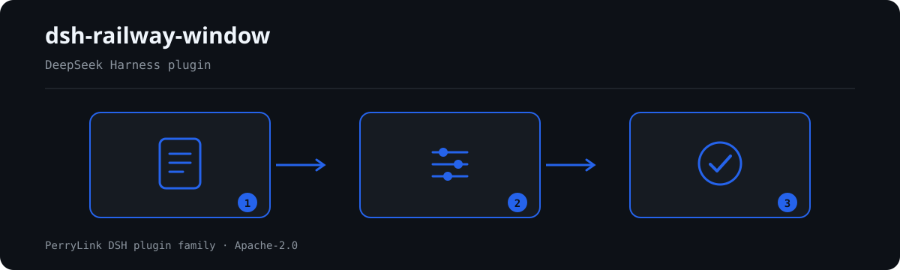

# dsh-railway-window — Railway work-window register check for time and arithmetic self-consistency

[English](README.md) · [简体中文](README-zh.md) · [Español](README-es.md) · [Português](README-pt.md) · [हिन्दी](README-hi.md)

[](https://dsh.market/)
[](https://dshfind.com/en/plugins/PerryLink/dsh-railway-window?ref=badge)

`dsh-railway-window` reads one railway work-window register — the day's header plus one row per window — and checks that register's own time and arithmetic self-consistency: that each window records its work content or its traffic-control order number, that the start and end times parse and follow each other, that the recorded duration equals the span, that the approved duration does not exceed the applied duration, that the window type comes from your vocabulary, that window numbers are unique, and that the register names its working date and railway bureau.

## Install

```sh
dsh plugin --profile <name> add dsh-railway-window
dsh --profile <name> --dump-config | grep 'dsh-railway-window'
```

## What it looks like



*Workflow overview: call → plugin → result. The examples below use the real command surface.*


## What it answers

### Examples

The table below is the example set: the first row is the detailed walkthrough, the remaining rows are short cases.

#### Detailed output

**Tool** `railway_window`

**Input**

~~~json
{"date":"2026-03-10","bureau":"某某铁路局集团公司","rows":[{"序号":"1","天窗类型":"V 类","开始时间":"2026-03-10 09:00","结束时间":"2026-03-10 11:00","作业内容":"","施工命令号":""}]}
~~~
 
**Output**

~~~json
{
  "id": "dsh-railway-window.RW-001.de09b5a6",
  "ruleId": "RW-001",
  "severity": "warn",
  "locator": {
    "row": 1,
    "field": "workContent"
  },
  "found": "第 1 行 workContent、permitNo 都为空",
  "expected": "workContent、permitNo 至少应填写一项",
  "fix": "补填作业内容与施工命令号；本条只核对是否填写，不判断施工是否违反规定"
}
~~~

*Observed from `dsh-railway-window/tests/fixtures/RW-001/RW-001-unsafe.json (cases.json expects 1×RW-001); executed parseMaterial+runCheck, checkedAt=2026-10-06T00:00:00.000Z`*

| You ask | What it answers |
|---|---|
| One row records neither the work content nor the traffic-control order number. Is that reported? | Yes. `RW-001` requires at least one of `workContent` and `permitNo` on every window and reports the row where both are missing. It only checks that one of them is filled in; it does not judge whether the work stayed inside its permitted scope or whether anything encroached on the clearance gauge. |
| A window runs from `23:30` to `01:30` and is written as two same-day times. Why is the end reported as earlier than the start? | `RW-002` compares the two instants and does not model crossing midnight, so a same-day pair reads as reversed; record the date on both sides, or disable the rule. An identical start and end counts as the start not being later, and a time that will not parse is reported on its own rather than skipped silently. |
| The duration column holds minutes (`120`) while the window ran 08:00 to 10:00. Why does the arithmetic not add up? | `RW-003` measures the span in days, so a register recording minutes differs by a factor of 1440; the default tolerance is 0.01 day. Point `daysField` at a day-denominated column, or disable the rule. It only checks the arithmetic, never whether the window was long enough for the work. |
| The approved duration is larger than the applied one. What is reported, and what if one of the two columns is blank? | `RW-004` reports the pair, because a dispatcher does not grant more than was applied for, so the two columns are usually transposed. It runs only when both `approvedMin` and `appliedMin` parse; with one missing it reports itself in `skipped`. No ceiling on how far an approval may be cut is built in, and it makes no finding about whether the window ought to be granted. |
| The window type column is filled in, but the rule never reports anything. Is it running? | No. `RW-005` ships with `values: []`, which means unconfigured, and reports itself in `skipped` until you list the classifications your bureau's measures use. Even configured, it only checks that the value is on your list; it does not decide which class a window belongs to. |
| The day's register is thin: the header names no bureau, and two windows of one section carry the same number. Which rules fire? | Two. `RW-007` reports a header that does not declare the working date and the railway bureau — it only checks that the header names them, and `skylightPlanNo` can be added to its `fields` if your form also records a window plan number. `RW-006` reports the repeated `windowNo`, comparing with whitespace ignored; a section given several windows in one day is normal, so number them apart. |

## Standards it follows

| Document | Number | Cited by rules |
|---|---|---|
| 《铁路营业线施工安全管理办法》 | 现行版本与条号本次未核实 | RW-001, RW-002, RW-003, RW-006, RW-007 |
| 各铁路局集团公司施工天窗管理办法（本机构配置） | 无统一标准（本条依据为台账的申请与批准两栏） | RW-004 |
| 各铁路局集团公司施工天窗管理办法（本机构配置） | 无统一标准（本条依据为本机构分类口径） | RW-005 |

**Boundary:** this plugin checks a **铁路施工天窗台账** for time and arithmetic self-consistency — that each window
records its work content or its traffic-control order number, that the start and end times parse and follow each
other, that the recorded duration equals the span, that the approved duration does not exceed the applied
duration, that the window type comes from your vocabulary, that window numbers are unique, and that the register
names its working date and railway bureau. It does **not** decide whether a window should be granted, whether
work encroached on the clearance gauge, whether it was an unsafe act, or whether it affected traffic safety.

> ### ⚠️ Read this before trusting a citation in the report
>
> **Every `excerpt` in this plugin's rule pack says, in so many words, that the clause text was not
> obtained.** The regime lives in 《铁路营业线施工安全管理办法》 and in each railway bureau's own work-window
> and traffic-control-order measures. The verification pass could not retrieve verbatim clause text, so rather
> than paraphrase a quotation the pack states the gap in the `excerpt` field itself and puts the honest
> reasoning in `note`. Every rule is therefore `warn` or `info`, and a test asserts that no rule claims a
> quotation it does not have. **When the texts are in hand, replace each `excerpt` with the real clause and
> raise `kind` to `direct`.**
>
> Three limits matter before trusting a finding:
>
> - **The plugin ships no window classification and no status vocabulary.** How windows are classified and how
>   their states are worded varies by bureau, so `RW-005` reports itself in `skipped` until you configure them.
> - **No approval-ratio ceiling is built in.** Whether an approved window may be shorter than applied for, and
>   by how much, is the bureau's rule; `RW-004` only checks that the approved figure does not exceed the
>   applied one, which is a data-entry property rather than a substantive one.
> - **The duration unit is days, and the rule says so.** `RW-003` measures the span in minutes internally and
>   expresses it in days, so a window that starts and ends on the same calendar day is measured correctly. A
>   register that records durations in minutes differs by a factor of 1440 — repoint `daysField` at a
>   day-denominated column, or disable the rule.
>
> The plugin also **does not handle crossing midnight**: a window written as two same-day times
> (`23:30` to `01:30`) will read as a reversed pair. Record the date on both sides, or disable that rule.

## Compatibility

| Surface | Status |
|---|---|
| Harness | Peer range `>=0.1.2-rc.1 <0.2.0 \|\| >=0.2.0-0 <0.3.0` — verified to accept both `0.2.0-rc.2` and `0.2.1-rc.2`. `engines.dsh` is declared as `>=0.2.1-0 <0.3.0` and is enforced by the host since 0.2.1 |
| Node | `^22.19.0 || >=24.0.0` |
| Platforms | All (plain ESM; no native code, no network, no model call) |
| Tool mode | Works in `native` and `ptc`; for a month of windows use `ptc` |

## What it does

Registers the `railway_window` tool. It reads one work-window register — the day's header plus one row per window
— applies a versioned rule pack, and returns a report.

| Rule | Check | Severity | Basis kind |
|---|---|---|---|
| `RW-001` | the work content or the order number is recorded | warn | principle |
| `RW-002` | start and end times parse and follow each other | warn | principle |
| `RW-003` | the duration equals the span | warn | principle |
| `RW-004` | the approved duration does not exceed the applied one | info | local |
| `RW-005` | the window type comes from your vocabulary (off by default) | info | local |
| `RW-006` | window numbers are unique | warn | principle |
| `RW-007` | the register names its date and bureau | warn | principle |

## Configuration

| Key | Type | Default | Description |
|---|---|---|---|
| `rulesFile` | string | `rules/railway-window.yaml` | Rule-pack path, relative to the package root |
| `disabledRules` | string[] | `[]` | Rule ids to stop running; each appears in `skipped` |
| `onlyRules` | string[] | `[]` | Run only these rule ids; empty runs every rule |
| `skipNotes` | string | `""` | Note appended to every `skipped` reason |
| `timeoutMs` | number | `120000` | Cooperative tool timeout budget |

Rule-level parameters worth knowing:

- `RW-002` `field` / `notAfterField` — the time pair, start against end.
- `RW-003` `daysField` / `fromField` / `toField` / `tolerance` — the duration arithmetic, in days. The default
  tolerance is `0.01` day.
- `RW-005` `values` — your window types, e.g. `[V 类, 垂直天窗, 综合天窗, 施工天窗, 维修天窗]`. Empty means no
  check.

## Material format

The tool accepts JSON or YAML:

```yaml
date: 2026-03-10
bureau: 某某铁路局集团公司
rows:
  - { 序号: '1', 天窗类型: V 类, 线别: 上行, 区间: K120+000 至 K125+000,
      开始时间: 2026-03-10 08:00, 结束时间: 2026-03-10 20:00, 天窗时长: '0.5',
      申请时长: '720', 批准时长: '720', 作业内容: 更换接触网吊弦,
      施工命令号: 调令〔2026〕第 018 号, 申请单位: 某某供电段, 状态: 已兑现 }
```

Column names are matched case-insensitively and ignoring spaces, underscores and hyphens; the register's own
column names are kept, so a finding names the column it read. Times are written `2026-03-10 09:00`; a Chinese
date form is reported as unparseable on purpose.

## Rule sources

Rule data lives in `rules/railway-window.yaml`. The pack's header states the citation gap in full, and each
rule's `note` repeats the part that matters for that rule. The load-time guard that normally enforces "an
excerpt must be a real quotation of at least eight characters" cannot tell a quotation from a description —
so this pack leans on the header, the per-rule notes and a test that asserts every `excerpt` admits the gap.

## Troubleshooting

- **`RW-003` fires on a duration I computed by hand.** Check the unit: the rule's figure is in **days**. A
  register recording minutes differs by 1440.
- **`RW-002` fires on a window I know crossed midnight.** The plugin does not model that; record the date on
  both sides, or disable the rule.
- **`RW-005` never runs.** Its vocabulary is empty; fill it with the classifications your bureau uses.
- **`RW-004` fires although the approval was reasonable.** It fires when the approved figure is *larger* than
  the applied one — usually a transposed pair. It makes no finding about reductions.
- **`RW-006` fires twice on one section.** A section given several windows in a day is normal; number them
  apart rather than reusing the number.
- **The plugin installs but the tool never appears.** Check that `main` resolves to `lib/index.mjs` and
  that `pnpm run build` produced it; a wrong `main` makes the loader skip the entry silently.
- **`dsh plugin add` refuses the package as incompatible.** The peer range covers `0.1.x` and `0.2.x`; if
  your runtime sits outside it, grant an explicit exemption:
  `dsh plugin --profile <name> allow-version dsh-railway-window@0.1.0 --dsh-version <runtime> --accept-risk`
- **`check` reports `manifest-peers` as failed.** The static checker compares against a hard-coded peer
  range that predates the 0.2 line. The runtime enforces peer compatibility at install time, so the
  declared range is the correct one; this is a known upstream issue in `dsh-plugin-dev`.

## Development

```sh
pnpm install
pnpm run typecheck   # tsc --noEmit
pnpm test            # vitest, the shared table-plugin suite plus paired fixtures
pnpm run build       # tsdown -> lib/index.mjs + lib/index.d.mts
node ../scripts/sync-shared.mjs dsh-railway-window   # refresh src/shared from ../_shared
```

The plugin is **data-only**: `src/model.ts` declares the table shape, the shared kit supplies the reader and
the check engine, and the rule pack declares every check.

## PerryLink DSH Plugin Family

This project is part of the DeepSeek Harness plugin family from [PerryLink](https://github.com/PerryLink). The roster stays collapsed below so every README keeps a short first screen; expand it to see every row and its status.

<details>
<summary>Expand all plugins</summary>

| Plugin | Status |
|---|---|
| **[dsh-aqua-input-check](https://github.com/PerryLink/dsh-aqua-input-check)** |  |
| **[dsh-archive-check](https://github.com/PerryLink/dsh-archive-check)** |  |
| **[dsh-auto-review](https://github.com/PerryLink/dsh-auto-review)** |  |
| **[dsh-autotier](https://github.com/PerryLink/dsh-autotier)** |  |
| **[dsh-bid-ca-precheck](https://github.com/PerryLink/dsh-bid-ca-precheck)** |  |
| **[dsh-bid-qual-check](https://github.com/PerryLink/dsh-bid-qual-check)** |  |
| **[dsh-cert-mcp](https://github.com/PerryLink/dsh-cert-mcp)** |  |
| **[dsh-checkpoint-rewind](https://github.com/PerryLink/dsh-checkpoint-rewind)** |  |
| **[dsh-click](https://github.com/PerryLink/dsh-click)** |  |
| **[dsh-composer-history](https://github.com/PerryLink/dsh-composer-history)** |  |
| **[dsh-contract-stance](https://github.com/PerryLink/dsh-contract-stance)** |  |
| **[dsh-customs-doc-check](https://github.com/PerryLink/dsh-customs-doc-check)** |  |
| **[dsh-data-quality](https://github.com/PerryLink/dsh-data-quality)** |  |
| **[dsh-demurrage-ledger](https://github.com/PerryLink/dsh-demurrage-ledger)** |  |
| **[dsh-doublecheck](https://github.com/PerryLink/dsh-doublecheck)** |  |
| **[dsh-drill-script-check](https://github.com/PerryLink/dsh-drill-script-check)** |  |
| **[dsh-eia-guide-check](https://github.com/PerryLink/dsh-eia-guide-check)** |  |
| **[dsh-emergency-plan](https://github.com/PerryLink/dsh-emergency-plan)** |  |
| **[dsh-essay-rubric-check](https://github.com/PerryLink/dsh-essay-rubric-check)** |  |
| **[dsh-evidence-check](https://github.com/PerryLink/dsh-evidence-check)** |  |
| **[dsh-export-ctl-check](https://github.com/PerryLink/dsh-export-ctl-check)** |  |
| **[dsh-fast](https://github.com/PerryLink/dsh-fast)** |  |
| **[dsh-fmea-table-check](https://github.com/PerryLink/dsh-fmea-table-check)** |  |
| **[dsh-forecast-penalty](https://github.com/PerryLink/dsh-forecast-penalty)** |  |
| **[dsh-fund-research](https://github.com/PerryLink/dsh-fund-research)** |  |
| **[dsh-github](https://github.com/PerryLink/dsh-github)** |  |
| **[dsh-gongwen-flow-check](https://github.com/PerryLink/dsh-gongwen-flow-check)** |  |
| **[dsh-gongwen-word-check](https://github.com/PerryLink/dsh-gongwen-word-check)** |  |
| **[dsh-guard-plan-qc](https://github.com/PerryLink/dsh-guard-plan-qc)** |  |
| **[dsh-hazchem-check](https://github.com/PerryLink/dsh-hazchem-check)** |  |
| **[dsh-hazplan-check](https://github.com/PerryLink/dsh-hazplan-check)** |  |
| **[dsh-hidden-risk-map](https://github.com/PerryLink/dsh-hidden-risk-map)** |  |
| **[dsh-hs-classify](https://github.com/PerryLink/dsh-hs-classify)** |  |
| **[dsh-icd-rule-check](https://github.com/PerryLink/dsh-icd-rule-check)** |  |
| **[dsh-industry-research](https://github.com/PerryLink/dsh-industry-research)** |  |
| **[dsh-lawcite-adapter](https://github.com/PerryLink/dsh-lawcite-adapter)** |  |
| **[dsh-laya](https://github.com/PerryLink/dsh-laya)** |  |
| **[dsh-lc-doc-check](https://github.com/PerryLink/dsh-lc-doc-check)** |  |
| **[dsh-learning-gap-check](https://github.com/PerryLink/dsh-learning-gap-check)** |  |
| **[dsh-library](https://github.com/PerryLink/dsh-library)** |  |
| **[dsh-local-ai](https://github.com/PerryLink/dsh-local-ai)** |  |
| **[dsh-lsp-actions](https://github.com/PerryLink/dsh-lsp-actions)** |  |
| **[dsh-mask](https://github.com/PerryLink/dsh-mask)** |  |
| **[dsh-mcp-panel](https://github.com/PerryLink/dsh-mcp-panel)** |  |
| **[dsh-medrec-qc](https://github.com/PerryLink/dsh-medrec-qc)** |  |
| **[dsh-memento](https://github.com/PerryLink/dsh-memento)** |  |
| **[dsh-nsfc-form-check](https://github.com/PerryLink/dsh-nsfc-form-check)** |  |
| **[dsh-nurse-record-check](https://github.com/PerryLink/dsh-nurse-record-check)** |  |
| **[dsh-observe](https://github.com/PerryLink/dsh-observe)** |  |
| **[dsh-origin-rvc-check](https://github.com/PerryLink/dsh-origin-rvc-check)** |  |
| **[dsh-ota-review-check](https://github.com/PerryLink/dsh-ota-review-check)** |  |
| **[dsh-output-styles](https://github.com/PerryLink/dsh-output-styles)** |  |
| **[dsh-paper-doc-adapter](https://github.com/PerryLink/dsh-paper-doc-adapter)** |  |
| **[dsh-permission-rules](https://github.com/PerryLink/dsh-permission-rules)** |  |
| **[dsh-permit-report-check](https://github.com/PerryLink/dsh-permit-report-check)** |  |
| **[dsh-pipeline-check](https://github.com/PerryLink/dsh-pipeline-check)** |  |
| **[dsh-pleading-draft](https://github.com/PerryLink/dsh-pleading-draft)** |  |
| **[dsh-plugin-doctor](https://github.com/PerryLink/dsh-plugin-doctor)** |  |
| **[dsh-plugin-guide](https://github.com/PerryLink/dsh-plugin-guide)** |  |
| **[dsh-plugin-kit](https://github.com/PerryLink/dsh-plugin-kit)** |  |
| **[dsh-plugin-upgrade](https://github.com/PerryLink/dsh-plugin-upgrade)** |  |
| **[dsh-policy-brief-draft](https://github.com/PerryLink/dsh-policy-brief-draft)** |  |
| **[dsh-power-loss-split](https://github.com/PerryLink/dsh-power-loss-split)** |  |
| **[dsh-power-ticket-check](https://github.com/PerryLink/dsh-power-ticket-check)** |  |
| **[dsh-ppap-check](https://github.com/PerryLink/dsh-ppap-check)** |  |
| **[dsh-protest-deadline](https://github.com/PerryLink/dsh-protest-deadline)** |  |
| **[dsh-railway-window](https://github.com/PerryLink/dsh-railway-window)** |  |
| **[dsh-repair-order-qc](https://github.com/PerryLink/dsh-repair-order-qc)** |  |
| **[dsh-research-report](https://github.com/PerryLink/dsh-research-report)** |  |
| **[dsh-review-reply-check](https://github.com/PerryLink/dsh-review-reply-check)** |  |
| **[dsh-rulefile-check](https://github.com/PerryLink/dsh-rulefile-check)** |  |
| **[dsh-safety-brief-check](https://github.com/PerryLink/dsh-safety-brief-check)** |  |
| **[dsh-score](https://github.com/PerryLink/dsh-score)** |  |
| **[dsh-session-sync](https://github.com/PerryLink/dsh-session-sync)** |  |
| **[dsh-site-log-check](https://github.com/PerryLink/dsh-site-log-check)** |  |
| **[dsh-skill-pack-security](https://github.com/PerryLink/dsh-skill-pack-security)** |  |
| **[dsh-soe-decision-check](https://github.com/PerryLink/dsh-soe-decision-check)** |  |
| **[dsh-soilwater-check](https://github.com/PerryLink/dsh-soilwater-check)** |  |
| **[dsh-sop-sync-check](https://github.com/PerryLink/dsh-sop-sync-check)** |  |
| **[dsh-spc-gbt-adapter](https://github.com/PerryLink/dsh-spc-gbt-adapter)** |  |
| **[dsh-talk](https://github.com/PerryLink/dsh-talk)** |  |
| **[dsh-tender-extract](https://github.com/PerryLink/dsh-tender-extract)** |  |
| **[dsh-tender-matrix](https://github.com/PerryLink/dsh-tender-matrix)** |  |
| **[dsh-test-drive](https://github.com/PerryLink/dsh-test-drive)** |  |
| **[dsh-ticktick](https://github.com/PerryLink/dsh-ticktick)** |  |
| **[dsh-translate](https://github.com/PerryLink/dsh-translate)** |  |
| **[dsh-warranty-calc](https://github.com/PerryLink/dsh-warranty-calc)** |  |
| **[dsh-budget](https://github.com/PerryLink/dsh-budget)** | 🧊 FROZEN — see the repo README |
| **[dsh-claude-move](https://github.com/PerryLink/dsh-claude-move)** | 🧊 FROZEN — see the repo README |
| **[dsh-defend](https://github.com/PerryLink/dsh-defend)** | 🧊 FROZEN — see the repo README |
| **[dsh-draw](https://github.com/PerryLink/dsh-draw)** | 🧊 FROZEN — see the repo README |
| **[dsh-reach](https://github.com/PerryLink/dsh-reach)** | 🧊 FROZEN — see the repo README |
| **[dsh-background-agents](https://github.com/PerryLink/dsh-background-agents)** | 🚫 RETIRED — see the repo README |
| **[dsh-session-pin](https://github.com/PerryLink/dsh-session-pin)** | 🚫 RETIRED — see the repo README |
| **[dsh-team-rooms](https://github.com/PerryLink/dsh-team-rooms)** | 🚫 RETIRED — see the repo README |

</details>

## License

[Apache License 2.0](LICENSE) © 2026 dsh-railway-window contributors.
