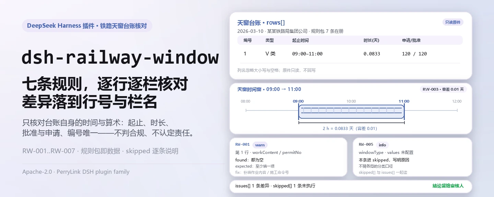
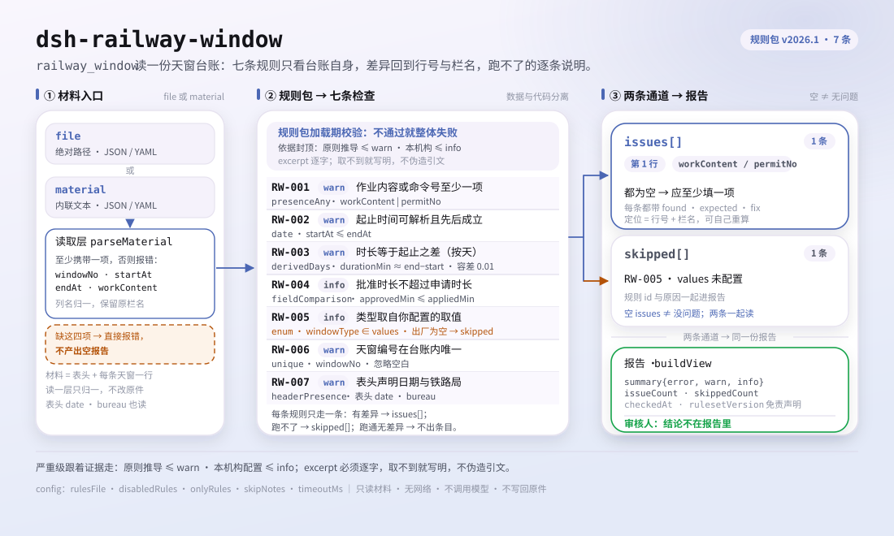

<div align="center">

<picture>
  <source media="(prefers-color-scheme: dark)" srcset="docs/assets/dsh-railway-window-hero-zh-dark.webp">
  
</picture>

# dsh-railway-window

**一次列清铁路施工天窗台账里「哪一行、哪一栏、差什么」——结论留给审核人。**

面向铁路施工调度与现场管理的 DSH 核对插件：读取当日表头加每条天窗一行，按 7 条规则核对时间与算术自洽，只列材料内部能逐条指认的差异，不判合规、不认定责任。

[安装](#三步上手) · [配置](#配置) · [FAQ](#faq) · [简体中文](README.md) · [English](README.en.md)

[](LICENSE)
[](#兼容性)
[](https://www.npmjs.com/package/dsh-railway-window)
[](https://github.com/PerryLink/dsh-railway-window/actions/workflows/ci.yml)
[](#兼容性)

[](https://github.com/PerryLink/dsh-railway-window/stargazers)
[](https://www.npmjs.com/package/dsh-railway-window)
[](https://dshfind.com/plugins/PerryLink/dsh-railway-window?ref=badge)
[](https://securityscorecards.dev/viewer/?uri=github.com/PerryLink/dsh-railway-window)
[](https://dsh.market/)
[](https://gitee.com/perrylink/dsh-railway-window)

```sh
dsh plugin --profile <name> add dsh-railway-window
```

</div>

<sub>社区插件，与 DeepSeek 官方无关。唯一仓库：<https://github.com/PerryLink/dsh-railway-window>（Gitee 为镜像）。</sub>

## 它是什么

`dsh-railway-window` 读取一份铁路施工天窗台账——当日表头加每条天窗一行——核对这份台账自身的时间与算术自洽：每条天窗是否记录了作业内容或施工命令号、起止时间是否可解析且先后成立、所记天窗时长是否等于起止之差、批准时长是否不超过申请时长、天窗类型是否出自你配置的取值、天窗编号是否唯一、台账是否声明施工日期与铁路局（集团公司）。

它只列材料内部能逐条指认的差异，**不判合规、不认定责任、不替代审核人**；跑不起来的检查逐条列入 `skipped` 并写明原因，空的问题列表不能被读成「没有问题」。

- **给谁用**：铁路施工调度、现场管理；不用懂命令行，在对话里把材料交给它即可。
- **你交什么**：这项核对用到的原始材料（表格、清单或文书）；不改原件。Excel 可先转成 JSON/YAML，对话里也能代转。
- **它交什么**：一份「哪一行、哪一栏、差什么、怎么补」的清单。

```text
台账（JSON / YAML）──railway_window──▶ rules/railway-window.yaml
                                          │ RW-001 … RW-007
                                          ▼
                          报告：found · expected · fix
                                skipped[]：规则 id + 原因
```

工具名是 `railway_window`；材料从 `file` 路径读，或直接用 `material` 内联文本。计算全程在主机端完成，不联网、不调用模型。

<picture>
  <source media="(prefers-color-scheme: dark)" srcset="docs/assets/dsh-railway-window-flow-v5-dark.svg">
  
</picture>

## 三步上手

1. **安装**（三选一；npm 已发布 `0.2.9`）：

   ```sh
   # git 通道（最新 main）
   dsh plugin --profile web add github:PerryLink/dsh-railway-window
   # npm 通道（已发布版本）
   dsh plugin --profile web add dsh-railway-window
   # tarball 通道：本仓库 pnpm pack 后
   dsh plugin --profile web add ./dsh-railway-window-<version>.tgz
   ```

   发布包自带构建产物 `lib/index.mjs`；从源码 checkout 使用需先 `pnpm install && pnpm run build`。

2. **最小配置**（默认即可用；bundle 行不带 `config` 时全部走默认值，规则包路径指向随包的 `rules/railway-window.yaml`）：

   ```yaml
   - insert:
       - id: dsh-railway-window
         name: dsh-railway-window
         config:
           timeoutMs: 120000
   ```

3. **验证已生效**（自带样例，无需自己的材料）：

   ```sh
   pnpm install && pnpm run build
   node samples/quickstart/run.mjs
   dsh --profile web --dump-config | grep 'dsh-railway-window'
   ```

   期望输出 `railway_window: 1 issue(s) — error 0, warn 1, info 0` 与 `skipped: 1`，与 `samples/quickstart/expected/result.json` 一致；样例输入在 `samples/quickstart/input/`，截图见 `docs/assets/quickstart.png`。

**卸载**：`dsh plugin --profile web remove dsh-railway-window`（或从 profile patch 删掉该行）。

<details>
<summary>在 WorkBuddy / 扣子中使用</summary>

在 WorkBuddy / 扣子搜「职业文档核对全集」（总包，本检查是其中一项；上架以商城为准）即可调用同一套核对能力，无需命令行。

</details>

## 核心能力

`dsh-railway-window` 注册 `railway_window` 工具：读入一份天窗台账，套用版本化规则包，返回一份报告。规则数据与代码分离——替换 `rules/railway-window.yaml` 即可切换规则集版本，无需改 TypeScript。

| 规则 | 核对内容 | 严重级 | 依据类型 |
|---|---|---|---|
| `RW-001` | 作业内容或施工命令号至少填写一项 | warn | 原则推导 |
| `RW-002` | 起止时间可解析且先后成立 | warn | 原则推导 |
| `RW-003` | 天窗时长等于起止时间之差（按天，容差 0.01 天） | warn | 原则推导 |
| `RW-004` | 批准时长不超过申请时长 | info | 本机构配置 |
| `RW-005` | 天窗类型取自你配置的取值（出厂未配置） | info | 本机构配置 |
| `RW-006` | 天窗编号在台账内唯一（比较时忽略空白） | warn | 原则推导 |
| `RW-007` | 台账声明施工日期与铁路局（集团公司） | warn | 原则推导 |

- **每条发现都带定位与改法。** `locator` 写明第几行、哪个字段，`found` 写实际读到的内容，`expected` 写应有的关系，`fix` 写可以怎么核对——复核者能自己重算的发现才有价值。
- **跑不起来就进 `skipped`。** 规则被停用、所需字段缺失、取值清单未配置，都会带着规则 id 与原因进 `skipped`；空的问题列表只表示「跑起来的检查没有发现差异」。
- **引用缺口如实标注。** 规则库不伪造引文：取不到逐字条款时，`excerpt` 直接写明，严重级封顶 `warn`（原则推导）或 `info`（本机构配置），并有测试断言没有任何规则声称拥有它并不拥有的引文。
- **纯主机端。** 纯 ESM，无原生代码、无网络请求、不调用模型；工具注册返回 disposer，卸载即移除。
- **时间按墙上时钟处理。** 全部计算都是对输入字符串做墙上时钟运算，不做时区换算；时间无法解析时会单独报出，不会静默跳过。

### 工具参数

| 参数 | 类型 | 说明 |
|---|---|---|
| `file` | string | 材料文件绝对路径（JSON 或 YAML），与 `material` 二选一 |
| `material` | string | 内联材料文本（JSON 或 YAML），与 `file` 二选一 |
| `rulesFile` | string | 覆盖配置中的规则库路径（相对包根或绝对路径） |
| `only` | string[] | 只执行这些规则 id；留空执行全部 |

## 示例：一次真实输出

下面这条输出来自本插件对 `RW-001` 测试夹具的实际执行，不是示意图。规则库不伪造引文，因此每条发现都会同时写明所引条款，以及该条款原文本次未取得。

**工具** `railway_window`

**输入**

~~~json
{"date":"2026-03-10","bureau":"某某铁路局集团公司","rows":[{"序号":"1","天窗类型":"V 类","开始时间":"2026-03-10 09:00","结束时间":"2026-03-10 11:00","作业内容":"","施工命令号":""}]}
~~~

**输出**

~~~json
{
  "id": "dsh-railway-window.RW-001.de09b5a6",
  "ruleId": "RW-001",
  "severity": "warn",
  "locator": {
    "row": 1,
    "field": "workContent"
  },
  "found": "第 1 行 workContent、permitNo 都为空",
  "expected": "workContent、permitNo 至少应填写一项",
  "fix": "补填作业内容与施工命令号；本条只核对是否填写，不判断施工是否违反规定"
}
~~~

*Observed from `dsh-railway-window/tests/fixtures/RW-001/RW-001-unsafe.json (cases.json expects 1×RW-001); executed parseMaterial+runCheck, checkedAt=2026-10-06T00:00:00.000Z`*

下表是示例集：第一行是详细走查，其余行是简短案例。

| 你会问 | 它怎么答 |
|---|---|
| 有一行既没填作业内容，也没填施工命令号，会被报出来吗？ | 会。`RW-001` 要求每条天窗的 `workContent` 与 `permitNo` 至少填一个，两项都缺时报出该行。它只核对是否填了其中一个，不判断该施工是否在准许范围内、是否侵入限界。 |
| 一条天窗从 `23:30` 到 `01:30`，写成两个同日时刻，为什么报结束时间早于开始时间？ | `RW-002` 只比较两个时刻，不处理跨零点，因此同日的一对时刻会被读成前后颠倒；请在时间栏补上日期，或停用本条。起止为同一时刻时视为不晚于；时间无法解析时会单独报出，不会静默跳过。 |
| 时长栏填的是分钟（`120`），而天窗是 08:00 到 10:00，为什么算术对不上？ | `RW-003` 计算的是两个时刻之间的天数，分钟口径的台账会相差 1440 倍，容差出厂为 0.01 天。请把 `daysField` 指向以天为单位的时长栏，或停用本条。它只核对算术，不判断天窗时长是否够用。 |
| 批准时长比申请时长还大，会怎么报？两栏缺一个呢？ | `RW-004` 会报出这一对数值——调度批准不会给出比申请更长的天窗，两栏通常是填反或抄错。它只在 `approvedMin` 与 `appliedMin` 都有可解析数值时执行；缺一即进 `skipped`。它不硬编码任何削减比例上限，也不判断该天窗申请是否应当批准。 |
| 天窗类型栏填了值，可这条规则从来不报任何东西，它到底跑没跑？ | 没跑。`RW-005` 出厂 `values: []`，即未配置，在你按本局办法填入分类取值之前，它只报告自己进了 `skipped`。即便配置好，它也只核对所填值是否在册，不判断该天窗应归入哪一类。 |
| 当天的台账信息不全：表头没写铁路局，同一区间的两条天窗编号还重复。会报哪些规则？ | 两条。`RW-007` 报出未声明施工日期与铁路局（集团公司）的表头——它只核对表头是否声明了这两项；若本机构表式还在表头记录天窗计划号，可把 `skylightPlanNo` 加进 `fields`。`RW-006` 报出重复的 `windowNo`，比较时忽略空白字符；同一区间同一天分多次给点属正常情形，请用不同的编号。 |

## 规则与依据

| 文件 | 文号 | 引用它的规则 |
|---|---|---|
| 《铁路营业线施工安全管理办法》 | 现行版本与条号本次未核实 | RW-001, RW-002, RW-003, RW-006, RW-007 |
| 各铁路局集团公司施工天窗管理办法（本机构配置） | 无统一标准（本条依据为台账的申请与批准两栏） | RW-004 |
| 各铁路局集团公司施工天窗管理办法（本机构配置） | 无统一标准（本条依据为本机构分类口径） | RW-005 |

**边界：** 本插件核对一份 **铁路施工天窗台账** 的时间与算术自洽——每条天窗是否记录了作业内容或施工命令号，起止时间是否可解析且先后成立，所记天窗时长是否等于起止之差，批准时长是否不超过申请时长，天窗类型是否取自你的取值口径，天窗编号是否唯一，以及台账是否写明施工日期与铁路局。它**不**判定天窗是否应当批准、作业是否侵入限界、是否属于不安全行为，或是否影响交通安全。

> ### ⚠️ 在相信报告中的引文之前，请先读这一节
>
> **本插件规则库中的每一个 `excerpt` 都明文写着：条款原文本次未取得。** 该制度见于《铁路营业线施工安全管理办法》以及各铁路局自己的施工天窗与行车调度命令办法。核验环节无法取得逐字条款原文，因此本规则库不去转述一段引文，而是在 `excerpt` 字段本身写明这一缺口，并把诚实的推理放进 `note`。因此每条规则都是 `warn` 或 `info`，并且有一项测试断言没有任何规则声称拥有它并不拥有的引文。**待取得原文后，请把每个 `excerpt` 换成真实条款，并把 `kind` 提到 `direct`。**
>
> 在相信任何一条发现之前，有三项限制值得注意：
>
> - **本插件不附带天窗分类，也不附带状态词表。** 天窗如何分类、其状态如何措辞因局而异，因此在配置之前，`RW-005` 会把自己记入 `skipped`。
> - **不内置任何批准比例上限。** 批准的天窗是否可以短于申请时长、可以短多少，是路局的规则；`RW-004` 只核对批准数值不超过申请数值，这是录入层面的属性，而不是实质层面的属性。
> - **时长单位是天，规则本身也写明了这一点。** `RW-003` 内部按分钟计量时间跨度，再以天表示，因此起止在同一日历日内的天窗会被正确计量。以分钟记录时长的台账会相差 1440 倍——请把 `daysField` 指向以天为单位的栏目，或停用该规则。
>
> 本插件也**不处理跨零点**：一条写成两个同日时刻的天窗（`23:30` 至 `01:30`）会被读成前后颠倒的一对。请在两栏都记录日期，或停用该规则。

<details>
<summary>规则来源与加载期校验</summary>

规则数据与代码分离，每条规则都带文件名、文号、按原文自身编号体系的条款号、摘录、依据类型与来源地址。加载期强制：摘录不得夸大依据；依据仅为原则性条款（`kind: derived-from-principle`，严重级上限 `warn`）或本机构配置（`kind: institutional-configuration`，上限 `info`）的检查不得标为 `error`。夸大依据的规则库会在加载期失败，而不会产出一份看起来很有底气的报告。

`excerpt` 必须是逐字摘录，不得改写。本规则库每条 `excerpt` 都明文声明条款原文本次未取得，因此 `check:citations` 把它们计为占位说明而不是引文；`rules/citations-baseline.json` 记录尚未能溯源的摘录段，当前为空，任何新增的不可溯源引文都会让门禁失败。

核验中确认的边界与「刻意没有作出的结论」写在 `rules/railway-window.yaml` 的头部说明与每条规则的 `note` 中。

</details>

## 材料格式

工具接受 JSON 或 YAML：

```yaml
date: 2026-03-10
bureau: 某某铁路局集团公司
rows:
  - { 序号: '1', 天窗类型: V 类, 线别: 上行, 区间: K120+000 至 K125+000,
      开始时间: 2026-03-10 08:00, 结束时间: 2026-03-10 20:00, 天窗时长: '0.5',
      申请时长: '720', 批准时长: '720', 作业内容: 更换接触网吊弦,
      施工命令号: 调令〔2026〕第 018 号, 申请单位: 某某供电段, 状态: 已兑现 }
```

列名匹配不区分大小写，且忽略空格、下划线与连字符；台账自己的列名会被保留，因此发现里写的始终是你表里那一栏的名字。时间写成 `2026-03-10 09:00` 这样的形式；中文日期形式会被有意报为无法解析。字段在读取层是可选的，由检查引擎校验，因此部分导出的材料会产生「缺项」类差异，而不是让程序崩溃。

读取层要求材料至少带 `天窗编号` / `windowNo`、`开始时间` / `startAt`、`结束时间` / `endAt`、`作业内容` / `workContent` 之一，否则直接报错，而不是产出空报告。

## 配置

全部可调参数都在 `src/config.ts` 的 Schemastery schema 中，只改 `cordis.yml` 即可生效，无需改代码；逐条阈值在 `rules/` 下的规则库文件里。

| 键 | 类型 | 默认值 | 说明 |
|---|---|---|---|
| `rulesFile` | string | `rules/railway-window.yaml` | 规则库文件路径，相对插件包根目录 |
| `disabledRules` | string[] | `[]` | 要停用的规则 id 列表；每条都会出现在 `skipped` 中 |
| `onlyRules` | string[] | `[]` | 只执行这些规则 id；留空表示执行全部规则 |
| `skipNotes` | string | `""` | 附加到每条 `skipped` 说明后的备注 |
| `timeoutMs` | number | `120000` | 工具协作式超时预算（毫秒） |

规则级参数值得知道：

- `RW-002` 的 `field` / `notAfterField`——时间对，开始时间对结束时间。
- `RW-003` 的 `daysField` / `fromField` / `toField` / `tolerance`——时长算术，单位是天。默认容差 `0.01` 天。
- `RW-005` 的 `values`——你的天窗类型取值，例如 `[V 类, 垂直天窗, 综合天窗, 施工天窗, 维修天窗]`。留空表示不检查。
- `RW-007` 的 `fields`——表头必须声明哪些项，默认 `["date","bureau"]`；若本机构表式还记录天窗计划号，可把 `skylightPlanNo` 加进去。

profile patch 覆盖示例：

```yaml
- insert:
    - id: dsh-railway-window
      name: dsh-railway-window
      config:
        disabledRules: [RW-003]
        skipNotes: 本季度只核对时间与编号
```

## FAQ

<details>
<summary>材料与报告存在哪里？会不会传到网上？</summary>

插件**没有自己的存储**：材料只在本次工具调用内读取（`file` 路径或 `material` 内联文本），报告作为工具结果返回，随后的会话记录由宿主管理。计算全程无网络请求、不调用模型、不写入材料原件；`package.json` 的 `dsh.demo` 也声明 `network: false`、`writes: []`。

</details>

<details>
<summary>报告里没有问题，就代表台账没问题吗？</summary>

不是。先看 `skipped`：规则被 `disabledRules` 停用、材料缺字段、`RW-005` 的取值清单未配置，都会让对应检查整条跳过并写明原因。空的问题列表只表示「跑起来的检查没有发现差异」，不表示「所有检查都跑过了」。

</details>

<details>
<summary>为什么 `RW-005` 从来不运行？</summary>

它的 `values` 出厂为 `[]`，即未配置；不配置就进 `skipped`。天窗如何分类（V 类、垂直天窗、综合天窗等）随各局施工管理办法变化，插件不硬编码任何分类体系——需要你按本局办法把分类取值填进规则库或配置。

</details>

<details>
<summary>性能开销多大？会不会卡住会话？</summary>

没有网络请求、没有模型调用、没有正则回溯；开销主要是读取一次材料、几次时间与算术比较、格式化为报告。`timeoutMs` 是传给工具的协作式超时预算（默认 `120000` 毫秒），工具还会响应宿主的中止信号。批量核对一个目录时建议用 `ptc` 工具模式，schema 成本只付一次。

</details>

<details>
<summary>排错：装不上、工具不出现、某条规则不跑</summary>

- **插件装上了但工具不出现**：确认 `main` 指向 `lib/index.mjs` 且 `pnpm run build` 已生成该文件；`main` 写错会让加载器静默跳过该条目。
- **`dsh plugin add` 报版本不兼容**：peer 范围覆盖 `0.1.x` 与 `0.2.x`；若运行时在其之外，可显式豁免：`dsh plugin --profile <name> allow-version <包名@版本> --dsh-version <runtime> --accept-risk`。
- **某条规则没有执行**：查看 `skipped` 数组，其中写明了规则 id 与原因。
- **`check` 报 `manifest-peers` 失败**：静态检查器比对的是一份早于 0.2 世代的硬编码 peer 范围；安装期的 peer 校验以运行时为准。这是 `dsh-plugin-dev` 的已知上游问题。
- **时间看起来偏移**：全部计算都是对输入字符串做墙上时钟运算，不做时区换算。
- **发现说引文原文未取得**：规则库不伪造引文；取不到逐字条款时，发现停留在 `warn` / `info` 并在 `excerpt` 中说明。请把它当作核验缺口，而不是材料合规的证明。
- **装上了却没有发现**：确认工具真的运行并返回了结果；空结果不等于跳过的运行，先核对材料字段与本 README 的字段表。

</details>

## 安全边界与已知限制

- **只核对台账自身的齐备与算术。** 它不判定天窗是否应当批准、作业是否侵入限界、是否构成违章施工、是否影响行车安全；那需要调度、工务与安全部门的专业判断，也是行车安全的核心环节。
- **引用缺口如实披露。** 规则库不伪造引文；`excerpt` 直接写明条款原文本次未取得，依据类型与严重级按证据封顶。一条发现意味着「台账里这个字段对不上」，不是「你违反了规章」。
- **空列表不等于无问题。** 跑不起来的检查进 `skipped` 并带原因；「没有问题」不能被读成「什么都没查」。
- **天窗分类与状态口径属于本机构。** 插件不附带天窗分类，也不附带状态词表；`RW-005` 的 `values` 出厂为空，未配置即跳过，不猜测。
- **不内置批准比例上限。** 批准时长可以比申请短多少由各局施工管理办法规定；`RW-004` 只核对批准数值不超过申请数值，这是录入层面的属性，不是实质层面的判断。
- **时长单位是天。** `RW-003` 内部按分钟计量时间跨度，再以天表示；以分钟记录时长的台账会相差 1440 倍，请把 `daysField` 指向以天为单位的栏目，或停用该规则。
- **不处理跨零点。** 一条写成两个同日时刻的天窗（`23:30` 至 `01:30`）会被读成前后颠倒的一对；请在两栏都记录日期，或停用该规则。
- **不做时区换算。** 全部计算都是对输入字符串做墙上时钟运算。
- **本地运行。** 无网络请求、无凭据、不写回材料原件；读取的路径就是你在 `file` 里给的那一个。

## 与其他 DSH 插件的互操作性

本插件只注册一个工具，注册面很窄：

- **一个工具、一个命名空间。** 只注册 `railway_window`，不占用内置工具或其他插件的裸名。
- **无服务键、无 HTTP 路由、无客户端 slot。** 不提供 service key，不注册 `webServer` 前缀，也没有客户端半（本仓无 `client/` 目录），因此不参与 slot 座位争抢。
- **不改全局。** 不修改原型、不改写 `process.env`、不替换全局 fetch。
- **注册即 effect。** `ctx.tools.register` 返回的 disposer 在卸载/热重载时移除工具；`inject: ['tools']` 意味着只在 `tools` 服务存在时加载。
- **规则库只读。** 工具运行时只读取 `rulesFile` 指向的文件，不写回规则库或材料。

依据：`src/index.ts` 的注册面（`export const inject = ['tools']`、单个 `ctx.tools.register`、无其他注册调用）。

## 兼容性

| 项目 | 状态 |
|---|---|
| Harness | 对等版本范围 `>=0.1.2-rc.1 <0.2.0 \|\| >=0.2.0-0 <0.3.0` —— 已实测同时接受 `0.2.0-rc.2` 与 `0.2.1-rc.2`。**已声明 `engines.dsh`**：0.2.1 起由宿主单独裁决，范围为 `>=0.2.1-0 <0.3.0` |
| Node | `^22.19.0 \|\| >=24.0.0` |
| 平台 | 全平台（纯 ESM；无原生代码、无联网、不调用模型） |
| 工具模式 | `native` / `ptc` 均可；批量校验整个目录时建议 `ptc`，schema 成本只付一次 |

## 生态与质量

- [Gitee 镜像](https://gitee.com/perrylink/dsh-railway-window)（同步镜像，以 GitHub 为准）
- [dshfind 插件页](https://dshfind.com/plugins/PerryLink/dsh-railway-window)（安装量与排名）
- [OpenSSF Scorecard 报告](https://securityscorecards.dev/viewer/?uri=github.com/PerryLink/dsh-railway-window)（由 [.github/workflows/scorecard.yml](.github/workflows/scorecard.yml) 驱动）
- [DSH Market](https://dsh.market/)（已上架）
- **WorkBuddy / 扣子**：搜「职业文档核对全集」（总包，本检查是其中一项；上架以商城为准）
- [按材料选核查器](https://perrylink.github.io/zh/checkers/choose/)（本插件所属的核查器索引）
- [问题反馈](https://github.com/PerryLink/dsh-railway-window/issues)（附版本、命令与最小化脱敏材料）

## 开发

```sh
pnpm install
pnpm run typecheck        # tsc --noEmit
pnpm test                 # vitest，每条规则一对合规/违规夹具
pnpm run build            # tsdown -> lib/index.mjs + lib/index.d.mts
pnpm run verify:self-contained
pnpm run check:lockfile
pnpm run check:readmes    # 中英 README 一致性
pnpm run check:citations
node ../scripts/sync-shared.mjs dsh-railway-window   # 刷新 src/shared
```

最后的 `sync-shared` 命令把 `../_shared` 的共享件同步进 `src/shared/`；每次改动共享件后都要重跑。配图由 [`scripts/gen-readme-assets.py`](scripts/gen-readme-assets.py) 程序化生成（hero 横幅用 Pillow 画、结构图用手写 SVG 画，各出深浅双版，hero 另有中英两套），可重复执行：`python scripts/gen-readme-assets.py`。

<details>
<summary>目录布局</summary>

| 路径 | 内容 |
|---|---|
| `src/index.ts` | 工具注册与规则库定位（function-plugin 契约，无 default export） |
| `src/config.ts` | Schemastery 配置 schema，所有可调项都在这里 |
| `src/model.ts` | 台账列别名与材料契约；表形状声明一次，读取层与规则引擎共用 |
| `src/view.ts` | 面向模型的报告投影；`output.schema` 与它对应 |
| `src/shared/` | 共享件（规则库加载、报告形状、YAML 子集、日期算术、措辞守卫），随包复制而非外部导入 |
| `rules/railway-window.yaml` | 7 条规则的规则库 |
| `rules/citations-baseline.json` | 尚未可溯源的摘录段清单（当前为空） |
| `tests/` | vitest；每条规则在 `tests/fixtures/<RULE>/` 下有合规/违规夹具 |
| `scripts/` | 机械门禁：自包含、锁文件漂移、README 一致性、引用检查、配图生成 |

</details>

Topics：`dsh`, `dsh-plugin`, `deepseek-harness`, `deepseek`, `cordis`, `railway`, `window`

## 家族与致谢

本项目是 [PerryLink](https://github.com/PerryLink) 维护的 DeepSeek Harness 插件家族成员（全部 Apache-2.0）。完整清单见 [按材料选核查器](https://perrylink.github.io/zh/checkers/choose/) 与 [全部插件](https://github.com/PerryLink)；本仓只是其中一个。如果这个插件帮到了你，**给个 star**——它不解锁任何功能，但会让下一个人更容易找到它。

- [@PerryLink](https://github.com/PerryLink) —— 创建者与维护者：规则库、核对核心、五语文档与配图脚本。

<details>
<summary>展开全部插件</summary>

| 插件 | 状态 |
|---|---|
| **[dsh-aqua-input-check](https://github.com/PerryLink/dsh-aqua-input-check)** |  |
| **[dsh-archive-check](https://github.com/PerryLink/dsh-archive-check)** |  |
| **[dsh-auto-review](https://github.com/PerryLink/dsh-auto-review)** |  |
| **[dsh-autotier](https://github.com/PerryLink/dsh-autotier)** | 🧊 已冻结 — 见仓库 README |
| **[dsh-bid-ca-precheck](https://github.com/PerryLink/dsh-bid-ca-precheck)** |  |
| **[dsh-bid-qual-check](https://github.com/PerryLink/dsh-bid-qual-check)** |  |
| **[dsh-cert-mcp](https://github.com/PerryLink/dsh-cert-mcp)** | 🧊 已冻结 — 见仓库 README |
| **[dsh-checkpoint-rewind](https://github.com/PerryLink/dsh-checkpoint-rewind)** |  |
| **[dsh-click](https://github.com/PerryLink/dsh-click)** |  |
| **[dsh-composer-history](https://github.com/PerryLink/dsh-composer-history)** |  |
| **[dsh-contract-stance](https://github.com/PerryLink/dsh-contract-stance)** |  |
| **[dsh-customs-doc-check](https://github.com/PerryLink/dsh-customs-doc-check)** |  |
| **[dsh-data-quality](https://github.com/PerryLink/dsh-data-quality)** | 🧊 已冻结 — 见仓库 README |
| **[dsh-demurrage-ledger](https://github.com/PerryLink/dsh-demurrage-ledger)** |  |
| **[dsh-doublecheck](https://github.com/PerryLink/dsh-doublecheck)** |  |
| **[dsh-drill-script-check](https://github.com/PerryLink/dsh-drill-script-check)** |  |
| **[dsh-eia-guide-check](https://github.com/PerryLink/dsh-eia-guide-check)** |  |
| **[dsh-emergency-plan](https://github.com/PerryLink/dsh-emergency-plan)** |  |
| **[dsh-essay-rubric-check](https://github.com/PerryLink/dsh-essay-rubric-check)** |  |
| **[dsh-evidence-check](https://github.com/PerryLink/dsh-evidence-check)** |  |
| **[dsh-export-ctl-check](https://github.com/PerryLink/dsh-export-ctl-check)** |  |
| **[dsh-fast](https://github.com/PerryLink/dsh-fast)** |  |
| **[dsh-fmea-table-check](https://github.com/PerryLink/dsh-fmea-table-check)** |  |
| **[dsh-forecast-penalty](https://github.com/PerryLink/dsh-forecast-penalty)** |  |
| **[dsh-fund-research](https://github.com/PerryLink/dsh-fund-research)** |  |
| **[dsh-github](https://github.com/PerryLink/dsh-github)** |  |
| **[dsh-gongwen-flow-check](https://github.com/PerryLink/dsh-gongwen-flow-check)** |  |
| **[dsh-gongwen-word-check](https://github.com/PerryLink/dsh-gongwen-word-check)** |  |
| **[dsh-guard-plan-qc](https://github.com/PerryLink/dsh-guard-plan-qc)** |  |
| **[dsh-hazchem-check](https://github.com/PerryLink/dsh-hazchem-check)** |  |
| **[dsh-hazplan-check](https://github.com/PerryLink/dsh-hazplan-check)** |  |
| **[dsh-hidden-risk-map](https://github.com/PerryLink/dsh-hidden-risk-map)** |  |
| **[dsh-hs-classify](https://github.com/PerryLink/dsh-hs-classify)** |  |
| **[dsh-icd-rule-check](https://github.com/PerryLink/dsh-icd-rule-check)** |  |
| **[dsh-industry-research](https://github.com/PerryLink/dsh-industry-research)** |  |
| **[dsh-lawcite-adapter](https://github.com/PerryLink/dsh-lawcite-adapter)** |  |
| **[dsh-laya](https://github.com/PerryLink/dsh-laya)** |  |
| **[dsh-lc-doc-check](https://github.com/PerryLink/dsh-lc-doc-check)** |  |
| **[dsh-learning-gap-check](https://github.com/PerryLink/dsh-learning-gap-check)** |  |
| **[dsh-library](https://github.com/PerryLink/dsh-library)** |  |
| **[dsh-local-ai](https://github.com/PerryLink/dsh-local-ai)** |  |
| **[dsh-lsp-actions](https://github.com/PerryLink/dsh-lsp-actions)** |  |
| **[dsh-mask](https://github.com/PerryLink/dsh-mask)** |  |
| **[dsh-mcp-panel](https://github.com/PerryLink/dsh-mcp-panel)** |  |
| **[dsh-medrec-qc](https://github.com/PerryLink/dsh-medrec-qc)** |  |
| **[dsh-memento](https://github.com/PerryLink/dsh-memento)** | 🧊 已冻结 — 见仓库 README |
| **[dsh-nsfc-form-check](https://github.com/PerryLink/dsh-nsfc-form-check)** |  |
| **[dsh-nurse-record-check](https://github.com/PerryLink/dsh-nurse-record-check)** |  |
| **[dsh-observe](https://github.com/PerryLink/dsh-observe)** |  |
| **[dsh-origin-rvc-check](https://github.com/PerryLink/dsh-origin-rvc-check)** |  |
| **[dsh-ota-review-check](https://github.com/PerryLink/dsh-ota-review-check)** |  |
| **[dsh-output-styles](https://github.com/PerryLink/dsh-output-styles)** |  |
| **[dsh-paper-doc-adapter](https://github.com/PerryLink/dsh-paper-doc-adapter)** |  |
| **[dsh-permission-rules](https://github.com/PerryLink/dsh-permission-rules)** |  |
| **[dsh-permit-report-check](https://github.com/PerryLink/dsh-permit-report-check)** |  |
| **[dsh-pipeline-check](https://github.com/PerryLink/dsh-pipeline-check)** |  |
| **[dsh-pleading-draft](https://github.com/PerryLink/dsh-pleading-draft)** |  |
| **[dsh-plugin-doctor](https://github.com/PerryLink/dsh-plugin-doctor)** | 🚫 已退役（仓库已归档） |
| **[dsh-plugin-guide](https://github.com/PerryLink/dsh-plugin-guide)** |  |
| **[dsh-plugin-kit](https://github.com/PerryLink/dsh-plugin-kit)** | 🚫 已退役（仓库已归档） |
| **[dsh-plugin-upgrade](https://github.com/PerryLink/dsh-plugin-upgrade)** | 🚫 已退役（仓库已归档） |
| **[dsh-policy-brief-draft](https://github.com/PerryLink/dsh-policy-brief-draft)** |  |
| **[dsh-power-loss-split](https://github.com/PerryLink/dsh-power-loss-split)** |  |
| **[dsh-power-ticket-check](https://github.com/PerryLink/dsh-power-ticket-check)** |  |
| **[dsh-ppap-check](https://github.com/PerryLink/dsh-ppap-check)** |  |
| **[dsh-protest-deadline](https://github.com/PerryLink/dsh-protest-deadline)** |  |
| **[dsh-railway-window](https://github.com/PerryLink/dsh-railway-window)** |  |
| **[dsh-repair-order-qc](https://github.com/PerryLink/dsh-repair-order-qc)** |  |
| **[dsh-research-report](https://github.com/PerryLink/dsh-research-report)** |  |
| **[dsh-review-reply-check](https://github.com/PerryLink/dsh-review-reply-check)** |  |
| **[dsh-rulefile-check](https://github.com/PerryLink/dsh-rulefile-check)** |  |
| **[dsh-safety-brief-check](https://github.com/PerryLink/dsh-safety-brief-check)** |  |
| **[dsh-score](https://github.com/PerryLink/dsh-score)** | 🧊 已冻结 — 见仓库 README |
| **[dsh-session-sync](https://github.com/PerryLink/dsh-session-sync)** |  |
| **[dsh-site-log-check](https://github.com/PerryLink/dsh-site-log-check)** |  |
| **[dsh-skill-pack-security](https://github.com/PerryLink/dsh-skill-pack-security)** |  |
| **[dsh-soe-decision-check](https://github.com/PerryLink/dsh-soe-decision-check)** |  |
| **[dsh-soilwater-check](https://github.com/PerryLink/dsh-soilwater-check)** |  |
| **[dsh-sop-sync-check](https://github.com/PerryLink/dsh-sop-sync-check)** |  |
| **[dsh-spc-gbt-adapter](https://github.com/PerryLink/dsh-spc-gbt-adapter)** |  |
| **[dsh-talk](https://github.com/PerryLink/dsh-talk)** |  |
| **[dsh-tender-extract](https://github.com/PerryLink/dsh-tender-extract)** |  |
| **[dsh-tender-matrix](https://github.com/PerryLink/dsh-tender-matrix)** |  |
| **[dsh-test-drive](https://github.com/PerryLink/dsh-test-drive)** |  |
| **[dsh-ticktick](https://github.com/PerryLink/dsh-ticktick)** | 🚫 已退役（仓库已归档） |
| **[dsh-translate](https://github.com/PerryLink/dsh-translate)** |  |
| **[dsh-warranty-calc](https://github.com/PerryLink/dsh-warranty-calc)** |  |
| **[dsh-budget](https://github.com/PerryLink/dsh-budget)** | 🧊 已冻结 — 见仓库 README |
| **[dsh-claude-move](https://github.com/PerryLink/dsh-claude-move)** | 🧊 已冻结 — 见仓库 README |
| **[dsh-defend](https://github.com/PerryLink/dsh-defend)** | 🧊 已冻结 — 见仓库 README |
| **[dsh-draw](https://github.com/PerryLink/dsh-draw)** | 🧊 已冻结 — 见仓库 README |
| **[dsh-reach](https://github.com/PerryLink/dsh-reach)** | 🧊 已冻结 — 见仓库 README |
| **[dsh-background-agents](https://github.com/PerryLink/dsh-background-agents)** | 🚫 已退役（仓库已归档） |
| **[dsh-session-pin](https://github.com/PerryLink/dsh-session-pin)** | 🚫 已退役（仓库已归档） |
| **[dsh-team-rooms](https://github.com/PerryLink/dsh-team-rooms)** | 🚫 已退役（仓库已归档） |

</details>

## License

[LICENSE](LICENSE)（Apache License 2.0）© 2026 dsh-railway-window contributors

<p align="center"><sub>Apache-2.0 · 社区插件，与 DeepSeek 无关。</sub></p>
