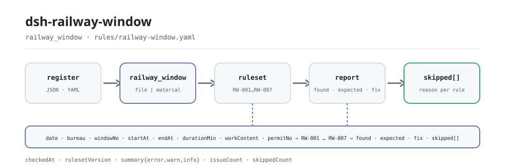

<div align="center">

<picture>
  <source media="(prefers-color-scheme: dark)" srcset="docs/assets/dsh-railway-window-flow-dark.svg">
  
</picture>

# dsh-railway-window

**Liste de uma vez cada linha e cada coluna do registo de janelas de trabalho ferroviário que não fecha — a conclusão fica com o revisor.**

Um verificador DSH para despachantes de obra ferroviária e responsáveis de obra: lê o cabeçalho do dia mais uma linha por janela e aplica sete verificações de tempo e aritmética, indicando apenas as diferenças que consegue apontar dentro do próprio material, sem juízo de conformidade nem atribuição de responsabilidade.

[Instalar](#instalação-em-três-passos) · [Configuração](#configuração) · [FAQ](#faq) · [简体中文](README.md) · [English](README.en.md) · [Español](README.es.md) · [Português](README.pt.md) · [हिन्दी](README.hi.md)

[](LICENSE)
[](#compatibilidade)
[](https://www.npmjs.com/package/dsh-railway-window)
[](https://github.com/PerryLink/dsh-railway-window/actions/workflows/ci.yml)
[](#compatibilidade)

[](https://github.com/PerryLink/dsh-railway-window/stargazers)
[](https://www.npmjs.com/package/dsh-railway-window)
[](https://dshfind.com/plugins/PerryLink/dsh-railway-window?ref=badge)
[](https://securityscorecards.dev/viewer/?uri=github.com/PerryLink/dsh-railway-window)
[](https://dsh.market/)
[](https://gitee.com/perrylink/dsh-railway-window)

```sh
dsh plugin --profile <name> add dsh-railway-window
```

</div>

<sub>Plugin da comunidade, sem afiliação com a DeepSeek. Repositório canónico: <https://github.com/PerryLink/dsh-railway-window> (o Gitee é um espelho).</sub>

## O que é

`dsh-railway-window` lê um registo de janelas de trabalho ferroviário — o cabeçalho do dia mais uma linha por janela — e verifica a coerência temporal e aritmética desse próprio registo: se cada janela regista o seu conteúdo de trabalho ou o seu número de ordem de controlo de tráfego, se o início e o fim são legíveis e sucessivos, se a duração registada é igual ao intervalo, se a duração aprovada não excede a solicitada, se o tipo de janela vem do seu vocabulário, se os números de janela não se repetem e se o registo declara a sua data de trabalho e a administração ferroviária (grupo empresarial).

Apenas lista diferenças que consegue apontar dentro do próprio material: **sem juízo de conformidade, sem atribuição de responsabilidade e sem substituir o revisor**. Toda a verificação que não possa ser executada fica em `skipped` com o motivo, e uma lista de problemas vazia nunca pode ser lida como «não há nada de errado».

- **Para quem é**: despachantes de obra ferroviária e responsáveis de obra; não é preciso saber usar a linha de comandos — entregue o material no chat.
- **O que entrega**: o material de origem sobre o qual a verificação trabalha (uma tabela, um registo ou um documento); o original nunca é alterado. O Excel pode ser convertido antes para JSON/YAML, inclusive no chat se a plataforma o permitir.
- **O que devolve**: uma lista de que linha, que coluna, o que difere e o que rever.

```text
registo (JSON / YAML)──railway_window──▶ rules/railway-window.yaml
                                          │ RW-001 … RW-007
                                          ▼
                           relatório: found · expected · fix
                                skipped[]: id da regra + motivo
```

A ferramenta é `railway_window`; o material chega por um caminho `file` ou diretamente como texto `material` em linha. Todo o cálculo acontece no host: sem rede e sem chamada ao modelo.

## Instalação em três passos

1. **Instalar** (escolha um canal; o npm tem `0.2.9`):

   ```sh
   # canal git (main mais recente)
   dsh plugin --profile web add github:PerryLink/dsh-railway-window
   # canal npm (versões publicadas)
   dsh plugin --profile web add dsh-railway-window
   # canal tarball: após pnpm pack neste repositório
   dsh plugin --profile web add ./dsh-railway-window-<version>.tgz
   ```

   O pacote publicado inclui o artefacto `lib/index.mjs`; para usar um checkout do código-fonte é preciso antes `pnpm install && pnpm run build`.

2. **Configuração mínima** (os valores por omissão funcionam; uma linha de bundle sem `config` usa-os todos e o caminho do pacote de regras aponta para o `rules/railway-window.yaml` incluído):

   ```yaml
   - insert:
       - id: dsh-railway-window
         name: dsh-railway-window
         config:
           timeoutMs: 120000
   ```

3. **Confirmar que funciona** (amostra incluída, sem material próprio):

   ```sh
   pnpm install && pnpm run build
   node samples/quickstart/run.mjs
   dsh --profile web --dump-config | grep 'dsh-railway-window'
   ```

   Saída esperada: `railway_window: 1 issue(s) — error 0, warn 1, info 0` e `skipped: 1`, igual a `samples/quickstart/expected/result.json`; a entrada da amostra está em `samples/quickstart/input/` e a captura em `docs/assets/quickstart.png`.

**Desinstalar**: `dsh plugin --profile web remove dsh-railway-window` (ou remova a linha do patch do perfil).

<details>
<summary>Usar no WorkBuddy / Coze</summary>

Pesquise «Professional Document Check Suite» no WorkBuddy / Coze (o conjunto completo; esta verificação é uma das suas partes; disponibilidade conforme catálogo) para usar a mesma capacidade de verificação sem linha de comandos.

</details>

## Capacidades principais

`dsh-railway-window` regista a ferramenta `railway_window`: lê um registo de janelas, aplica um pacote de regras versionado e devolve um relatório. Os dados das regras estão separados do código: substituir `rules/railway-window.yaml` muda o conjunto de regras sem tocar em TypeScript.

| Regra | Verificação | Gravidade | Tipo de base |
|---|---|---|---|
| `RW-001` | o conteúdo de trabalho ou o número de ordem é registado | warn | princípio |
| `RW-002` | o início e o fim são legíveis e sucessivos | warn | princípio |
| `RW-003` | a duração é igual ao intervalo (dias, tolerância 0,01 dia) | warn | princípio |
| `RW-004` | a duração aprovada não excede a solicitada | info | institucional |
| `RW-005` | o tipo de janela vem do seu vocabulário (por configurar) | info | institucional |
| `RW-006` | os números de janela são únicos (espaços ignorados) | warn | princípio |
| `RW-007` | o registo declara a data e a administração ferroviária | warn | princípio |

- **Cada achado traz a localização e a correção.** `locator` nomeia a linha e o campo, `found` diz o que foi lido, `expected` a relação que devia valer e `fix` o que rever; um achado que o revisor não consegue recalcular vale pouco.
- **O que não pode correr vai para `skipped`.** Uma regra desativada, um campo em falta ou um vocabulário por configurar colocam a regra em `skipped` com o id e o motivo; uma lista de problemas vazia significa apenas «as verificações que correram não encontraram diferenças».
- **As lacunas de citação são declaradas.** O pacote de regras não inventa citações: quando o texto literal da cláusula não está disponível, `excerpt` diz isso e a gravidade fica limitada a `warn` (princípio) ou `info` (institucional). Um teste garante que nenhuma regra afirma uma citação que não tem.
- **Apenas host.** ESM puro, sem código nativo, sem pedidos de rede e sem chamadas ao modelo; o registo da ferramenta devolve um disposer, pelo que a descarregar remove-a.
- **Horas de relógio.** Todo o cálculo é aritmética de hora local sobre as cadeias de entrada, sem conversão de fuso horário; uma hora que não se consegue ler é reportada à parte em vez de omitida em silêncio.

### Parâmetros da ferramenta

| Parâmetro | Tipo | Significado |
|---|---|---|
| `file` | string | caminho absoluto para o ficheiro de material (JSON ou YAML); um de `file` / `material` |
| `material` | string | texto de material em linha (JSON ou YAML); um de `file` / `material` |
| `rulesFile` | string | substitui o caminho configurado do pacote de regras (relativo à raiz do pacote ou absoluto) |
| `only` | string[] | executar apenas estes ids de regra; vazio executa todas |

## Uma saída real

A saída seguinte é uma execução real deste plugin contra o seu próprio fixture de teste `RW-001`, não uma simulação. O pacote de regras não inventa citações, por isso cada achado nomeia a cláusula aplicada e regista que o seu texto não foi obtido desta vez.

**Ferramenta** `railway_window`

**Entrada**

~~~json
{"date":"2026-03-10","bureau":"某某铁路局集团公司","rows":[{"序号":"1","天窗类型":"V 类","开始时间":"2026-03-10 09:00","结束时间":"2026-03-10 11:00","作业内容":"","施工命令号":""}]}
~~~

**Saída**

~~~json
{
  "id": "dsh-railway-window.RW-001.de09b5a6",
  "ruleId": "RW-001",
  "severity": "warn",
  "locator": {
    "row": 1,
    "field": "workContent"
  },
  "found": "第 1 行 workContent、permitNo 都为空",
  "expected": "workContent、permitNo 至少应填写一项",
  "fix": "补填作业内容与施工命令号；本条只核对是否填写，不判断施工是否违反规定"
}
~~~

*Observado em `dsh-railway-window/tests/fixtures/RW-001/RW-001-unsafe.json (cases.json expects 1×RW-001); executed parseMaterial+runCheck, checkedAt=2026-10-06T00:00:00.000Z`*

A tabela abaixo é o conjunto de exemplos: a primeira linha é o caso detalhado e as restantes são casos breves.

| Você pergunta | O que ele responde |
|---|---|
| Uma linha não regista nem o conteúdo de trabalho nem o número da ordem de controlo de tráfego. Isso é reportado? | Sim. `RW-001` exige que em cada janela esteja preenchido pelo menos um dos dois, `workContent` ou `permitNo`, e reporta a linha em que faltam ambos. Verifica apenas que um deles está preenchido; não julga se a obra se manteve dentro do âmbito autorizado nem se algo invadiu o gabarito de circulação. |
| Uma janela vai de `23:30` a `01:30` e está escrita como duas horas do mesmo dia. Porque é reportado que o fim é anterior ao início? | `RW-002` compara os dois instantes e não modela a passagem da meia-noite, pelo que um par do mesmo dia é lido invertido; registe a data dos dois lados ou desative a regra. Se o início e o fim coincidirem, considera-se que o início não é posterior, e uma hora que não se consegue ler é reportada à parte em vez de ser omitida em silêncio. |
| A coluna da duração está em minutos (`120`) e a janela foi das 08:00 às 10:00. Porque é que a aritmética não bate certo? | `RW-003` mede o intervalo em dias, pelo que um registo em minutos difere por um fator de 1440; a tolerância de fábrica é de 0,01 dia. Aponte `daysField` para uma coluna de duração expressa em dias ou desative a regra. Verifica apenas a aritmética, nunca se a janela foi suficientemente longa para a obra. |
| A duração aprovada é maior do que a solicitada. O que é reportado, e o que acontece se faltar uma das duas colunas? | `RW-004` reporta esse par, porque um despachante não concede mais do que foi solicitado e o habitual é as duas colunas estarem trocadas. Só é executada quando `approvedMin` e `appliedMin` são legíveis; se faltar um, reporta que entrou em `skipped`. Não inclui qualquer teto de redução da aprovação e não conclui se a janela devia ser concedida. |
| A coluna do tipo de janela tem valor, mas a regra nunca reporta nada. Está a ser executada? | Não. `RW-005` vem com `values: []`, ou seja, por configurar, e reporta que entrou em `skipped` até indicar as classificações usadas pelas medidas da sua administração. Mesmo configurada, verifica apenas se o valor consta da sua lista; não decide em que classe uma janela deve ser enquadrada. |
| O registo do dia está incompleto: o cabeçalho não nomeia a administração e duas janelas do mesmo troço repetem número. Que regras disparam? | Duas. `RW-007` reporta um cabeçalho que não declara a data de trabalho e a administração ferroviária (grupo empresarial) — verifica apenas que o cabeçalho as declare, e pode acrescentar `skylightPlanNo` aos seus `fields` se o seu formulário também registar um número de plano. `RW-006` reporta o `windowNo` repetido, comparando com os espaços em branco ignorados; um troço com várias janelas no mesmo dia é normal, pelo que deve numerá-las de forma distinta. |

## Regras e base

| Documento | Número | Regras que o citam |
|---|---|---|
| Medidas de gestão da segurança de obras em linhas ferroviárias em serviço | versão em vigor e números de cláusula não verificados nesta passagem | RW-001, RW-002, RW-003, RW-006, RW-007 |
| Medidas de gestão de janelas de trabalho de cada administração ferroviária (configuração institucional) | sem norma nacional (esta regra apoia-se nas colunas de solicitado e aprovado do registo) | RW-004 |
| Medidas de gestão de janelas de trabalho de cada administração ferroviária (configuração institucional) | sem norma nacional (esta regra apoia-se no vocabulário de classificação da instituição) | RW-005 |

**Limite:** este plugin verifica a coerência temporal e aritmética de um **registo de janelas de trabalho de obra ferroviária** — que cada janela registe o seu conteúdo de trabalho ou o seu número de ordem de controlo de tráfego, que o início e o fim sejam legíveis e sucessivos, que a duração registada seja igual ao intervalo, que a duração aprovada não exceda a solicitada, que o tipo de janela venha do seu vocabulário, que os números de janela sejam únicos e que o registo declare a sua data de trabalho e a administração ferroviária. **Não** decide se uma janela devia ser concedida, se a obra invadiu o gabarito de circulação, se constituiu um ato inseguro ou se afetou a segurança do tráfego.

> ### ⚠️ Leia isto antes de confiar numa citação do relatório
>
> **Cada `excerpt` do pacote de regras deste plugin diz, por palavras expressas, que o texto da cláusula
> não foi obtido.** O regime vive nas medidas nacionais de segurança de obras em linhas ferroviárias em
> serviço e nas medidas de janelas de trabalho e ordens de controlo de tráfego de cada administração. A
> passagem de verificação não conseguiu recuperar o texto literal, por isso, em vez de parafrasear uma
> citação, o pacote declara a lacuna no próprio campo `excerpt` e põe o raciocínio honesto em `note`. Por
> isso todas as regras são `warn` ou `info`, e um teste garante que nenhuma regra afirma uma citação que não
> tem. **Quando os textos estiverem disponíveis, substitua cada `excerpt` pela cláusula real e eleve `kind`
> para `direct`.**
>
> Três limites importam antes de confiar num achado:
>
> - **O plugin não inclui classificação de janelas nem vocabulário de estados.** Como as janelas são
>   classificadas e como os seus estados são redigidos varia por administração, pelo que `RW-005` se declara
>   em `skipped` até que os configure.
> - **Não há teto de rácio de aprovação incorporado.** Se uma janela aprovada pode ser mais curta do que a
>   solicitada, e quanto, é regra da administração; `RW-004` apenas verifica que o valor aprovado não excede
>   o solicitado, uma propriedade de introdução de dados e não uma propriedade substantiva.
> - **A unidade de duração é o dia, e a regra di-lo.** `RW-003` mede o intervalo em minutos internamente e
>   exprime-o em dias, pelo que uma janela que começa e termina no mesmo dia civil é medida corretamente. Um
>   registo que anota durações em minutos difere por um fator de 1440 — aponte `daysField` para uma coluna
>   em dias ou desative a regra.
>
> O plugin também **não trata a passagem da meia-noite**: uma janela escrita como duas horas do mesmo dia
> (`23:30` a `01:30`) será lida como um par invertido. Registe a data dos dois lados ou desative essa regra.

<details>
<summary>Origem das regras e validação na carga</summary>

Os dados das regras estão separados do código: cada regra traz documento, número, cláusula na numeração própria da fonte, extrato, tipo de base e URL de origem. Na carga impõe-se que um extrato não exagere a sua base; uma verificação apoiada apenas num princípio (`kind: derived-from-principle`, gravidade máxima `warn`) ou em configuração institucional (`kind: institutional-configuration`, máxima `info`) não pode ser marcada `error`. Um pacote que infle a sua base falha na carga em vez de produzir um relatório que pareça sólido.

`excerpt` tem de ser uma citação literal, nunca uma paráfrase. Cada `excerpt` deste pacote declara por palavras expressas que o texto da cláusula não foi obtido, pelo que `check:citations` os conta como notas de marcador e não como citações; `rules/citations-baseline.json` registra os segmentos de extrato ainda não rastreáveis e está vazio, e qualquer citação nova não rastreável faz falhar a porta.

Os limites confirmados durante a verificação e as conclusões deliberadamente **não** afirmadas estão no cabeçalho de `rules/railway-window.yaml` e no `note` de cada regra.

</details>

## Formato do material

A ferramenta aceita JSON ou YAML:

```yaml
date: 2026-03-10
bureau: 某某铁路局集团公司
rows:
  - { 序号: '1', 天窗类型: V 类, 线别: 上行, 区间: K120+000 至 K125+000,
      开始时间: 2026-03-10 08:00, 结束时间: 2026-03-10 20:00, 天窗时长: '0.5',
      申请时长: '720', 批准时长: '720', 作业内容: 更换接触网吊弦,
      施工命令号: 调令〔2026〕第 018 号, 申请单位: 某某供电段, 状态: 已兑现 }
```

Os nomes das colunas são comparados sem distinguir maiúsculas de minúsculas e ignorando espaços, sublinhados e hífenes; os nomes próprios do registo são mantidos, pelo que um achado nomeia sempre a coluna que vê. As horas escrevem-se `2026-03-10 09:00`; uma data em formato chinês é reportada como ilegível de propósito. Os campos são opcionais na camada de leitura e validados pelo motor, pelo que uma exportação parcial produz diferenças por «campo em falta» em vez de uma falha.

A camada de leitura exige pelo menos um campo canónico de linha — `windowNo`, `startAt`, `endAt` ou `workContent` — e, se não houver, falha de forma ruidosa em vez de produzir um relatório vazio.

## Configuração

Todos os parâmetros ajustáveis vivem no esquema Schemastery de `src/config.ts`, pelo que mudar `cordis.yml` basta, sem tocar em código; os limites por regra estão no pacote de regras em `rules/`.

| Chave | Tipo | Padrão | Descrição |
|---|---|---|---|
| `rulesFile` | string | `rules/railway-window.yaml` | caminho do pacote de regras, relativo à raiz do pacote |
| `disabledRules` | string[] | `[]` | ids de regras a desativar; cada uma aparece em `skipped` |
| `onlyRules` | string[] | `[]` | executar apenas estas regras; vazio executa todas |
| `skipNotes` | string | `""` | nota acrescentada a cada motivo de `skipped` |
| `timeoutMs` | number | `120000` | orçamento de tempo limite cooperativo da ferramenta |

Parâmetros ao nível da regra que vale a pena conhecer:

- `RW-002` `field` / `notAfterField` — o par de horas, início contra fim.
- `RW-003` `daysField` / `fromField` / `toField` / `tolerance` — a aritmética da duração, em dias. A tolerância por omissão é `0,01` dia.
- `RW-005` `values` — os seus tipos de janela, por exemplo `[classe V, janela vertical, janela composta, janela de obra, janela de manutenção]`. Vazio significa que não se verifica.
- `RW-007` `fields` — que elementos do cabeçalho devem ser declarados, por omissão `["date","bureau"]`; acrescente `skylightPlanNo` se o seu formulário também registar um número de plano.

Exemplo de substituição no patch do perfil:

```yaml
- insert:
    - id: dsh-railway-window
      name: dsh-railway-window
      config:
        disabledRules: [RW-003]
        skipNotes: este trimestre só se verificam tempos e numeração
```

## FAQ

<details>
<summary>Onde ficam o material e o relatório? Sai alguma coisa para a rede?</summary>

O plugin **não tem armazenamento próprio**: o material só é lido dentro desta chamada à ferramenta (caminho `file` ou texto `material` em linha), o relatório é devolvido como resultado da ferramenta e o registo de sessão posterior é gerido pelo host. O cálculo não faz pedidos de rede, não chama o modelo e não escreve de volta no material; o `dsh.demo` do `package.json` também declara `network: false` e `writes: []`.

</details>

<details>
<summary>Se o relatório não tiver achados, o registo está bem?</summary>

Não. Veja primeiro `skipped`: uma regra desativada por `disabledRules`, um campo em falta ou o vocabulário de `RW-005` por configurar fazem com que a verificação correspondente seja omitida e diga por quê. Uma lista de problemas vazia significa apenas «as verificações que correram não encontraram diferenças», não «correram todas».

</details>

<details>
<summary>Porque é que `RW-005` nunca corre?</summary>

O seu `values` vem como `[]`, ou seja, por configurar; por configurar vai para `skipped`. Como as janelas são classificadas (classe V, janela vertical, janela composta, etc.) varia com as medidas de cada administração, e o plugin não codifica qualquer sistema de classificação: introduza o vocabulário da sua administração no pacote de regras ou na configuração.

</details>

<details>
<summary>Quanto custa em desempenho? Vai bloquear a sessão?</summary>

Sem pedidos de rede, sem chamadas ao modelo e sem retrocesso de expressões regulares; o custo é ler o material uma vez, algumas comparações de tempo e aritmética, e formatar o relatório. `timeoutMs` é um orçamento de tempo limite cooperativo passado à ferramenta (por omissão `120000` ms), e a ferramenta também responde ao sinal de aborto do host. Para verificar um diretório inteiro, o modo `ptc` paga o custo do esquema uma só vez.

</details>

<details>
<summary>Resolução de problemas: instalação, ferramenta ausente, uma regra que não corre</summary>

- **O plugin instala mas a ferramenta não aparece.** Confirme que `main` resolve para `lib/index.mjs` e que `pnpm run build` o gerou; um `main` errado faz o carregador omitir a entrada em silêncio.
- **`dsh plugin add` recusa o pacote por incompatibilidade.** O intervalo de peers cobre `0.1.x` e `0.2.x`; se o seu runtime ficar fora, conceda uma isenção explícita: `dsh plugin --profile <name> allow-version <pkg@version> --dsh-version <runtime> --accept-risk`.
- **Uma regra não correu.** Leia o arranjo `skipped`; indica o id da regra e o motivo.
- **`check` reporta `manifest-peers` como falha.** O verificador estático compara com um intervalo de peers codificado anterior à linha 0.2; a compatibilidade de peers na instalação é aplicada pelo runtime. É um problema conhecido do `dsh-plugin-dev`.
- **As horas parecem deslocadas.** Todo o cálculo é aritmética de hora local sobre as cadeias de entrada, sem conversão de fuso horário.
- **Um achado diz que o texto da cláusula não foi obtido.** O pacote de regras não fabrica citações; quando a cláusula literal não está disponível, o achado fica em `warn` / `info` e di-lo em `excerpt`. Trate-o como uma lacuna de verificação, não como prova de que o material cumpre.
- **Instalou mas não encontra nada.** Confirme que a ferramenta correu de facto e devolveu um resultado; um resultado vazio não é o mesmo que uma execução omitida: compare os campos do material com a tabela deste README.

</details>

## Limites de segurança e limitações conhecidas

- **Apenas a integridade e a aritmética do próprio registo.** Não decide se uma janela devia ser concedida, se a obra invadiu o gabarito de circulação, se foi uma infração ou se afetou a segurança do tráfego; isso exige o juízo profissional dos departamentos de despacho, via e segurança, e é o núcleo da segurança operacional.
- **As lacunas de citação são declaradas.** O pacote de regras não fabrica citações; `excerpt` diz que o texto da cláusula não foi obtido, e o tipo de base e a gravidade ficam limitados pela evidência. Um achado significa «este campo do registo não fecha», não «você violou uma norma».
- **Uma lista vazia não é «nada errado».** As verificações que não podem correr vão para `skipped` com um motivo; «sem problemas» não deve ser lido como «nada foi verificado».
- **A classificação de janelas e a redação de estados são da instituição.** O plugin não inclui classificação de janelas nem vocabulário de estados; os `values` de `RW-005` vêm vazios e uma regra por configurar é omitida em vez de adivinhar.
- **Não há teto de rácio de aprovação incorporado.** Quanto mais curta do que a solicitada pode ser uma aprovação é fixado pelas medidas de obra de cada administração; `RW-004` apenas verifica que o valor aprovado não excede o solicitado, uma propriedade de introdução de dados, não um juízo substantivo.
- **A unidade de duração é o dia.** `RW-003` mede o intervalo em minutos internamente e exprime-o em dias; um registo em minutos difere por um fator de 1440: aponte `daysField` para uma coluna em dias ou desative a regra.
- **A passagem da meia-noite não é tratada.** Uma janela escrita como duas horas do mesmo dia (`23:30` a `01:30`) é lida como um par invertido; registe a data dos dois lados ou desative a regra.
- **Sem conversão de fuso horário.** Todo o cálculo é aritmética de hora local sobre as cadeias de entrada.
- **Apenas local.** Sem pedidos de rede, sem credenciais e sem escrever de volta no material; o único caminho lido é o que passou em `file`.

## Interoperabilidade com outros plugins DSH

Este plugin regista uma só ferramenta e a sua superfície de registo é estreita:

- **Uma ferramenta, um espaço de nomes.** Só registra `railway_window` e não ocupa qualquer nome nu de uma ferramenta integrada ou de outro plugin.
- **Sem chave de serviço, sem rota HTTP, sem slot de cliente.** Não fornece service key, não regista qualquer prefixo `webServer` e não tem metade cliente (este repositório não tem diretório `client/`), pelo que não disputa um lugar de slot.
- **Sem mutação global.** Não altera protótipos, não reescreve `process.env` nem substitui o fetch global.
- **Os registos são efeitos.** O disposer devolvido por `ctx.tools.register` remove a ferramenta ao descarregar ou recarregar a quente; `inject: ['tools']` significa que o plugin só carrega quando o serviço `tools` existe.
- **O pacote de regras é só de leitura.** Em execução a ferramenta só lê o ficheiro para onde `rulesFile` aponta; nunca escreve de volta no pacote de regras nem no material.

Evidência: a superfície de registo em `src/index.ts` (`export const inject = ['tools']`, uma única chamada `ctx.tools.register`, nenhuma outra chamada de registo).

## Compatibilidade

| Superfície | Estado |
|---|---|
| Harness | Intervalo de peers `>=0.1.2-rc.1 <0.2.0 \|\| >=0.2.0-0 <0.3.0` — verificado para aceitar tanto `0.2.0-rc.2` como `0.2.1-rc.2`. **`engines.dsh` é declarado** como `>=0.2.1-0 <0.3.0` e o host aplica-o desde 0.2.1 |
| Node | `^22.19.0 \|\| >=24.0.0` |
| Plataformas | Todas (ESM puro; sem código nativo, sem rede, sem chamada ao modelo) |
| Modo de ferramenta | Funciona em `native` e `ptc`; para um mês de janelas use `ptc` |

## Ecossistema e qualidade

- [Espelho no Gitee](https://gitee.com/perrylink/dsh-railway-window) (espelho sincronizado; o GitHub é o canónico)
- [Página do plugin no dshfind](https://dshfind.com/plugins/PerryLink/dsh-railway-window) (instalações e ranking)
- [Relatório OpenSSF Scorecard](https://securityscorecards.dev/viewer/?uri=github.com/PerryLink/dsh-railway-window) (impulsionado por [.github/workflows/scorecard.yml](.github/workflows/scorecard.yml))
- [DSH Market](https://dsh.market/) (em catálogo)
- **WorkBuddy / Coze**: pesquise «Professional Document Check Suite» (o conjunto completo; esta verificação é uma das suas partes; disponibilidade conforme catálogo)
- [Escolher um verificador por material](https://perrylink.github.io/zh/checkers/choose/) (o índice de verificadores a que este plugin pertence)
- [Acompanhamento de problemas](https://github.com/PerryLink/dsh-railway-window/issues) (inclua versão, comando e material mínimo expurgado)

## Desenvolvimento

```sh
pnpm install
pnpm run typecheck        # tsc --noEmit
pnpm test                 # vitest, um par de fixtures conforme/infrator por regra
pnpm run build            # tsdown -> lib/index.mjs + lib/index.d.mts
pnpm run verify:self-contained
pnpm run check:lockfile
pnpm run check:readmes    # consistência dos README chinês e inglês
pnpm run check:citations
node ../scripts/sync-shared.mjs dsh-railway-window   # atualizar src/shared
```

O último comando `sync-shared` copia o kit partilhado de `../_shared` para `src/shared/`; volte a executá-lo após cada alteração partilhada. As imagens do README são geradas por programa por [`scripts/gen-readme-assets.py`](scripts/gen-readme-assets.py) (Python + Pillow, par de SVG claro/escuro) e podem ser executadas de novo: `python scripts/gen-readme-assets.py`.

<details>
<summary>Estrutura de diretórios</summary>

| Caminho | Conteúdo |
|---|---|
| `src/index.ts` | registo da ferramenta e resolução do pacote de regras (contrato function-plugin, sem default export) |
| `src/config.ts` | esquema de configuração Schemastery; todos os ajustes vivem aqui |
| `src/model.ts` | aliases de colunas do registo e contrato do material; a forma da tabela é declarada uma vez e partilhada pelo leitor e pelo motor |
| `src/view.ts` | projeção do relatório orientada ao modelo; `output.schema` reflete-a |
| `src/shared/` | kit partilhado (carga do pacote de regras, forma do relatório, subconjunto YAML, aritmética de datas, guarda de redação), copiado em vez de importado |
| `rules/railway-window.yaml` | o pacote de 7 regras |
| `rules/citations-baseline.json` | segmentos de extrato ainda não rastreáveis (atualmente vazio) |
| `tests/` | vitest; cada regra tem fixtures conforme/infrator em `tests/fixtures/<RULE>/` |
| `scripts/` | portas mecânicas: autocontenção, deriva do lockfile, consistência de README, verificação de citações, geração de imagens |

</details>

Tópicos: `dsh`, `dsh-plugin`, `deepseek-harness`, `deepseek`, `cordis`, `railway`, `window`

## Família e agradecimentos

Este projeto faz parte da família de plugins de DeepSeek Harness da [PerryLink](https://github.com/PerryLink) (todos Apache-2.0). Índice completo: [escolher um verificador por material](https://perrylink.github.io/zh/checkers/choose/) e [todos os plugins](https://github.com/PerryLink); este repositório é um deles. Se lhe for útil, **uma estrela ajuda a próxima pessoa a encontrá-lo** — não desbloqueia nada.

- [@PerryLink](https://github.com/PerryLink) — criador e mantenedor: pacote de regras, núcleo de verificação, documentação em cinco idiomas e script de imagens.

<details>
<summary>Ver todos os plugins</summary>

| Plugin | Estado |
|---|---|
| **[dsh-aqua-input-check](https://github.com/PerryLink/dsh-aqua-input-check)** |  |
| **[dsh-archive-check](https://github.com/PerryLink/dsh-archive-check)** |  |
| **[dsh-auto-review](https://github.com/PerryLink/dsh-auto-review)** |  |
| **[dsh-autotier](https://github.com/PerryLink/dsh-autotier)** | 🧊 CONGELADO — ver o README do repo |
| **[dsh-bid-ca-precheck](https://github.com/PerryLink/dsh-bid-ca-precheck)** |  |
| **[dsh-bid-qual-check](https://github.com/PerryLink/dsh-bid-qual-check)** |  |
| **[dsh-cert-mcp](https://github.com/PerryLink/dsh-cert-mcp)** | 🧊 CONGELADO — ver o README do repo |
| **[dsh-checkpoint-rewind](https://github.com/PerryLink/dsh-checkpoint-rewind)** |  |
| **[dsh-click](https://github.com/PerryLink/dsh-click)** |  |
| **[dsh-composer-history](https://github.com/PerryLink/dsh-composer-history)** |  |
| **[dsh-contract-stance](https://github.com/PerryLink/dsh-contract-stance)** |  |
| **[dsh-customs-doc-check](https://github.com/PerryLink/dsh-customs-doc-check)** |  |
| **[dsh-data-quality](https://github.com/PerryLink/dsh-data-quality)** | 🧊 CONGELADO — ver o README do repo |
| **[dsh-demurrage-ledger](https://github.com/PerryLink/dsh-demurrage-ledger)** |  |
| **[dsh-doublecheck](https://github.com/PerryLink/dsh-doublecheck)** |  |
| **[dsh-drill-script-check](https://github.com/PerryLink/dsh-drill-script-check)** |  |
| **[dsh-eia-guide-check](https://github.com/PerryLink/dsh-eia-guide-check)** |  |
| **[dsh-emergency-plan](https://github.com/PerryLink/dsh-emergency-plan)** |  |
| **[dsh-essay-rubric-check](https://github.com/PerryLink/dsh-essay-rubric-check)** |  |
| **[dsh-evidence-check](https://github.com/PerryLink/dsh-evidence-check)** |  |
| **[dsh-export-ctl-check](https://github.com/PerryLink/dsh-export-ctl-check)** |  |
| **[dsh-fast](https://github.com/PerryLink/dsh-fast)** |  |
| **[dsh-fmea-table-check](https://github.com/PerryLink/dsh-fmea-table-check)** |  |
| **[dsh-forecast-penalty](https://github.com/PerryLink/dsh-forecast-penalty)** |  |
| **[dsh-fund-research](https://github.com/PerryLink/dsh-fund-research)** |  |
| **[dsh-github](https://github.com/PerryLink/dsh-github)** |  |
| **[dsh-gongwen-flow-check](https://github.com/PerryLink/dsh-gongwen-flow-check)** |  |
| **[dsh-gongwen-word-check](https://github.com/PerryLink/dsh-gongwen-word-check)** |  |
| **[dsh-guard-plan-qc](https://github.com/PerryLink/dsh-guard-plan-qc)** |  |
| **[dsh-hazchem-check](https://github.com/PerryLink/dsh-hazchem-check)** |  |
| **[dsh-hazplan-check](https://github.com/PerryLink/dsh-hazplan-check)** |  |
| **[dsh-hidden-risk-map](https://github.com/PerryLink/dsh-hidden-risk-map)** |  |
| **[dsh-hs-classify](https://github.com/PerryLink/dsh-hs-classify)** |  |
| **[dsh-icd-rule-check](https://github.com/PerryLink/dsh-icd-rule-check)** |  |
| **[dsh-industry-research](https://github.com/PerryLink/dsh-industry-research)** |  |
| **[dsh-lawcite-adapter](https://github.com/PerryLink/dsh-lawcite-adapter)** |  |
| **[dsh-laya](https://github.com/PerryLink/dsh-laya)** |  |
| **[dsh-lc-doc-check](https://github.com/PerryLink/dsh-lc-doc-check)** |  |
| **[dsh-learning-gap-check](https://github.com/PerryLink/dsh-learning-gap-check)** |  |
| **[dsh-library](https://github.com/PerryLink/dsh-library)** |  |
| **[dsh-local-ai](https://github.com/PerryLink/dsh-local-ai)** |  |
| **[dsh-lsp-actions](https://github.com/PerryLink/dsh-lsp-actions)** |  |
| **[dsh-mask](https://github.com/PerryLink/dsh-mask)** |  |
| **[dsh-mcp-panel](https://github.com/PerryLink/dsh-mcp-panel)** |  |
| **[dsh-medrec-qc](https://github.com/PerryLink/dsh-medrec-qc)** |  |
| **[dsh-memento](https://github.com/PerryLink/dsh-memento)** | 🧊 CONGELADO — ver o README do repo |
| **[dsh-nsfc-form-check](https://github.com/PerryLink/dsh-nsfc-form-check)** |  |
| **[dsh-nurse-record-check](https://github.com/PerryLink/dsh-nurse-record-check)** |  |
| **[dsh-observe](https://github.com/PerryLink/dsh-observe)** |  |
| **[dsh-origin-rvc-check](https://github.com/PerryLink/dsh-origin-rvc-check)** |  |
| **[dsh-ota-review-check](https://github.com/PerryLink/dsh-ota-review-check)** |  |
| **[dsh-output-styles](https://github.com/PerryLink/dsh-output-styles)** |  |
| **[dsh-paper-doc-adapter](https://github.com/PerryLink/dsh-paper-doc-adapter)** |  |
| **[dsh-permission-rules](https://github.com/PerryLink/dsh-permission-rules)** |  |
| **[dsh-permit-report-check](https://github.com/PerryLink/dsh-permit-report-check)** |  |
| **[dsh-pipeline-check](https://github.com/PerryLink/dsh-pipeline-check)** |  |
| **[dsh-pleading-draft](https://github.com/PerryLink/dsh-pleading-draft)** |  |
| **[dsh-plugin-doctor](https://github.com/PerryLink/dsh-plugin-doctor)** | 🚫 APOSENTADO (repo arquivado) |
| **[dsh-plugin-guide](https://github.com/PerryLink/dsh-plugin-guide)** |  |
| **[dsh-plugin-kit](https://github.com/PerryLink/dsh-plugin-kit)** | 🚫 APOSENTADO (repo arquivado) |
| **[dsh-plugin-upgrade](https://github.com/PerryLink/dsh-plugin-upgrade)** | 🚫 APOSENTADO (repo arquivado) |
| **[dsh-policy-brief-draft](https://github.com/PerryLink/dsh-policy-brief-draft)** |  |
| **[dsh-power-loss-split](https://github.com/PerryLink/dsh-power-loss-split)** |  |
| **[dsh-power-ticket-check](https://github.com/PerryLink/dsh-power-ticket-check)** |  |
| **[dsh-ppap-check](https://github.com/PerryLink/dsh-ppap-check)** |  |
| **[dsh-protest-deadline](https://github.com/PerryLink/dsh-protest-deadline)** |  |
| **[dsh-railway-window](https://github.com/PerryLink/dsh-railway-window)** |  |
| **[dsh-repair-order-qc](https://github.com/PerryLink/dsh-repair-order-qc)** |  |
| **[dsh-research-report](https://github.com/PerryLink/dsh-research-report)** |  |
| **[dsh-review-reply-check](https://github.com/PerryLink/dsh-review-reply-check)** |  |
| **[dsh-rulefile-check](https://github.com/PerryLink/dsh-rulefile-check)** |  |
| **[dsh-safety-brief-check](https://github.com/PerryLink/dsh-safety-brief-check)** |  |
| **[dsh-score](https://github.com/PerryLink/dsh-score)** | 🧊 CONGELADO — ver o README do repo |
| **[dsh-session-sync](https://github.com/PerryLink/dsh-session-sync)** |  |
| **[dsh-site-log-check](https://github.com/PerryLink/dsh-site-log-check)** |  |
| **[dsh-skill-pack-security](https://github.com/PerryLink/dsh-skill-pack-security)** |  |
| **[dsh-soe-decision-check](https://github.com/PerryLink/dsh-soe-decision-check)** |  |
| **[dsh-soilwater-check](https://github.com/PerryLink/dsh-soilwater-check)** |  |
| **[dsh-sop-sync-check](https://github.com/PerryLink/dsh-sop-sync-check)** |  |
| **[dsh-spc-gbt-adapter](https://github.com/PerryLink/dsh-spc-gbt-adapter)** |  |
| **[dsh-talk](https://github.com/PerryLink/dsh-talk)** |  |
| **[dsh-tender-extract](https://github.com/PerryLink/dsh-tender-extract)** |  |
| **[dsh-tender-matrix](https://github.com/PerryLink/dsh-tender-matrix)** |  |
| **[dsh-test-drive](https://github.com/PerryLink/dsh-test-drive)** |  |
| **[dsh-ticktick](https://github.com/PerryLink/dsh-ticktick)** | 🚫 APOSENTADO (repo arquivado) |
| **[dsh-translate](https://github.com/PerryLink/dsh-translate)** |  |
| **[dsh-warranty-calc](https://github.com/PerryLink/dsh-warranty-calc)** |  |
| **[dsh-budget](https://github.com/PerryLink/dsh-budget)** | 🧊 CONGELADO — ver o README do repo |
| **[dsh-claude-move](https://github.com/PerryLink/dsh-claude-move)** | 🧊 CONGELADO — ver o README do repo |
| **[dsh-defend](https://github.com/PerryLink/dsh-defend)** | 🧊 CONGELADO — ver o README do repo |
| **[dsh-draw](https://github.com/PerryLink/dsh-draw)** | 🧊 CONGELADO — ver o README do repo |
| **[dsh-reach](https://github.com/PerryLink/dsh-reach)** | 🧊 CONGELADO — ver o README do repo |
| **[dsh-background-agents](https://github.com/PerryLink/dsh-background-agents)** | 🚫 APOSENTADO (repo arquivado) |
| **[dsh-session-pin](https://github.com/PerryLink/dsh-session-pin)** | 🚫 APOSENTADO (repo arquivado) |
| **[dsh-team-rooms](https://github.com/PerryLink/dsh-team-rooms)** | 🚫 APOSENTADO (repo arquivado) |

</details>

## Licença

[LICENSE](LICENSE) (Apache License 2.0) © 2026 dsh-railway-window contributors

<p align="center"><sub>Apache-2.0 · Plugin da comunidade, sem afiliação com a DeepSeek.</sub></p>
